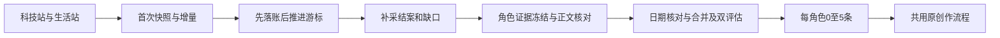

## Context

现有逐站candidate不等于可采集，用户已有两站，集中采集可减少重复维护。两站公开API已真实200；urllib遇403/1010，但文档原样curl成功，不要求用户提供密钥。接口schemaVersion1，Agent文档4.0.0。

## Goals / Non-Goals

**Goals:** 科技站→角色2、生活站→角色3，持久同步、停机恢复先补采、原始证据追溯与角色选题。

**Non-Goals:** 不修改外部站、不安装Skill、不改商品创作、不凭摘要或上游分数直接通过质量检查。

## Decisions

1. 使用匿名REST。资讯/api/v1/items提供id/title/summary/source.name/links.aihot/links.original/publishedAt/discoveredAt/category/score及page.nextCursor。读取得到资讯不等于已有正文。
2. 首次/api/v1/selected/snapshot按默认fields分页保存（保留摘要与原文链接），全部完成后使用第一页同步cursor。随后/api/v1/selected/changes逐页处理新增/编辑/撤选，每页成功落库才推进cursor。409 snapshot_required重新快照；304无变化；429遵守Retry-After，401/403显示实际阻塞。快照可能数千条，只首次运行、持久分页进度；不每次全量重抓。
3. 复用现有来源扫描，建议默认15分钟增量一次。08:00及开机恢复先同步到本次边界、结案补采，再冻结未开始的当天选题。缺口按partial显示，未知缺失数量不填0；已完成Run不重跑、unknown不盲重发。日报仅辅助，不作为08:00选题前置，以免双方同刻出刊竞态。hot-topics及stories按需读取。
4. 聚合键=站点+item.id；保留上游source、聚合页、原URL及事件追溯。科技样本原文链接可能指向aihot.news另一聚合层，须继续追溯，不能按两个聚合站计两个独立主体；无法确认则显示未知。
5. publishedAt只是上游标注的报道日期，discoveredAt是发现日期，均不能自动当事件日期。正文从可验证原文/站内完整阅读页取得，冻结正文和精确引用；站内AI摘要不是原文。缺正文拒绝，沿用三类日期、热点/近期报道/常青、同类合并、双独立评估、同主体最多2条、每角色每日0至5条。历史精选新入库不等于当天热点。
6. 撤选不删除历史，停止未来选题引用；已存在未转换机会标上游撤选待复核，已转换项目保留冻结版本并显示来源变化提示，不自动改写成稿。
7. 两站真实验收后备份切换：两个角色暂停旧逐站自动采集和自动搜源，通过可恢复聚合模式表达，保留原源及人工设置，其他角色不受影响；为证据读取原链接仍允许。两个站未验证成功前不暂停旧源。

## Risks / Trade-offs

- 上游摘要与评分已加工 → 原文核对，保留评分为参考。
- 客户端差异 → 正式Worker独立验证，不绕过站点防护、不把403猜成缺密钥。
- 精选集不是全网全集 → 同步覆盖只限站点提供的精选，不宣称全网无漏采。

## Migration Plan

用户确认后实施，正式切换前备份SQLite/配置并验证两入口。回滚恢复原模式与源调度，保留已落账历史。新入口自然日批证据单独记录，父change原清单不因此自动关闭。

## Open Questions

快照/增量实际响应、撤选格式及正文链实施时依据已取得OpenAPI和真实小样本确认，本轮不宣称已验证。
