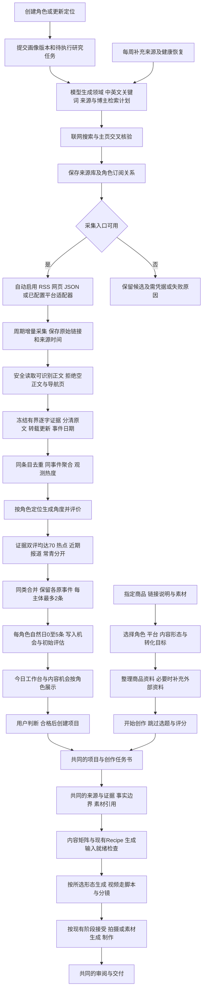

## Context

用户要求先确认 OpenSpec。现有两个经营角色已有版本化定位；内容机会支持人工信号、评估和项目转换；采集 Connector 与 Celery Worker 已存在。缺口是角色触发的公开来源研究、长期采集与每日荐题。参考实现与固定提交见 reference_research.md；首批公开来源见 source_inventory.json。

## Goals / Non-Goals

**Goals:** 创建有效角色后，自动搜集相关媒体/官方站点/博主并储备；自动验证、订阅、采集与补充来源；每天形成角色相关、有原始依据的内容机会；失败可解释、运行可恢复。既有两个角色是首批启用实例，新角色使用同一流程。支持指定商品跳过选题直接开始创作，与机会入口复用同一条内容生产链。

**Non-Goals:** 不把每日荐题变成无人确认的自动发稿；不增加自动发布、商品库存/订单/支付、第二套内容管理站或视频制作引擎、通用浏览器爬虫平台、无限扩散的全网关注网络。机会入口仍由用户判断是否创建项目；商品入口由用户直接发起创作，两者沿用已有阶段接受与事实确认流程。

## Decisions

### 1. 端到端流程

资料采集可以持续进行；日批次负责有界选题，不每抓到一篇就调用完整写作链。新角色完成首轮研究后自动生成首批机会，之后按日运行。

“商品直接生成”指跳过内容机会的发现、评分和转项目门槛，直接启动所选创作流程的首个可执行生成阶段。它不是只建一个空项目，也不表示一次点击自动接受所有阶段或直接发布成片。

### 2. 角色的真实定位与动态触发

| 角色 | 主要选题方向 | 选择角度 | 排除的自动假设 |
| --- | --- | --- | --- |
| AI科技研发技术博主（现有Persona 2 v3） | AI Agent、架构、开发工具、工程实践 | 怎么用、工程取舍、适用条件、真实案例、限制 | 不把榜单热度当性能，不编造亲测与benchmark |
| 日常生活方式博主（现有Persona 3 v2） | 生活变化、城市与社区、数字生活、具体观察、近未来趣事 | 变化怎样进入普通人的生活、值得观察的场景与问题 | 不局限美食、不制造焦虑、不编造用户个人经历 |

运行时读取角色最新有效修订，不硬编码名称或上述ID。最低可用画像为定位、受众、领域；尚无修订的占位/验收角色显示“待完善定位”，不扩散采集。

建立 `discovery_profile_hash`，只覆盖定位、受众、领域、内容/事实边界及相关平台。修改音色或排版不重新发现来源；定位变化自动重新研究，并保留旧研究版本溯源。角色暂停/归档时停止其新研究和荐题；共享来源仍被其他有效角色订阅时继续采集。

角色事务提交时持久保存待执行任务意图；Worker按任务表领取，避免角色保存成功但消息队列通知丢失。对角色保存端点及直接保存修订的服务路径统一生效。

### 3. 来源发现：模型规划，搜索工具取证

输入采用角色定位和公开检索主题。模型生成有界中英文检索词，分别找官方发布、垂直媒体、实践者/博主、社区讨论和平台热点。以真实搜索结果作为候选；通过作者主页、个人网站关联账号、官方介绍和代表作确认身份与相关性。保存 URL、账号稳定ID（可得时）、语言、主题、归属主体、发现依据与检索批次。不以模型记忆直接构造账号地址，不虚构粉丝数。

从网页声明发现 RSS/Atom；无订阅则尝试公开列表或JSON入口。模型可提出选择器/字段映射，但必须通过有限试抓验证标题、链接、日期、正文范围后自动启用。配置只允许受支持的字段，不执行模型生成的脚本。无可用入口保存为候选；下次维护可自动重新验证，无需用户逐个点批准。

现有 `search_provider` 是图片搜索，不重用该名称误称网页搜索。新增窄接口 `DiscoverySearchProvider.search(query, locale, time_range, limit)`，已核验本机Tavily与MiniMax MCP均有凭据，原生搜索均成功；MiniMax另通过独立后台进程实测。首个后端复用固定MiniMax MCP的web_search，Tavily HTTP作为可配置替代，复用现有secret引用及HTTP读取。模型负责分析，搜索适配器负责返回引用。若项目已有经实测等价的联网服务，实施时可绑定该后端，接口和验收不变；没有凭据时明确 `search_unavailable`，已储备来源仍可采集但不声称自主拓源已通过。

本机开发可显式选择只读引用当前操作系统账号的固定Codex MCP配置，仅加载选定搜索服务的凭据，不复制密钥到项目数据库或回显。后台使用固定离线已安装官方MCP命令，仅调用web_search；生产使用环境凭据，不读取本机Codex配置。

这是一次性运行能力配置，不是每天的用户触发。开发者聊天工具不被后台继承；自然运行必须在关闭页面和无聊天会话的情况下由 Worker 完成。

### 4. 来源库与采集边界

来源按 owner 存储，在同一 owner 下允许多角色订阅一个 URL；不跨用户混用私有配置。区分官方一手、媒体、独立创作者、社区及热榜聚合。来源等级用于解释可信度，不把“大V”默认当事实来源。

自动化启用时的公共来源策略允许模型分析必要的公开片段和元数据；该策略按来源落账，并在每次调用前检查。私人项目资料、Obsidian笔记及需登录内容不因角色发现自动送到新搜索服务。未经明确全文再分发许可，来源库保存链接、必要摘要及内部处理范围，内容机会不复制整篇原文。已有 Source/FactPack 的权限继续沿用；采集成功不自动生成确认事实。

| 来源入口 | 首版处理 | 不可用时 |
| --- | --- | --- |
| RSS/Atom | 自动发现、解析及增量获取；ETag/Last-Modified可用时复用 | 记录失败并退避，保持已采集条目 |
| HTML列表/公开JSON | 有界试抓验证后自动启用；复用安全URL读取 | 日期/内容抽取不成立则保留候选 |
| 公开博主主页 | 找其RSS、博客或官方账号关联；用主页确认身份 | 动态/登录页记录受限，不能当正文 |
| 平台热榜 | 通过可配置聚合JSON适配，来源注明第三方；保留原链接 | 独立降级，不阻断其他来源 |
| X/公众号/小红书/B站等账号 | 有已配置且验证过的适配器时自动绑定；否则保存账号和公开搜索线索 | `credential_required`或`adapter_unavailable`；不中断整体荐题 |

首版不为上述每个平台承诺新建专用抓取器；公共搜索、RSS/网页和可用适配器共同提供自动发现。不存在“全网所有内容都可抓取”的承诺。

初次导入最多每源30条，默认只将有可信发布时间且48小时内的内容计入热点窗口。历史资料可为明确标注的常青选题提供依据；缺日期资料不伪装成今日新闻。采集失败不推进游标；304是无新内容的成功。单源错误不回滚其他成功源。

### 5. 去重、事件与角色评价

先按规范URL/平台条目ID去重，再按主题实体、发生时间和语义关联识别同一事件。先用标题/实体相似度缩小近14天候选，再对疑似同事件做有界模型判断；首版不强制部署向量库。只有明确同事件才合并，不确定则分开并标注。事件后续进展保留新的证据版本。

沿用 AIHOT 的可解释起点：48小时窗口，每个独立来源主体只计一次，24小时半衰期。相同作者跨平台、转载链与同一机构不同账号不算独立确认；无法识别独立性则保守计数。无原始时间不参与新鲜热度；单一来源可产生有价值机会，但不标“多源热议”。页面表述为“已跟踪来源中的热度”。

角色相关性先筛，再评估：角色匹配30%、读者价值25%、证据质量20%、角度新意15%、时效/常青价值10%。每维0–100并带依据，最终候选独立评价两次、不把第一次结果送给第二次，均值≥70且无事实编造才进入机会；这些是待确认的首版规则，记录规则版本。只对最多10个最终候选批量评分，不对整个互联网两次全量评分。

每日每角色默认最多5个机会，优先当前新变化，再使用有依据的常青角度补充；不为了凑数复活已否决题或造热点。每条必须含标题、角色匹配理由、为什么现在做、切入角度、来源链接、时间、证据缺口、建议形态和期限。科技与生活可共享事件，但各自有独立评价与差异化角度。

去重跨天生效：同角色、同事件版本、同角度只创建一次；次日重跑不重复上架，不覆盖人工编辑或恢复已dismissed/archived机会。事件出现实质新进展时才允许新的机会，并引用前一事件/机会。角色修改不会重置已处理选题的去重历史。

`angle_key`由服务端基于规范事件、角色方向与标准化角度生成；标题措辞或模型自造随机ID不能改变身份。写入前还需比较该角色同事件已有机会的角度，避免换标题绕过去重。证据/订阅权限在模型调用前与最终机会提交前分别检查；期间撤权或角色版本变化的结果保留为历史运行回执，不写入当前机会。

### 6. 调度、预算与恢复（建议默认值）

| 动作 | 默认策略 |
| --- | --- |
| 角色首次有效画像 | 提交后自动研究并生成首批；无需点击刷新 |
| 定位相关变化 | 自动排一个增量研究任务，旧运行版本失配时不覆盖新结果 |
| 来源维护 | 每周一次，周日06:30，Asia/Taipei；失效来源在预算内重探 |
| 采集 | 通常每60分钟；低频博客6小时，热榜30分钟；按来源独立配置 |
| 每日机会 | 08:00 Asia/Taipei，每角色最多5条；到时从已落库采集结果选题 |
| 断电/睡眠恢复 | 恢复后只补今天到期批次；不连续补造错过的历史日报 |
| 初次来源研究 | 每角色最多8个检索请求、40个候选核验、24个自动活跃来源 |
| 每周拓源 | 每角色最多4个检索请求；已有健康源优先复用 |
| 日常联网补充 | 每角色每天最多4个检索请求，填补新事件和来源覆盖缺口 |
| 模型调用 | 每角色每日最多12个请求、累计输入120k/输出24k token；重试计入上限，首次研究另设同等独立桶 |

上限是执行预算不是必须耗尽的额度。复用模型配置的单次输出限制；并发预留预算，调用前检查，真实用量结算；缺少供应商价格时不编造费用金额。配置可暂停自动化，手工“重试”只是恢复入口，不是正常链路必需步骤。

定时器复用 Celery beat 的周期扫描，以配置时区计算业务日，不改动现有Celery UTC或其他任务。任务持久状态建议 `queued/running/succeeded/partial/failed/blocked/unknown`；无合格选题可为 succeeded，计数0且原因明确；某源失败有有效机会为partial。消息重复投递必须复用同一批次，领取租约和唯一约束阻止重复模型消费。

HTTP读取失败可退避重试；模型解析失败最多修复一次并计预算。请求已发出但结果未知时不自动重复付费调用，任务显示unknown，其他角色继续。已有确认输出在恢复时复用；事务提交必须一次写入机会、信号、评估和审计。服务停止时不能声称仍在每天执行；运行页给出最后成功和下一次时间。

### 7. 最小数据与代码责任

| 记录 | 用途与关键字段 |
| --- | --- |
| `DiscoverySource`（新增） | owner、规范入口、主体归属、类型、适配配置、发现依据、处理权限、游标、健康与下次采集；同owner规范入口唯一 |
| `PersonaSourceSubscription`（新增） | persona、source、匹配依据、画像hash、启停；自动发现与手动停用分开，重探不自动撤销手动停用 |
| `DiscoveryItem`（新增） | 来源条目ID/规范URL、标题、有限正文/摘要、原始时间、采集时间、checksum；每个内容版本不可变，重抓相同版本唯一 |
| `DiscoveryEvent`（新增） | owner、事件标识、当前证据引用、版本、独立主体、热度；历史批次冻结所用事件与条目引用 |
| `PersonaResearchRun`（新增） | owner/persona、任务种类、业务日/周期/画像hash、attempt、状态、provider请求与用量、快照、错误及产出；稳定幂等键与租约 |
| `ContentOpportunity`（加法字段） | 可空persona_id、persona_revision_id、research_run_id、event_key、angle_key；手工旧机会仍可无角色 |
| 既有 Signal / Assessment / AuditLog | 保存研究引用、模型评估、系统actor与转换审计；不另建机会事件表 |

采集租约、次数和最后错误放来源记录；需要明细时在研究运行的采集摘要保存source ID与结果，不新建通用工作流引擎。模型调用日志沿用 `record_run`，研究Run只存引用，不复制密钥。

Opportunity信号复用 `external_ref` + 有界annotation（source/item/event的精确ID、版本、checksum）；不自动塞进共享SourceDocument和确认事实库。用户转项目时可选择把引用导入普通Source，再沿既有权限/确认/冻结流程；不是自动通过Fact Boundary。

现有 `save_assessment` 只接受manual且内部commit，不能直接串进自动批次。实施时共享验证逻辑，抽出不自行提交的内部写入步骤；公开人工API保留原有限制，只有可信Worker上下文可写system/provider来源。现有单机会 `/analyze` 可继续报告不可用，日批能力单独回显，避免额外扩展单条分析功能。

| 位置 | 预期改动 |
| --- | --- |
| `apps/api/app/models.py`、`apps/api/alembic/versions/` | 上述加法schema、唯一约束与索引 |
| `services/content_identity.py`及角色入口 | 有效画像保存事务中安排研究，暂停/归档同步取消待启动工作 |
| `services/source_discovery.py`（拟新增） | 研究计划、搜索调用、来源核验、角色订阅 |
| `services/discovery_ingestion.py`（拟新增） | 有界采集、条目与事件聚合、热度 |
| `services/daily_opportunities.py`（拟新增） | 角色角度、评价、去重与原子写入 |
| `services/opportunities.py`、`home_projection.py` | 角色与自动生成元数据、读取状态与现有转换衔接 |
| `tasks/celery_app.py`、`tasks/worker_tasks.py` | 周期扫描、领取任务、恢复，复用现有队列 |
| 既有设置/运行配置、`routers/opportunities.py` | 搜索凭据引用、暂停、读取来源/运行；owner/editor边界 |
| `apps/web/src/product/OpportunityPages.tsx`、`HomePage.tsx`、`opportunityTypes.ts` | 角色筛选、来源与运行状态、每日机会卡片；保持现有懒加载 |

新增API在 `/content-opportunities/discovery/*` 下：settings、sources、runs、status及受限retry/暂停；角色筛选进入现有机会列表。不向前端暴露密钥或任意脚本执行。

### 8. 用户可见结果与验收

角色保存后自动显示“正在寻找相关来源”；“内容机会”增加角色筛选和来源/运行页签。正常使用只需创建角色、查看每日建议、判断选题。页面显示收录来源/可采集来源/需凭据数量、最近成功、下次执行；不把没有机会统称为空。

首页仍是只读投影；保留原有机会优先级顺序，在角色组内展示，不用模型隐形改变原有队列。`capabilities.schedule=false`继续表示内容发布时间排期未实现；新用 `capabilities.daily_discovery` 和 `discovery_status` 表达研究调度，不能混淆两种排期。

验收至少包括：全新有效角色无手动触发建来源和首批机会；定位变化与音色变化差异；两角色角度区分；次日自然运行；消息重复、单源失败、无合格内容、模型未知、暂停、断电补今天；跨用户访问拒绝；旧人工机会及项目转换继续可用。已有测试按相关范围运行；遵守用户要求，不新增测试代码，使用一次性验收操作与结果记录。

### 9. 商品入口与共享创作流程

| 项目 | 机会驱动 | 商品驱动 |
| --- | --- | --- |
| 起点 | 角色来源、热点或常青内容机会 | 用户要介绍或销售的具体商品 |
| 进入项目 | qualified 后显式转换 | 现有新建项目入口选择“从商品创作”，点击“开始创作” |
| 前置依赖 | 机会与评估；是否采纳由用户判断 | 商品身份、足够描述、角色、内容目标及所选流程的必要输入 |
| 创作角度 | 继承机会建议并允许编辑 | 按商品卖点、受众需求与角色定位生成，不需要单独选题记录 |
| 外部资料 | 已有信号可导入普通来源，必要时补充 | 先用提供的资料；只按缺口补充，不等待每日研究或热点 |
| 共用后半程 | 普通项目、任务书、证据、素材、内容矩阵、Recipe、生成阶段、审阅与交付 | 完全相同；商品上下文作为额外输入 |

**正常使用路径。** 用户提供商品链接、粘贴说明或上传资料，任选其一；图片和实拍片段按需要添加。选择现有角色、目标受众（默认来自角色）、平台、内容形态（本需求主要为视频）、目标与CTA；时长等参数沿用对应Recipe。系统整理可编辑任务书并提示缺失项，不要求用户手工复制到另一套创作页面。链接无法解析时可以继续用粘贴或上传资料，不无限重试网页。原有手工新建项目仍可使用。

商品名称、型号/规格（需要区分时）、可表达卖点与来源必须对应用户指定商品。价格、优惠及有效期仅在内容要使用这些信息时提供并记录核验时间，不将缺少价格变成所有视频的硬门槛。科技角色可侧重适用场景、使用方法与取舍，生活角色可侧重日常场景和体验表达；两者只改变叙述，不改变商品事实，也不自动替用户宣称亲测。

**直接开始的含义。** 用户点击开始后，保存普通ContentProject、Brief首版、来源/素材引用，准备所选内容单元与现有Recipe，并调用同一个生成入口执行首个就绪阶段。内容矩阵的默认建议可在入口确认，用户不必先去机会页；入口本身不创建占位ContentOpportunity，不依赖opportunity_id、评分或每日调度开关。事实确认、冻结/绑定和素材权限使用已有操作，并在入口展示需要完成的具体步骤；单纯提交商品链接不等于确认全部宣传语。资料满足要求时直接开始；不满足时保留可恢复项目与明确缺口，补齐后从该项目继续。

**外部资料。** 先复用项目来源、用户提供的商品资料和已授权素材。需要补充时复用本方案的搜索适配器以及现有来源导入，优先商品官方页面/说明书，用公开资料补充使用场景、用户问题或对比依据。用户提供的私有文档/素材不自动上传搜索服务，检索词只取必要商品标识与公开主题。搜索失败不阻断资料已足够的任务；缺失关键事实则提示补资料，其他博主说法仅作为引用线索，不能代替本商品证明。商品补充研究按任务执行，不自动订阅该商品或改变角色长期来源库；相关模型调用沿用创作Run记录和配置，不消耗每日荐题配额。

**共享输入与版本。** 复用CreativeBriefRevision，新增可空 `product_context_json`（API为 `product_context`）。其内容限定为商品身份/规格、带出处和确认状态的事实条目、可用卖点、不得使用的说法，以及需要时的价格/优惠/有效时间快照。外部资料记录SourceDocument及所用版本或checksum，图片/视频记录精确MaterialRevision引用；CTA、受众、平台和角色复用Brief现有字段。无需新增商品主库或第二套创作任务表。

商品上下文校验、序列化和checksum必须一致；非空上下文纳入Brief校验和，缺省/空值沿用旧Brief算法，历史修订与校验和不重算。商品变化保存下一版Brief，并由共同生成快照冻结该版商品上下文、角色修订、证据及素材引用；共享预览和正式生成读取同一份输入。商品规格或价格改变使基于旧版的待用生成结果提示过期，保留历史产物，不静默替换已接受内容；源网页后续变化也不改写旧快照。

**执行与产物。** 项目及首版输入先持久化，再通过现有生成执行机制调度；保存与派发之间的中断必须可恢复。重复点击或请求重试复用同一发起标识对应的项目和首阶段Run；项目已保存但派发失败时从已有项目续跑，不能重复建项目或重复付费。供应商结果未知沿用现有unknown处理，不盲重发。后续候选接受、Content Master、MaterialRevision、版本和交付均由现有链管理。视频脚本、分镜和拍摄清单可以作为阶段成果；拍摄、素材生成及剪辑走项目当时已接通的能力，缺少制作能力时展示待拍摄/待素材/待制作，不把脚本当成已完成视频。本change不实施相邻Grok/Gemini或剪辑工具接入方案。

| 已有位置 | 商品入口的预期改动 |
| --- | --- |
| `apps/api/app/models.py`、`apps/api/alembic/versions/` | Brief可空商品上下文；沿用现有版本和项目关系 |
| `apps/api/app/services/project_brief.py`、`apps/api/app/routers/content_projects.py` | 输入校验、完整读写、兼容checksum、普通项目创建及可恢复发起 |
| `apps/api/app/services/generation/orchestrator.py`、`apps/api/app/services/stage_resolver.py` | 共用输入准备、就绪判断和阶段执行；核对商品修订进入预览/正式Run快照与失效判断 |
| `apps/web/src/product/PersistentProjectPage.tsx`及现有新建项目组件 | 商品录入、资料缺口与开始创作，进入共同项目页，不复制生产页面 |

商品入口验收必须覆盖：无任何内容机会也可开始；搜索不可用但资料充分可开始；关键资料不足可补齐恢复；双击/派发中断不重复建项目；两角色事实一致而表达不同；商品修订影响新生成但保留历史；预览/正式生成一致；最终产物与就绪状态如实展示。不得仅以“成功创建项目”代替“开始生成”验收。

## Risks / Trade-offs

- 搜索出口尚未配置 → 明示一次性依赖；首批来源可先储备，但全自动拓源验收必须实际通过，不能用静态名单替代。
- 平台登录/限流和第三方热榜不稳定 → 来源独立健康状态及可用替代，不靠模型编造缺失内容。
- 社区热度偏离角色 → 角色匹配先过滤；热度只作依据之一，保持低夸张和具体表达。
- 同源转载造成伪热度 → 归并主体与转载，热度仅反映已跟踪范围。
- 来源数量和自动研究成本增长 → 自动启用数量、检索/调用/token上限及预算原子预留。
- 本机睡眠 → 恢复补当日并展示延迟；不承诺离线期间采集。

## Migration Plan

1. 用户确认后才 apply；先核对当前工作区并保留相邻修改。
2. 加法迁移在隔离副本验证，旧表旧字段保持；本轮不执行正式迁移。
3. 导入 source_inventory.json 时按规范入口幂等保存为候选；忽略research HTTP可达状态的启用含义，必须重新试抓。
4. 配置联网出口与模型、公共来源策略和预算；迁移不自动触发调用。正式启用步骤显式记录并覆盖现有两个经营角色，新角色随后自动纳管。
5. 验证商品入口的直接生成、共享后续阶段、恢复与旧项目兼容；另验证完整自动发现链，再验收自然日批次。商品一次生成成功不能替代自然荐题验收，单次手动荐题验收也不等于每日运行通过。
6. 回退通过暂停自动化与停止新任务领取；保留来源、已写机会和日志，旧人工链继续工作。完成验收后按 OpenSpec 同步规范并归档。

## Open Questions

无须阻塞出稿的问题。待用户确认本提案时一并确认建议默认：08:00、Asia/Taipei、每角色最多5条、每周拓源与上述预算。搜索出口已按用户要求核对现成MCP，实施默认复用实测成功的MiniMax MCP，Tavily保留替代适配；不再要求新增Tavily凭据。

## 2026-10-15 已确认质量修复

排名前执行正文与逐字引用、三类日期和双评证据质量硬检查。只从article/main/结构化articleBody读取，不能用整页导航或Feed标题凑正文。每次最多20次安全读取，按来源主体轮转取证；模型证据总量限制12000 UTF-8字节，单篇冻结片段1800字节，完整抓取仅处理内存中必要部分，不新增采集平台或依赖。未知日期保持未知；只有已核对近期原文日期时，缺事件日期的hot降为近期报道；旧转载不得刷新事件。日期引用仅证明日，不能由模型补小时。合并只发生在双评合格候选间，保留每引用原事件、时间线和评分。相同主体每天最多2条，每角色最多5条，不补齐被剔除的条数。

复用现有new/qualified为当前建议，watching为备选，dismissed保留合并/暂缓历史；首页仅排除自动选题的watching，人工观察机会原语义保留。默认机会页筛台北今日当前建议，备选/历史可清日期查看。今日10条的定向修订追加评估v2与审计，不删除原评估或原来源条目。
