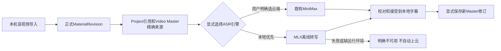

## Context

实际基线为 `main@8c0e3b8` 加既有 F7/F8 dirty 工作区；当前个人本地库已显式升级 f7d，未启用 F8。本 change 不包含其他 dirty 内容的提交/归档。

用户已确认：本机音视频→优先本机转写→校对/接受字幕→显式保存 Video Master，MiniMax 保留可选。本机不等于免除精确素材、权利和保存验证。

已实际读到 Radar `transcription/mlx_whisper.py`、contracts 和非敏感 ASR 配置：`ASR_PROVIDER=mlx`，桥接 voice-pro `venv_arm64/bin/python3.12` 与 `site-packages/mlx_worker.py`。两个文件存在，但尚未在 Studio 运行模型。worker 使用 `_mlx_quantize_polyfill` 后导入 mlx_whisper，CLI接受 audio/model/lang/output-json，输出秒级 segments；本机性能数字仅是 Radar README 历史记录，不是 Studio 新实测。

Studio已有 `ASRProvider`、`asr_suggestions.py`、`AsrSuggestionPanel.tsx`、Video字幕编辑和append-only保存。当前只接精确已保存Video v2 Master，来源WAV/MP4、最多10分钟、读取30MiB。既有`/materials/upload`按`materials.validate_upload()`限制30MiB；`upload_max_bytes`默认20MiB用于`/sources/upload`文档入口，不是Material上传或ASR的统一上限。本change消费已保存MaterialRevision，不修改两种上传入口或叠加20MiB限制；共享 `provider_calls.call()` 等待30秒且保留超时中的并发slot。不可直接照搬Radar的3600秒/无界capture_output。

## Goals / Non-Goals

**Goals:** 复用已有本机MLX桥接；只在本机读取音视频/识别；明确本地引擎优先和云端显式选择；有界执行并保留receipt/精确引用/CAS；完成真实字幕保存闭环。

**Non-Goals:** 云端上传、自动云端fallback、语音合成/新素材生成接受、模型下载/安装、任意路径API、雷达采集/观点/DB、逐字高亮/说话人识别/自动剪辑、长视频/大文件扩容、新任务引擎/表/migration、F8、发布/推送。首批为真实段级毫秒字幕，不伪造word timestamps。

## Decisions

### 1. Minimal bridge, one registry and existing runtime

新增单一 `apps/api/app/services/local_mlx_asr_provider.py` 实现 `local.mlx_whisper@1`，移植Radar音频→固定Python/worker argv→JSON段落的核心；直接适配Studio bytes/hash/mime/duration请求与transcript/cues结果，不导入雷达整个包，也不修改Radar/voice-pro源码。

沿用Registry初始化注册。显式server-side配置：`AICS_ENABLE_LOCAL_MLX_ASR`、`AICS_MLX_ASR_PYTHON`、`AICS_MLX_ASR_WORKER`、`AICS_MLX_ASR_MODEL_DIR`。关闭为默认；本机操作员apply后配置已批准的固定路径和已有模型snapshot。UI/API不接收路径、repo下载参数、shell/flags或可执行文件；不从Radar `.env`读取其他密钥。Studio无需安装MLX。

替代方案：复制雷达完整转录/数据库会重复真源；继续只用MiniMax需外发及付费，不符合本次本地优先目标。复用桥接是最小方案。

### 2. Offline preparation, fixed input and real runtime provenance

使用精确素材实际字节，不让客户端路径成为识别来源。WAV解码验证；MP4验证真实音轨并固定ffmpeg提取首音轨为16kHz mono WAV；无音轨/不支持/超限明确不可执行，不裁切后伪装全片。

worker直接接已有本机模型snapshot目录，不传可触发下载的远程repo。显式离线/禁遥测环境，子进程不继承API/token/代理等敏感环境；本机进程使用可用的网络拒绝机制（macOS固定sandbox-exec的deny-network profile）保证不外发。缺缓存/tokenizer/运行环境/网络隔离能力返回可说明的unavailable，不下载、不降级到云端。

runtime fingerprint绑定adapter版本、实际Python/worker及兼容polyfill/相关模型运行组件、模型snapshot配置/权重校验摘要；不能只绑定路径存在。文件改变使缓存失效；模型摘要允许受控缓存以避免每次库存读取全量GB权重，不能缓存成永久已验证。派发/结果/显式保存的runtime一致，变更则拒绝旧receipt。准备阶段不加载模型；只有用户请求字幕才识别。

### 3. Local deadline without changing legacy providers

本机单请求总截止120秒（包括预处理和进程运行），本机并发最多1；首批音频长度仍≤600秒、读取≤30MiB。模型冷启动可能失败；超限返回真实结果，不无限等待。外层`provider_calls.call()`仅为服务端识别的本机adapter增加可选有界等待参数，其他调用保留30秒和原2个slot；客户端不能改变它。进程应在外层终止边界前被回收，超时到终止完成仍占slot。

临时目录0700/文件0600，argv无shell，ffprobe/ffmpeg/worker共用剩余deadline，stdout/stderr有界且不返回原始诊断，JSON≤4MiB/转录文本≤100000字符/≤1000 cues/单cue≤500字符；非法/非有限/负数/重叠/越界timestamp拒绝，不编造或截断不完整输出成成功。进程组终止/回收后清理，仅返回脱敏typed reason。

不引入额外持久ASR Job；继续现有900秒、actor/project/unit/current-Master绑定的receipt。服务重启后尚未保存的旧建议应明确过期，不伪称可恢复；已保存Master历史不依赖缓存。

### 4. Local-first UX, not a new global model policy

`/asr-provider-options` 加安全label、execution_mode、available/reason投影；Registry仍是真源，库存不启动识别/探测供应商、不把已配置称verified。字幕面板本机可用时优先选它；本机缺失时留空并显示原因，不自动选MiniMax。

MiniMax仍显式可选，并显示“云端，将发送所选音频”；只有用户明确选择/请求才调用。此优先仅ASR面板引擎选择，不改已保存CPA默认/文本routes或MiniMax能力配置，不制造第二套模型配置/全局路由。原input/权限/模型使用许可仍派发前和保存前live校验；本机处理不自动授予任何public/commercial/model权限。

本机文件通过既有素材导入（仅localhost）→Project引用→已保存Video Master。文件大于现有导入/ASR限制时诚实提示；不通过任意文件系统路径绕过引用库。复用现有source selector与字幕编辑，不新增专业编辑器。Accept只替换local cues、使旧final render绑定失效，显式Save才创建Revision；修改后记subsequently_modified，保留receipt来源。

## Risks / Trade-offs

- 依赖voice-pro现有环境/缓存 → 指纹绑定实际文件，配置缺失明确不可用，不写外部项目或下载模型。
- MLX可能真实输出边界异常 → 按现有输出约束验证，禁止假时间码；如需要语义上不同的映射回到规格，不直接放宽全局。
- 小文件限制/120秒不能保证所有10分钟素材 → 显示限制和实际耗时，首批短音视频验收；长视频/大文件/异步作业不静默塞进本change。
- 许可未知的上轮MiniMax样本不能强行保存Video引用 → 只用明确获准的素材，保留原样本许可状态；真实许可缺失是阻断，不能改成true补验收。
- dirty工作区含未完成F7/F8 → 限定新Provider/既有ASR边界，记录本次结果，不沿用旧全量或归档其他change。

## Migration Plan

零DB migration。用户确认apply后在main一次完成后端和UI批次；显式配置本机受控路径/opt-in前保存runtime配置备份，不改签名key或CPA配置。用已有许可清晰的本地短WAV/MP4验证请求→校对→接受→Save→刷新/重启；不调用MiniMax/CPA作为本地验收fallback。

回滚仅关闭本地opt-in并恢复该次配置备份；Registry/UI恢复本机unavailable，保留原素材和Master/ASR历史，不删除或强制重写。实现/验收完成后才另按授权同步新主规格并归档本change，不等于F7全阶段归档。

## Open Questions

需求方向已确认，无需重复问本地/云端优先。真实验收文件及其许可须在apply时精确选择；本轮只确认路径存在与静态合同，不把模型/缓存、离线沙箱或真实识别冒充已验收。若受控环境证明必须新增持久对象、安装依赖或放宽大文件/时间/权限契约，停止实施并重新确认范围。
