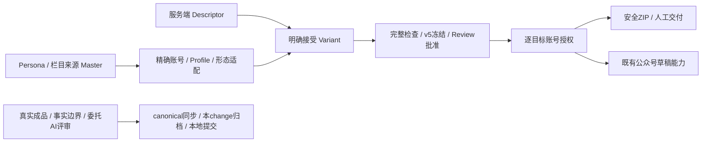

# Twelve-platform Content Handoff

**当前阶段：验收通过并归档，43/43（2026-10-14）。** 代码位于本仓本地 main；实际提交版本以 Git HEAD 为准。工作区保留相邻未提交改动，选择性提交的代码范围/精确哈希见 [提交范围](docs/BATCH_B_RECEIPTS/commit-scope.json)和[版本索引](docs/BATCH_B_RECEIPTS/index.json)。

## PRD / 需求背景

补齐12个平台、17种形态的专属稿件与真实素材交付包，复用栏目、Variant、冻结候选、Review和逐账号授权。公众号沿用既有草稿箱，其他平台人工发布。本地包、草稿和公开发布分别验收。

## 目录结构与成果入口

- [proposal](proposal.md)、[design](design.md)、[specs](specs/)：确认目标、exact合同和设计；七capability已同步canonical。
- [tasks](tasks.md)、[task_plan](task_plan.md)：43/43与持续实施计划。
- [progress](progress.md)、[findings](findings.md)、[review](review.md)：实际过程、关键决策、独立复核和已知例外。
- [完成矩阵](docs/CURRENT_GAP_MATRIX.md)：逐形态contract和整模态quality证据；E6为最终状态，早期段落为历史。
- [17形态证据](docs/BATCH_B_RECEIPTS/README.md)、[四账号真实包](docs/BATCH_B_RECEIPTS/accounts-real/README.md)。
- [两Persona整模态质量评审](docs/BATCH_B_RECEIPTS/persona-real/quality-review.md)、[最终来源与完整检查](docs/BATCH_B_RECEIPTS/persona-real/final/README.md)。

## 已完成

17形态专属合同与Descriptor编辑，逐目标Account适配/冻结/Review/独立授权、安全ZIP；原五schema/hash、legacy固定账号和相邻active change保全。配套备份/dry-run/副本演练后正式幂等启用12个Profile版本19–30；必要API加载后ready=true，schema a3series00000001。

受控17形态UI/API/ZIP完整通过；正式17可选，旧复杂Master6的3媒体/脚本预览通过、14文字目标明确结构/素材映射阻断，不混称任意来源自动适配。四个真实账号包独立冻结/批准/授权/下载，换号409，真实媒体/权利/字节保持，账号仍bound_unverified。

两角色真实生成2文章、6张1080×1440 PNG、107.124/84.683秒WAV。补齐author_opinion/明确假想来源边界、render refs与有依据的新图卡权限；四份完整checks current且无阻断，累计19次工作流Provider。图文平台正确区分输出卡与input照片，原照片样式门槛保持。

用户明确委托的Codex与独立整模态rubric通过，六张实际像素和两段完整ASR/声学均检查；原human_review_required和private WAV权限保留。未直接试听，不声称主观音色/韵律/实际发音已人工确认。

新鲜工作区后端2639通过/28跳过/1既有wewrite断链环境失败如实豁免，Web/FE-P1通过。实际选择性提交代码树另经独立复核：368通过/1跳过，Web/FE-P1、Node8/8、Ruff通过。七capability同步23新增/2修改/0删除，原要求/场景和相邻任务hash保全，本change已归档。

## 待完成 / TODO

本需求无开放项。公开发布、主观试听、正式账号远端资格及相邻Persona151/156、Stage141/144各自未闭项不由本需求替代。未push、未新增公众号发送；它们不阻塞已经确认的本地交付/委托AI质量范围。

## 关键设计决策与流程

服务端Descriptor是合同唯一投影；exact账号/Profile/绑定进入context和冻结refs。Candidate原hash与安全export hash独立，旧包/来源/历史不改写。Source观点不能升级为verified事实；模型生成不能反向当证据。纯文字/形状图卡满足image_note输出卡合同，照片预设仍单独要求真实输入照片。

## 依赖与启动方式

沿用apps/api/.venv、FastAPI/SQLite、React/Vite和现有Provider/renderer，无新增产品依赖。Batch A已有a3series00000001迁移，Batch B及本次图文修复零新增迁移。现有服务按[本机运行手册](../../../../docs/runbooks/production-readiness.md)管理；Vite/worker及配置未动。临时验证服务/浏览器已停止；隔离库和耐久成品保留。不要复跑带真实调用的harness，按manifest只读复核。

## 实际 Skill

using-superpowers、writing-plans、executing-plans/subagent-driven-development、openspec-apply-change、systematic-debugging、test-driven-development、verification-before-completion、playwright、finishing-a-development-branch、openspec-archive-change。最新收尾没有新增浏览器或生成调用。
