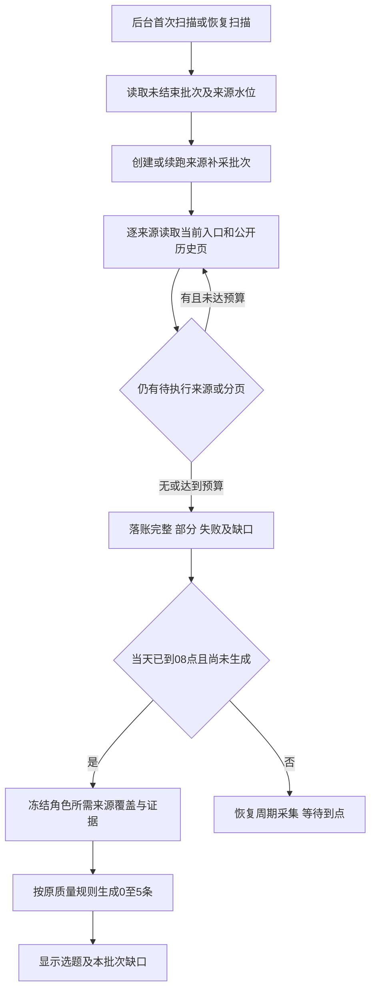

## Context

本机 API / Celery / Beat 为现有运行方式；调度每分钟检查一次。当前 `scan_persona_discovery` 先提交研究任务，再提交来源采集，队列先后也不能保证跨队列执行顺序。`collect_source` 只读当前入口，每次解析与写入上限30条；`last_success_at` 表示请求成功而非历史覆盖完整。日批已具备当天唯一键、过期租约恢复、模型 unknown 不盲重发和每日最多5条约束。

用户要求：开机后先补采关机期间的信息，再生成当天选题，补不到的明确显示。这里的“开机”指后台服务恢复执行；网页打开不能作为触发器，电脑关机时不能采集。

## Goals / Non-Goals

**Goals:** 自动恢复来源检查、尽力回溯公开历史、持久保存进度和缺口；日批等待补采结案；生成结果可追溯至当时真实覆盖情况。

**Non-Goals:** 全网全量历史镜像、登录/付费内容绕过、云端24小时托管、任意站点通用爬虫、修改选题质量标准、历史日期补造选题、重复补满当天5条。暂停/未授权来源不因恢复而启用。

## Decisions

### 1. 先补采，再冻结当天证据

正常日批也使用相同前置检查，避免只有“心跳中断”才能触发修复。调度器负责唤醒，Worker入口再次检查依赖；不能只调整入队顺序，不能在一个 solo Worker 内同步等待另一条队列而造成死锁。未满足前置条件的日批保持等待态，释放租约，由后续扫描继续。

每个角色只等待自身有效关联来源；共享来源同一窗口只抓一次，两个角色复用回执。停用、未授权、未验证、容量候补分别显示排除原因，不假装已补采。角色本轮有效来源中任一尚未结案，不能先冻结选题证据。全部结案后可带缺口生成；没有可用正文时为0条并说明原因。

恢复发生在09:00时，补采结案后补跑当天；07:00恢复则先补采，08:00再检查是否有已到期来源需要刷新，随后生成。当天已有完成结果只更新来源库，既有选题不自动重算或追加。bootstrap 若会生成当天首批选题，也必须通过同一门槛，不能绕过 daily。

### 2. 用可核实来源边界，不猜准确关机时间

每个来源的目标窗口为“上次成功读取入口的时间 → 本次恢复扫描时间”；它通常比停机窗口略宽。界面称“补采检查区间”，不把心跳时间称为准确关机时间。批次上界固定，恢复期间继续新增的内容可正常入库，但不无限延长本批次。

若有尚未结案的批次，先续跑原窗口，随后处理原上界到本次恢复之间的新窗口；当天尚未冻结证据时，必须覆盖至最近一次恢复扫描上界。再次长时间停机不能把旧窗口结案误作新的恢复已经完成。

现有 last_success_at / ETag / Last-Modified 是请求水位；新增回执保存覆盖判断及依据，两者不混用。历史缺口单独保留，即使后续最新采集成功也不会被清零。没有已知起点的新来源按首次收录处理，显示“历史覆盖未知”；不倒填保证已补全。

### 3. 有界回溯与诚实覆盖

| 来源能力 | 拟实施方式 | 无法补全的表现 |
|---|---|---|
| RSS / Atom | 解析本次响应中窗口内的条目；跟随响应明确声明的历史/下一页链接；与上次已知条目标识对齐 | Feed只留最近内容且无法衔接，显示“历史记录不足，无法确认完整” |
| 新闻网站 / 博客 | 使用现有列表提取及页面明确给出的历史/下一页入口；只支持现有解析器可识别的链接 | 没有可识别历史入口，保留当前可抓内容并显示“来源不支持历史回溯” |
| 已配置JSON入口 | 有明确日期/分页游标语义时续读；没有则按当前快照处理 | 缺少历史能力时显示部分覆盖 |
| 热榜 | 保存当前可见快照，提供历史接口才回溯 | 关机期间已下榜的内容标为无法确认，当前热榜不证明过去榜单 |

不再在解析入口处静默截断30条。写入可仍每30条分块提交，但必须保留继续位置，分块不是采集总量。建议默认每源每批最多10个页面/请求（含重试）、300条扫描记录；每次只取一页后释放执行权，避免单一高频来源占满 Worker。沿用现有响应大小、URL安全验证、超时及来源租约；历史链接同样逐跳校验，禁止模型猜页码或构造未经来源声明的端点。

批次对日批的等待预算建议为累计后台运行15分钟，关机/休眠的心跳空档不计入；由短任务和扫描回执累计，不能用进程内 sleep。源级请求预算先耗尽则该源先结案为部分覆盖；整批预算耗尽时，未处理来源显示“等待预算耗尽，尚未完成”。失败重试仍计入同一预算，不能通过重启重置预算。后续正常周期采集继续，迟到结果不悄悄改写已生成选题的覆盖快照。

“已覆盖”只指本来源公开可读取入口的目标区间，有明确连续游标/完整历史返回，或有序分页衔接到此前保存的边界且没有截断、未知排序和日期歧义。仅遇见一条旧文章、HTTP 200、空列表、0新增、搜索结果或304，都不足以证明历史完整。304仅能在同一已验证入口/缓存快照可证明目标窗口连续性时继承覆盖，否则显示“当前入口未变化，历史覆盖仍待确认”。删除或未公开内容不在保证范围内。

回执区分：`covered`（入口区间已核对）、`partial`（有资料但不能确认完整）、`failed`（本次未能读取）、`excluded`（当前策略不允许）、`pending/running`（尚未结案）。补不到的确切起止若无法确定，显示整个受影响检查区间和“具体缺失时段/数量未知”，不能以最早文章日期推断无缺口。处理完成与覆盖完整是两个字段。

### 4. 最小持久化职责

| 对象 | 职责与主要字段 |
|---|---|
| 新增 DiscoveryCatchupBatch | owner、幂等窗口键、触发原因、固定上界、批次状态、累计运行预算、创建/结案时间；批次必须由服务端唯一约束避免重复扫描建多批 |
| 新增 DiscoveryCatchupSource | batch/source唯一键、起止边界、角色订阅快照、进度游标、页面/扫描/新增/重复计数、请求次数、覆盖状态、原因与依据、未确认区间、完成时间；同一Source写入仍受既有租约保护 |
| DiscoverySource | 复用当前采集入口、权限、最近请求成功时间与调度；cursor_json 增加版本化可续读信息，保留已有HTTP缓存字段 |
| PersonaResearchRun | input_json 引用依赖回执、固定证据截止与覆盖快照；未满足门槛时显示 waiting_collection；沿用日批唯一键/模型调用账本 |
| DiscoveryItem | 沿用 source/item_key/checksum 去重；采集时间与原文/事件时间分离 |

采用两张小型账表而非把全体来源进度塞进单条全局 JSON，便于分源提交和恢复；无需新增通用工作流平台。普通采集与恢复采集复用同一安全解析/存储路径。回执保留窗口内条目引用或可复核的选取边界，日批不能把尚未提交的补采内容当作输入。

### 5. 重启、跨天和权限变更

- 页内条目写入与游标推进在同一事务，失败不推进；重复响应通过既有唯一约束去重。租约过期才能接手；旧 Worker 迟到结果必须核对 token，不能覆盖新回执。
- 停机数日时从来源实际水位尽力补采，达到预算显示缺口；只生成恢复日选题。昨日等待中的日批记为错过日期；资料仍保留。跨午夜的旧日批在调用与落库前复查业务日，避免生成昨日结果。
- 尚未开始模型阶段即可更新前置依赖；已经开始模型阶段并有冻结证据/账本的中断日批，继续原快照，不追加或重发 unknown 请求。新补采单独完成并展示“本次补采未纳入已开始的当天批次”；若当天已有输出则保全。该例外用于避免重复付费和结果漂移，必须可见。
- 关联/角色/来源权限发生变化时重新核对：撤权立即停止后续读取和模型引用，回执标记排除；新关联在证据冻结前纳入所需检查，冻结后留给下一正常批次。仅储备来源不自动获得采集权限。别名合并沿用现有 canonical source 对齐及人工配置保护。

### 6. 页面与API

复用 `GET /content-opportunities/discovery/status`、`sources` 和 `runs` 投影，必要时增加只读补采详情接口，所有查询按 owner 隔离。读取页面绝不触发补采。

| 位置 | 用户看到的内容 |
|---|---|
| 运行状态 | “正在补采，今日选题等待中”；各角色进度；结案后“补采结束，部分来源有缺口”及延迟执行时间 |
| 信息源储备 | 每源检查区间、上次成功、扫描/新增数量、覆盖状态、缺口原因与无法确认范围 |
| 研究记录 | 日批开始时间、关联补采批次、当时覆盖完整/部分情况；区别“没有合适选题”和“资料未采齐” |

新增数是抓取条目版本数，不等于文章正文核验数、更不等于选题数。断网与登录限制用实际错误说明，不通过推断声称网站没有更新。后续来源恢复不能把旧日批回执悄悄改成完整。

## Risks / Trade-offs

- 来源没有公开历史 → 本地关机后无法保证找回消失内容；明确缺口，可用资料仍参加正常筛选。
- 长停机、高频站点耗尽预算 → 记录受影响范围和截断原因，保留已经取得的内容；不以凑齐资料为由无限抓取。
- 单Worker任务较长 → 按页让出执行权，门槛用持久状态推进；15分钟为后台运行预算，不承诺15分钟墙钟内必出选题。
- 部分覆盖仍生成 → 页面与日批同时标记；沿用正文、时间、角色、同类合并与来源分散规则，不降低质量门槛。
- 原日批change尚待自然验收 → 本change独立跟踪，原验收不能证明停机补偿已实现。

## Migration Plan

用户确认后先核实运行版本并备份数据库与涉及代码；仅加表与兼容JSON字段。老来源保留实际 last_success_at，但缺少历史覆盖证据时按未知处理。旧日批和选题不回填虚假补采记录。隔离验证真实 Beat/Worker 恢复顺序后，按既有授权范围接入，做实际服务停启自然恢复验收；归档前同步新增主规范。回退代码时保留新增回执和已有内容，不执行删除历史数据的降级。

## Open Questions

无阻塞性业务歧义。待用户确认：采用上述“有界尽力补采、明确缺口后允许生成”的策略，以及默认每源10次请求/300条、累计后台运行15分钟的预算。具体不支持历史的来源由运行回执说明，不在方案阶段声称已具备历史能力。
