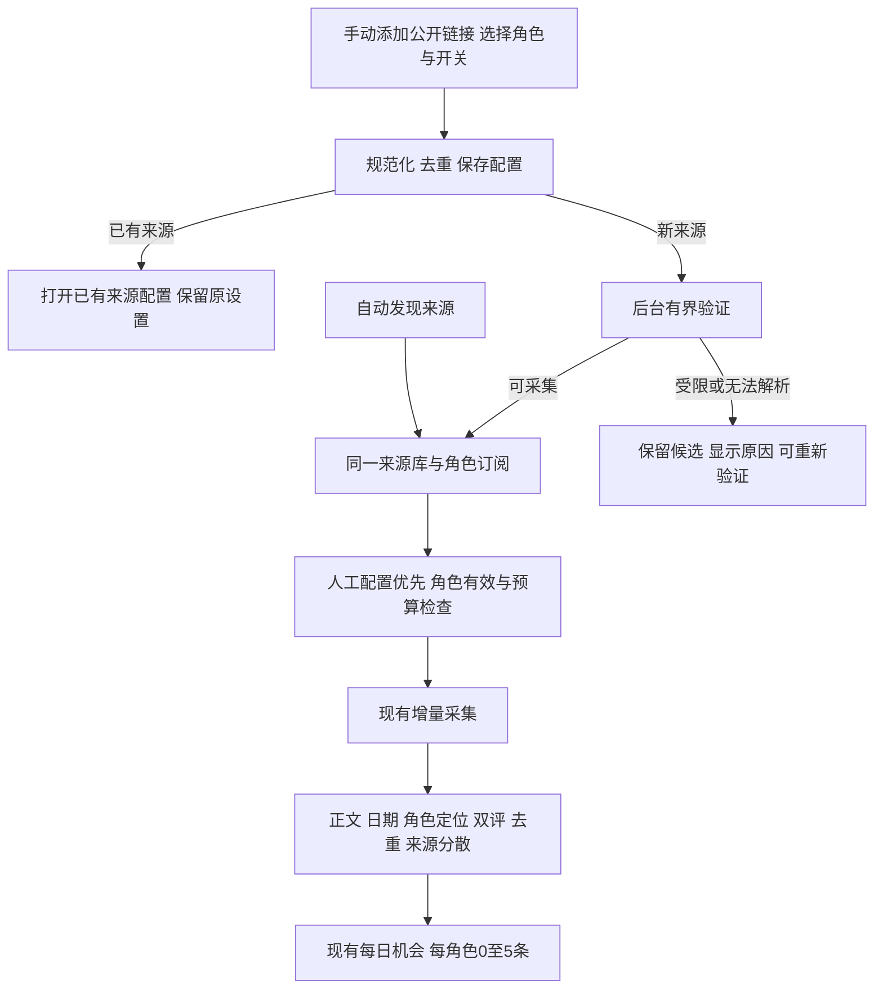

## Context

当前系统已经有 owner 级 `DiscoverySource`、角色级 `PersonaSourceSubscription`、RSS/Atom和受支持的公开HTML/JSON采集、后台扫描、来源暂停与模型权限。`DiscoveryPanel` 没有手动添加/配置表单，API没有来源登记或角色关联写入口。自动研究会更新订阅profile_hash并禁用旧画像订阅，直接套用这段逻辑会丢失人工选择。

本提案为新增手动管理范围，依赖已接入的每日机会基础能力。前一change的自然日批验收仍独立进行；此提案等待确认，不能被前一change的apply或归档授权顺带实施。

## Goals / Non-Goals

**Goals:** 用户通过正常页面添加三类公开链接，配置多角色关联和现有开关；手动与自动来源统一管理，验证结果可见；人工选择持久生效并接入同一采集与选题质量链路。

**Non-Goals:** 新建聚合站、登录凭据托管、绕过平台限制、平台专用采集器、全站无限抓取、批量导入、用户编写抓取脚本、优先级权重和逐来源定时配置。本期链接保存后作为来源身份，不直接改成另一网址；换网址通过添加新来源及调整关联完成，避免旧证据被归到另一站点。

## Decisions

### 1. 复用当前来源面板

「内容机会 → 信息源储备」继续作为统一入口，在同一列表增加「添加来源」与逐条「配置」。不在角色页另建一套管理列表。

| 表单字段 | 行为 |
| --- | --- |
| 来源类型 | 新闻网站、RSS/Atom、博主主页；产品类型与实际rss/html/json适配器分开 |
| 链接 | 必填HTTP(S)公开地址；保存后展示原始入口与已验证采集入口 |
| 名称 | 可选；未填先使用域名，验证后可补站点名；手填名称不被自动研究覆盖 |
| 关联角色 | 当前用户角色多选；从角色筛选进入时预选当前角色，可取消；允许0个作为储备 |
| 采集 | 新来源默认启用意图，验证通过且有有效关联才执行采集；暂停与恢复沿用现有开关 |
| 允许模型分析 | 新来源沿用当前公开资料处理设置并在表单明确显示，用户可关闭；已有来源权限不被重复添加覆盖 |

列表同时显示：添加方式（手动、自动、手动+自动、初始储备）、关联角色及待完善/暂停状态、原始地址与采集入口、采集/模型权限、验证状态、最近成功与失败原因。支持按角色和添加方式筛选、现有分页参数对应的翻页。编辑展示名/类型/角色/开关不必重新填写地址。

列表显示的是“已保存/可采集/采集失败”等来源状态；可采集不等于每条文章都有正文，也不保证生成选题。

### 2. 保存意图与后台验证分开

保存先持久化来源候选和角色配置，返回验证中，随后由现有Celery扫描领取来源验证工作；关页面后继续。复用来源的next_due_at和租约，保存待验证标记与错误原因，无第二套队列或新服务。验证仅做有界公开HTTP读取，不需要调用搜索或大模型。

- RSS/Atom：验证Feed及条目。
- 网站/博主主页：先发现公开RSS/Atom，找不到则尝试现有受支持结构化HTML/JSON入口；不把“网页HTTP200”当作可持续采集成功。
- 受限主页、只有单篇文章却无法确认持续入口、解析失败：保留候选及具体原因；可通过「重新验证」使用原地址重试，或另添有效入口。
- 没有关联角色的来源可以保存和验证，不进入周期采集/荐题。
- 暂停来源不被验证动作隐式恢复；验证或配置在进行中时再次保存，旧任务只能应用与当前配置相符的结果。

### 3. 一个来源身份与可追溯的添加方式

继续使用同一owner内canonical URL唯一约束；链接规范化去掉已知追踪参数。只有验证明确证明相同采集入口才把网站首页与其RSS视为同一来源，不按“同域名”合并不同栏目或作者。

首次重复添加直接返回已有来源和“已存在”提示，并打开当前配置；不创建第二份来源、不替换其角色集合或解除暂停。用户随后保存配置才生效。并发保存、重复点击和验证后发现入口已存在，均需原子复用已有来源，保留所有原关联、已采集条目及发现证据，冲突人工配置不由验证任务擅自覆盖。

来源的原始URL、已验证别名、添加方式和人工展示名称/类型存入现有 `evidence_json` 的明确管理区；自动发现证据与人工操作审计分开合并，不能覆盖历史搜索来源。现有记录按run_id/search_provider、seed_id等确切证据识别来源方式，无法证明时显示“既有来源”，不能猜成手动。

### 4. 人工角色集合优先，仍按画像评价选题

人工首次保存来源配置时，角色选择预填已有有效关联；提交的角色集合即该来源当前用户指定的准确范围。之后自动发现只能补充发现依据，不能增加未选角色、删掉已选角色或覆盖人工名称/类型/暂停/权限。来源的手动+自动标签记录来源来历，不代表自动获得修改人工配置的权限。

复用来源管理元数据记录角色管理模式与所选role IDs，订阅表继续承担执行过滤。手动移除的关系保留为禁用/人工移除状态，历史条目与机会不删除，也不阻断其他角色。再次手动勾选才能恢复该关系；仅恢复全局采集不会恢复已解除的关联。

角色修改定位时，人工关联保持，并在当前有效修订下更新执行快照；角色暂停、归档或定位未完善时，保留配置但停止该角色的使用。选题相关性仍由角色当前画像和质量检查决定，手选来源不保证入选。

沿用现有活跃来源/执行预算。超过现有容量时保存配置意图并显示待容量状态，不擅自停用其他来源或扩大预算；容量释放后由后台重新核对。全局自动研究关闭时保存/显式验证仍可用，周期采集与生成继续受全局开关控制。

### 5. API和最小改动边界

| 接口 | 责任 |
| --- | --- |
| GET `/content-opportunities/discovery/sources` | 扩充来源方式、原始/采集URL、关联角色/执行状态、验证信息；增加来源方式过滤，沿用limit/offset |
| GET `/content-opportunities/discovery/sources/{id}` | 读取来源并解析合并别名，供跨筛选的合并通知打开已有配置 |
| POST `/content-opportunities/discovery/sources` | 保存链接、类型、名称、角色集合与开关；创建/复用结果可区分，持久安排验证 |
| PATCH `/content-opportunities/discovery/sources/{id}` | 扩充名称、类型与角色集合；未提供角色集合时不更改原关联，空数组明确解除全部；保留原暂停/权限客户端兼容 |
| POST `/content-opportunities/discovery/sources/{id}/validate` | 有界、幂等地安排后台重新验证，不触发每日补跑或模型调用 |

所有读写沿用owner/editor权限，角色ID逐一验证归属；配置和审计在同一事务完成。继续使用现有安全HTTP、重定向、大小和时间限制。不得通过手动地址或类型设置执行任意脚本、授予转载许可或自动确认FactPack事实。

优先修改 `routers/discovery.py`、`services/discovery_ingestion.py`、`source_discovery.py`、`discovery_runtime.py`、`tasks/worker_tasks.py`、`DiscoveryPanel.tsx`，按实际调用涉及 `content_identity.py` 和 `_evidence`/`check_current` 的订阅检查。先复用现有JSON与租约/状态字段，不预设新表；确认后如发现现有字段无法表达最小正确性，再把所需加法迁移写入同一规范。

## Risks / Trade-offs

- 部分新闻网站/博主主页没有现成公开适配器 → 保留并明确“已添加、暂不能采集”；本期不承诺所有平台链接可采集。
- 自动研究清理旧profile订阅会误删人工选择 → 人工管理模式先行过滤，角色修订刷新执行快照，并验证重研究后的稳定性。
- 网站与RSS入口重复、多人并发保存 → 复用owner唯一身份与来源租约，合并证据并保留原配置；冲突时返回现有配置供用户编辑。
- 添加后尚未到每日时刻 → 显示来源已就绪及正常下次执行时间；不为证明功能手动改业务日或绕过每日上限。

## Migration Plan

1. 用户确认本提案后，复核前一change最新代码与验收状态，使用隔离工作区完成最小实现，不混入并发修改。
2. 新元数据对旧来源采用兼容读取；只有用户保存配置才转为人工管理，不把旧自动来源批量改成人工。必要加法迁移另记实际证据。
3. 运行既有相关检查、临时操作验收和独立审阅，不新增测试代码；验证三类入口、重复/别名、角色隔离、暂停/解除关联、画像变化、失败及后台恢复。
4. 正式接入前在线备份SQLite与相关代码/配置；验证新旧来源同列表、后台自然扫描采集和正常日批消费。手动接口成功不替代后台验收。
5. 仅完整验收后同步本capability并归档；若回退，关闭新增入口和未处理验证意图，保留来源、条目和人工操作记录，不覆盖历史数据库。

## Open Questions

无阻塞产品问题。待用户确认的是本提案范围与交互约定；具体站点可采集性在添加后的实际验证中判定。

## 实施补充

新增单一 `services/discovery_sources.py` 承担配置/验证/人工订阅协调，六个既有路径窄接入。来源列表增加merged_only读取未确认的合并通知，UI独立轮询，不随角色/来源方式过滤；用户保存目标配置后清除提示。新旧类型保存时未变更kind则省略该字段，避免把原有official/media等类型改成website。来源统一按owner→source→Persona写锁顺序应用配置，网络读取期间不持有写锁。
