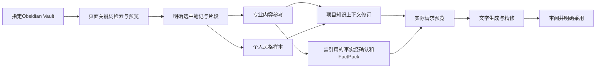

## Context

已有SourceDocument、ProjectSourceBinding、KnowledgeCollection及FactPack；system-assets-knowledge明确集合不等于事实边界。data_source_plugins.py的obsidian项available=false，没有执行器。ProjectEvidenceTab.tsx是现有页面衔接点。领域知识服务domain_knowledge.py是量化方法论专用，不扩为本需求通用知识库。

只读元数据发现本机登记了一个存在的“知识库”Vault；未遍历笔记、未读取正文。Obsidian安装包版本1.11.7，命令行PATH未发现obsidian；官方CLI文档要求更新安装包，故本次不让CLI升级成为依赖。

## Goals / Non-Goals

**Goals:** 从“来源与证据”检索指定Vault，明确选择专业内容参考/个人风格样本，使用被选内容辅助文字创作并显示实际引用的快照。

**Non-Goals:** 改写Obsidian、全库自动导入、嵌入服务/模型微调、笔记附件处理、自动跟随双链扩展整库、同时实现MCP与文件两套接入、自动发布。第一版以保存到磁盘的Markdown为准。

## Decisions

1. **采用本机只读Markdown适配器。** Obsidian官方说明Vault就是本地Markdown文件夹；当前API与Vault同机，文件方式足够支撑页面搜索/预览并减少安装依赖。MCP/Local REST API可提供检索，但装在某个AI客户端不等于AIContentStudio后端已有页面接入。以后如需Obsidian实时元数据、未保存编辑器或远端Vault，再独立选择MCP，不预建抽象框架。
2. **只配置一个明确Vault与选定目录范围。** 用管理员现有设置方式保存本机根目录，前端只传连接ID/相对笔记路径；仅访问范围内普通Markdown，解析真实路径防越界，跳过配置、隐藏目录与非笔记文件。搜索是有界标题/正文关键词搜索，列出片段；不默认读取整库并发送模型。
3. **用户明确选用后形成Source快照与用途引用。** 复用SourceDocument的解析/内容SHA，保留笔记相对路径、标题、磁盘版本标识及所选片段；相同内容重复引用不无故复制。Vault原文变化需显式重新读取并生成新上下文修订，不静默改写旧Source/Run。已选Source遵循既有V1系统共享语义，未选笔记不导入共享库。
4. **专业内容参考与风格样本进入独立项目知识上下文。** 两种用途可以并选，角色/单元限定明确记录。不将风格样本放进FactPack；观点、方法论和历史作品不自动确认为事实。需要引用的事实仍走现有确认、FactPack模型/公开授权及冻结。知识引用另有明确的模型使用允许项，默认false；不由本机可读或Source存在推断授权。
5. **先复用现有持久化与Run快照。** 用户确认范围后、执行apply前只读确认项目级既有JSON/版本合同是否能完整表达source ID/SHA、用途、范围、授权及片段；若不能，新增一个最小ProjectKnowledgeContextRevision结构和加法迁移，保持Source为内容真源，不复制通用Asset层。此决定与确切文件清单在apply前回写本design，避免借用无关字段或承诺未经验证的零迁移。
6. **贯穿文字相关AI阶段并显示实际输入。** 预览显示专业资料/风格参考及精确版本；生成、精修、终稿读取同一已固定知识选择，后续编辑不得悄悄替换。无知识选择的旧项目原样运行。知识文本作为引用资料，不能作为系统操作指令或扩大工具权限。结构和来源可检查；“风格符合”用同主题稿件与选定作品的委托AI人工代理对照说明，不能用渲染/归档成功代替。

## Risks / Trade-offs

- 磁盘内容与Obsidian未保存编辑器内容不同 → UI明确以已保存笔记为准；不宣称实时编辑器读取。
- 同目录混有他人摘录和本人作品 → 用途显式选择，用户核对作者与允许模型使用；风格与事实不混同。
- iCloud占位文件暂不可读或内容变化 → 返回明确不可读取/版本已变状态，不将空内容当成功或替换历史。
- 资料过长 → 沿用可见上下文预算，预览已选片段和任何裁剪；不悄悄发送整库。

## Migration Plan

确认方案/Vault → 只读连接与预览 → 明确选用/版本快照 → 接入文字实际输入 → 两角色各一个正常页面创作验收 → 既有检查/独立复核 → 单独change归档与白名单本地提交。若需迁移先备份并演练加法迁移。关闭连接入口不删除Vault或历史稿件。

## Open Questions

待用户确认：第一版采用当前登记的“知识库”Vault本地只读接入，而不是先安装MCP。读取目录范围在设置中明确选择；本轮未读取内容或修改设置。

## Primary references

- https://obsidian.md/help/Files%2Band%2Bfolders/How%2BObsidian%2Bstores%2Bdata
- https://obsidian.md/help/cli
- https://github.com/coddingtonbear/obsidian-local-rest-api

## Confirmed implementation contract — 2026-10-15
用户已明确确认“只用连接本地”。已在apply前只读确认：ContentProject无知识字段，ProjectSourceBinding.note不是版本化授权合同；新增一张ProjectKnowledgeContextRevision最小修订表。Run使用既有WorkflowRun.context_json固定选择，Stage沿用input_snapshot_json记录实际输入。配置仅SystemSetting key obsidian_local_v1，项目知识不放SystemSetting。

确切源码白名单：apps/api/app/models.py（仅新增表class）、apps/api/alembic/versions/obsidian000001_project_knowledge_context.py（新增）、apps/api/app/services/obsidian_knowledge.py（新增）、apps/api/app/routers/obsidian_knowledge.py（新增）、apps/api/app/main.py（注册新路由）、apps/api/app/services/creation_recipes.py、apps/api/app/services/workflow_engine.py、apps/api/app/services/stage_resolver.py、apps/web/src/product/project/ObsidianKnowledgePanel.tsx（新增）、apps/web/src/product/project/ProjectEvidenceTab.tsx（接入panel）。配置入口放在该知识库面板的管理员折叠区域；不改无关产品设置或启用尚无执行器的旧Data Node占位。

边界：同一Vault默认已配置根目录内Markdown，管理员可收窄子目录；search最多返回20项并明确扫描覆盖/异常，单笔记至多256KiB，每项目修订最多5个选中笔记，单片段4000字/总6000字，页面明示。项目/Persona或Unit范围与允许模型使用明确保存，默认false。导入Source只保存所选片段，不读取未选附件或递归双链；原笔记SHA与片段SHA分开保存。两个角色各一次短稿实际生成，总注册模型派发上限4（每角色draft+refine），语义QC如触发另最多4，总8；串行/两次顶层派发起始≥10秒/Unknown不重发，预算与价格未知不当成零。

隔离工作区/分支：/Users/mshengran/.codex/worktrees/obsidian-knowledge/AIContentStudio，codex/obsidian-knowledge-context。配套私有备份为backups/obsidian-knowledge-20261015.olyuf7ao；969旧行/75旧media/477归档文件及75相邻文件已指纹保全，SQLite backup integrity ok。正式笔记只读，模型生成只由根正常页明确选用并授权后执行。

必要第11文件apps/api/app/db.py已纳入白名单：本地批准schema head和migration_only同步；实际runtime.env明确固定旧schema head，正式迁移后仅更新REQUIRED_SCHEMA_HEAD=obsidian000001，其余配置原字节保持。
