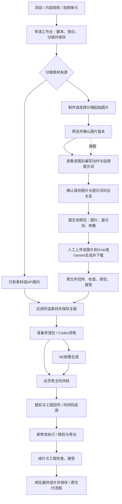
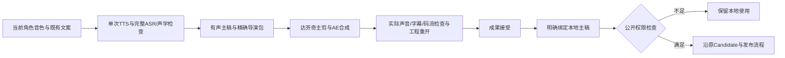

> Revision 4：先制作并确认分镜图片，再基于该图片编写视频提示词，人工图生视频并回传。流程方向已确认，本版规范已确认，实施进行中；revision 3工程与历史任务保留。

## Context

状态：REVISION_4_APPLY_IN_PROGRESS。用户确认先图后提示词的方向；本轮实施同一方案。第三版已实施至19/27，本版新增图片确认和据图提示词顺序，用户已授权实施及最多2次新起始帧生成。

已核验的代码基线为本地main@636d60e并有相邻dirty。Grok API生图返回真实JPEG；Gemini images/generations被HTTP400拒绝，同网关generateContent已返回真实1024×1024 JPEG。旧诊断和unknown保持历史，不冒充正常页面验收。

用户明确当前通道的视频素材走Grok/Gemini网页，AE/达芬奇本机MCP由其保证可用。本方案不依赖视频API是否提供，不把网页订阅当API凭据。

现有基础：VideoStudioShell的导演工作台、Video Master v2、director.video.v1、CreativeExecutionPackage/Execution/Output、受限本机MCP、MaterialRevision与明确绑定流程均存在。creative-orchestration相邻change仍未归档；本需求不关闭它。当前creative_contracts.MAX_FILE_BYTES为30MiB，shared metadata拒绝任意本地路径，专业工程与完整视频需显式传输方案。

## Goals / Non-Goals

**Goals:** 正常页面管理分镜任务；Grok/Gemini网页生成可追踪短片；回传真实素材并明确采用；Codex接收精确导演包；达芬奇主剪、AE按需输出；粗剪反馈、最终MP4/字幕/可重开工程回到同一项目。API图片接入仍完成。

**Non-Goals:** 新建专业NLE、浏览器账号管理/反检测、抓Cookie或调用网页私有接口、增加视频API/新凭据、安装/排障AE/达芬奇MCP、自动公开发布、批量无上限生成、自动把网页自述型号当供应商验证事实。

## Decisions

### 1. 页面入口与实际动作

复用 `/projects/:projectId?tab=matrix` → 选择视频单元 → `/projects/:projectId/units/:unitId/production`。默认内容页仍是现有导演工作台，不新增顶层导航。下表为拟新增/强化的操作，不能描述成已经上线。

| 位置 | 页面操作 | 行为与下一步 |
| --- | --- | --- |
| 视频主稿·导演工作台 | 脚本、旁白、分镜、画幅/目标时长 | 沿用原编辑/保存；保存后才能准备任务，草稿编辑不触发生成 |
| 分镜 → 素材制作 | 选已有素材 / API生成图片 / 网页生成视频 / AE制作动效 | 显示来源方式、提示词、参考图、目标使用时长、生成时长、声音意图和素材状态 |
| 分镜 → 起始图片 | 生成/上传/选择图片，预览并“确认用于本镜头” | 先保存精确图片版本，显示实际画幅；入库不等于镜头确认 |
| 分镜 → 视频提示词 | 基于已确认图片填写或由Codex起草，再确认 | 区分生图描述与视频提示词；展示动作/运镜/节奏，记录据图版本，换图须重核 |
| 分镜 → 网页图生视频 | 下载图片，复制视频提示词/参数，打开Grok或Gemini | 冻结精确图片/主稿/镜头；用户上传该图、生成下载并回传 |
| 同一分镜任务 | 上传生成视频、预览、拒绝/补交、接受 | 人工原片回传进入精确候选槽位；专业剪辑仍可MCP提交；接受只增加素材版本/项目引用 |
| 分镜素材汇总 | 应用所选素材并保存主稿 | 使用稳定shot_id和精确MaterialRevision，明确新增Master版本，不能按文件名猜镜头 |
| 导演包与外部执行 | 准备剪辑任务、复制Codex任务说明 | 汇总脚本/音频/字幕/选定素材/裁切与动效要求，明确达芬奇主剪、AE任务清单和成果要求 |
| 创意执行与成果 | 粗剪播放、按时间码填写反馈、要求修改或接受 | 反馈绑定本次粗剪输出ID/hash；未接受可补交更高attempt，接受后另建修改执行 |
| 创意执行与成果 / 最终成片 | 预览、接受、绑定为最终成片并保存 | 收回MP4、字幕、工程和清单；接受及保存为可见的两步，沿用Candidate检查 |
| 创作与执行队列 | 待网页生成/待你处理/待素材审阅/待剪辑/待成片审阅 | 投影已有执行状态和阶段，能回到精确项目/单元/执行/镜头；读取不派发 |

### 1a. 先制作图片，再据图写视频提示词

顺序：分镜意图 → 生图描述 → 制作/选取图片 → 预览并确认本镜头起始帧 → 基于该图编写视频提示词 → 确认并保存 → 人工网页图生视频。画面未选定时，不输出或准备可提交的视频提示词包。视频提示词由用户或Codex在查看图片后编写；复用现有编辑/保存及CLI/MCP，不新增提示词生成服务、自动模型调用或图像工作流引擎。

图片沿用现有API生图、上传和素材选择；图像描述独立于video production.prompt（后者仅用于视频）。明确“确认用于本镜头”才保存参考图片的MaterialRevision/hash。使用既有参考槽位作为唯一图片真源；确认状态由保存的引用表达，不建图片审批表。多个镜头允许明确复用同一图片；需要不同构图时先为对应镜头制作并选定图片，不强制每镜头新生图。

新流程采用versioned image-first制作配置（video.shot-production.v2）：复用已有reference_material_revision_id，并为视频提示词记录prompt_reference的revision_id/content_hash。新流程只有参考图已明确保存、可用且model_use_allowed，提示词绑定同一版本，才可准备包。网页包仍沿用web.video-shot.v1并冻结image_to_video及实际授权图片。所有新建网页执行在专用与通用prepare入口均要求该v2先图后提示词合同；新建v1网页执行不能绕过；旧v1文档/已准备任务只按原合同读取、回传或明确接管，不因升级重写成图生视频。

换图后保留旧提示词供查看，但标为需要依据新图核对；用户重新核对并确认后更新prompt_reference，不自动用新图重签旧提示词。服务端拒绝缺图、提示词图片版本不符或撤权的任务准备。图片尚未适合目标画幅时先完成构图调整并保存新素材版本，不让网站静默裁切。针对本样片应先制作/确认16:9图片；不对其他画幅/旧任务增加全局限制。

图片经模型生成并已入库，不代表视觉定稿或授权外发。现有19/20两张素材为1024×1024，model_use_allowed=false，形状与布局不同；本轮可展示为风格候选，不能直接外发或冒称连续场景的定稿。确定图片后再填写实际图生视频提示词，不沿用旧文生视频提示词当完成。

### 2. 版本化分镜与精确素材对应

分镜继续以Video Master中已有shot.id为稳定ID。既有shot的可选production配置v1保持兼容；新图优先流程使用video.shot-production.v2（见1a），共同包含source_mode、web_provider、prompt、reference revision、requested_generation_duration_ms、audio_intent；目标剪辑使用时长沿用shot.duration_ms。已有source_material_revision_id仍是实际采用素材真源，不复制第二份采用状态。单图生视频第一版仅一张已接受且有权参考图；新增参考槽位纳入原asset_refs/hash/权利校验。旧Video v2缺此可选字段时行为保持。

已有素材和API图片沿用原入口；网页任务一次只生成一个镜头，避免单镜头失败阻塞其他镜头。完整计划可以包含多镜头，但领取/提交按独立执行计账，默认串行，预算内每任务一次生成，不固定要求10秒。期望生成时长与实际可选时长不一致时先调整保存任务，不能静默使用网页默认值。

所有同一制作批次的分镜任务冻结同一Master版本。接受镜头素材不自动保存Master；多个镜头完成后统一应用并保存，避免第一个素材回传即让其余任务过期。中途主动修改脚本/分镜时显示受影响任务并保留原输出，旧包按既有currentness规则不能继续副作用操作；不在后台重发，已接受素材可明确复用到新版本。

### 3. 网页任务复用外部执行域

沿用creative.execution.v1，在服务器构造的package_json内增加受限web_video扩展（schema web.video-shot.v1），冻结shot_id、source Master revision/hash、provider网页标识、单图生视频方式（历史任务保留原方式）、prompt、参考素材SHA、画幅、期望生成时长、声音意图、数量和预算。一次任务的必需输出为一个原始视频候选及安全来源信息。作为既有manual_image机制的相邻专用服务实现，不把网页任务写成ProviderGenerationTask或添加视频API适配器。

网页素材准备只提供人工复制包和上传入口。专业剪辑任务提供可复制的Codex执行说明；Codex通过平台MCP读取/领取任务、落地授权输入和回传成果。Skill覆盖人工素材交接和专业工具步骤，不自动操作生成网页。prepare与实际开始始终分开。

网页阶段：先完成并明确保存分镜起始图片 → 基于实图编写/确认视频提示词 → 保存精确图片及提示词版本 → 准备下载图片＋提示词＋参数包 → 用户上传同一图片到网站并人工生成/下载 → 按镜头回传 → 检查/预览/明确接受 → 批量绑定保存。平台和Skill不自动操作生成网站；Codex操作平台只用CLI/MCP。

人工操作可在同一任务复制prompt、下载授权参考图、打开网站，再上传对应视频，记录manual_web来源。历史Codex网页任务保留，接管必须沿用CAS并核对既有结果；可能已提交时先对账，不因本次范围变化重发。

### 4. 状态与失败处理

不添加新状态机，使用已有执行状态；用户文案只做投影：prepared=待领取/待网页制作，claimed/in_progress=制作中，blocked=待你处理或待补交，unknown=生成结果待核对，result_ready=待审阅，accepted=素材已接受。素材已接受与已绑定分镜分开显示。

登录/验证码/额度/功能不可用，保留任务与具体安全原因；未提交可blocked，可能已提交为unknown。页面刷新、超时、下载失败、客户端重启都不能自动重新点击生成；先检查原网页结果，已有成品可继续下载同一文件。重试生成须用户明确新尝试且计入剩余预算。HTTP明确拒绝的API图片也不再被泛化成unknown。

### 5. 回传、校验、接受与绑定

Codex从执行私有outputs目录提交；手动文件上传经执行范围的HTTP流式暂存，使用同一输出合同与服务。禁止MCP传MP4 base64、任意本地路径扫描、仅回一个远端URL就声称有素材。

检查真实文件MIME、SHA、大小、可解码性、时长、画幅、分辨率/帧率及有无音轨。记录网页来源和已知参数，不伪造供应商API回执。参考图模型授权在准备/外发前/接受复查，派生成果权利不升级。画幅、最短可用时长或音轨意图不符时提示具体差异，用户明确修改要求或重新制作，不能暗中裁切覆盖原文件。实际多出可剪余量允许，但要符合冻结允许范围。

候选可播放、拒绝及补交；只接受选定版本。接受产生MaterialRevision和项目引用，回读后在对应shot显示待绑定。明确“应用所选素材并保存主稿”才建立shot引用。跨项目/错误镜头/过期包/重复提交按原scope/currentness/CAS/幂等保护处理。

### 6. 文件容量与传输

旧合同、图片API、一般上传维持原上限。给新网页视频/导演视频执行启用显式versioned media_transfer_policy：单视频或工程输出上限512MiB，单执行授权输入与暂存输出合计最多4GiB，单次同时传输1个文件；合同可选择更低额度。数量上限沿用既有约束。超限在生成/剪辑准备时预检并在实际字节流中再次执行；不自动压缩原件或提高限额。

必须贯通合同校验、HTTP上传、执行输入落地、MCP submit_output的本地文件读取、hash/ffprobe检查、MaterialRevision持久存储和授权视频预览。采用分块读写及有界缓冲，不对512MiB内容调用read_bytes或完整JSON/base64。预览使用授权Range/流式读取；素材SHA由服务端完整流式校验，浏览器不先全量buffer才能播放。既有JSON最大2MiB保持。

MCP只传相对文件引用和小型清单；本机程序工作文件仍在该执行授权目录。持久工程引用采用相对路径/素材ID/hash，网页/API不披露任意绝对路径。普通项目文件按现有other输出保存且默认不公开；不执行上传脚本。

### 7. 达芬奇主剪与AE按需

剪辑输入仍由当前已保存Master构造director.video.v1；增加可选、版本化postproduction说明，包含phase（rough_cut/refinement/final）、目标帧率/分辨率、统一声音方案、逐镜头素材/入出点、字幕、动效要求和父粗剪输出/反馈引用。精确资产均进入授权assets；若需引用先前粗剪，作为明确的项目素材引用保存，再冻结新包，不绕过Master输入真源。正常页面给出缺少素材/配音和未保存修改清单。

Codex领取后生成可读剪辑清单，落地实际素材，创建/打开本任务达芬奇工程。主时间线由达芬奇维护；AE只对标记需要的镜头/标题/图表做合成，输出明确帧率、尺寸、时长和透明通道要求的中间文件供达芬奇导入。没有AE需求时直接跳过；不强制每个镜头经过AE，不自动变更两个工具的全局设置或既有无关工程。

统一旁白为整条叙事时间基准。每段素材明确使用范围，默认网页片段原声不与旁白叠加，只有选定需保留的声音才进混音；按实际旁白/字幕修正时间码，镜头长度不强制10秒。网站生成不能保证连续人物一致，使用已选参考图和人工/AI逐镜头审阅；不要只靠文件名一致声称画面连续。

### 8. 粗剪反馈、最终成果和工程

粗剪执行必需输出：完整rough_cut.mp4、resolve_project.drp、edit_manifest.json；已有对白则同时需要subtitle.srt。manifest记录相对工程/素材引用、精确素材ID/hash、时间线片段/入出点、版本及已核实工具信息。AE确有参与时，该执行还必须回传AE工程与对应中间素材/依赖映射；无AE任务则不要求这些输出。

页面时间码反馈绑定粗剪的具体output_id/hash，不与未来版本混淆。粗剪尚未接受时可拒绝相关槽位并按原attempt机制补交；整单已经accepted则不可追加修改，必须从新保存的主稿/创作意图及已选粗剪素材准备新refinement/final执行，冻结修改范围与父结果引用。

最终执行必需输出：final.mp4、字幕（有对白时）、可重开达芬奇工程和完整剪辑清单；AE使用时附对应工程。用已接受素材和持久工程目录保全依赖；自动清理不得删除仍被交付工程引用的素材，路径清单只能指向该任务已授权的相对位置。执行者实际重开工程并核对时间线/缺媒体情况，保存有界回读记录；只提交文件名不能算“可继续编辑”。

最终MP4经预览/权利接受进入素材库，再明确绑定当前Video Master并保存，沿用F6D时长/画幅/输入匹配和Candidate检查；不会自动批准或发布。

## Flow

## Verification and acceptance

先离线已有回归、一次性隔离合同检查和Web构建，再真实正常页面样片。无新增持久测试代码。未授权实施前不发送模型/网页生成、不打开或操作专业工具。

已执行API图片预算2次（Grok/Gemini各1），本版拟最多追加2次图片请求用于两段16:9起始帧，累计最多4次；优先复用适合的已有/人工图片。追加额度随本版方案确认后生效，不在本轮发送。网页视频累计最多4次：此前Grok已生成1次、Gemini已提交待核验1次均计入，合计已用2次；本版至多剩余2次，供两网站各一次新的图生视频。旧任务先由用户核对，unknown仍计入预算，不能把未取回当未提交；额度用完后不自动重做，串行，每次1片、按页面实际支持档位且不超过15秒；页面/订阅额外购买不在范围。每次点击前冻结提示/参考/时长/账户与额度，无法确认是否发送即停止该批并对账。不会为了填满预算而追加生成。

制作一条60–90秒、至少6镜头的完整样片：包含从已确认图片生成的Grok网页片段1、Gemini网页片段1、已有素材/API图片、至少一处AE实际合成；达芬奇完成粗剪、一次带时间码修改、最终MP4/字幕和工程重开。通过正常界面验证提示词/参数复制和同任务体系的人工回传/预览/接受路径；用户提供的两网站图生视频原片经来源、参考图片版本与字节核对后使用，不为补旧自动化验收重复生成。样片长度用于验收，不作为产品时长上限。

每项记录真实字节/hash/时长、精确来源、人工生成来源、工具版本、时间线/重开证据和页面刷新结果；播放完整成片检查黑帧、音画、字幕、衔接和声音。自动检查/AI质量检查与用户最终审美接受区分。

增加一次性大于30MiB的本地受控媒体贯通上传/落地/检查/预览/接受，验证512MiB边界及超额提前拒绝、并发/重复/过期/撤权/Unknown对账；不用小样片假称大文件传输已通过。受控文件不计供应商质量。

## Risks / Trade-offs

- 网页UI/账号额度可变化：用当前可见操作，已提交结果先核对，人工接管同任务；不采用隐藏API或无人值守重发。
- 同批分镜改变主稿使包过期：先收素材，批次统一绑定保存；旧包和结果保留。
- 长视频超过旧传输限制：按第6节端到端有界流式实现及验证，不只修改一个常量。
- AE/达芬奇工具已由用户确认可用：实施直接做本任务调用与结果验收，不以未启动/disabled历史检查作为方案前置。
- 跨change规范尚未归档：复用实际实现合同，新增capability独立描述本轮增量；不得擅自同步/归档相邻change。

## Migration Plan

用户确认本版 → 保全相邻工作与隔离基线 → API图片修复 → 分镜/网页任务和传输 → 正常页面 → Codex项目Skill与导演交接 → 离线检查 → 真实完整样片 → 独立审查 → 本change strict、canonical同步、归档及选择性本地提交。旧Master/任务不回填，旧API视频计划不继续实施。无新表/迁移/依赖为设计目标；若确需越界先说明并回写确认。回退通过停用新入口/协议，保留已生成素材、工程和任务记录，不删除用户成果。

## Open Questions

无阻碍本次出方案的业务歧义。按用户确认的完整revision 4实施先图后提示词增量；网页当次可选型号/时长/额度是执行时记录，不在提案中伪造已验证值。

## Codex操作本平台的固定入口

原始依据：docs/AI_CONTENT_STUDIO_NORTH_STAR.md第15–16节及相邻align-creative-orchestration-product/design.md第9节。正式已实测POST http://127.0.0.1:8000/api/v1/creative-mcp：15个工具可列举。读取包、claim/start、materialize、进度、submit、unknown对账走现有MCP；准备任务、原片HTTP上传、授权接受和Master保存走命令行调用既有REST API，沿用当前权限、CAS及幂等约束。接受仅在用户明确授权的评审范围内执行，不把MCP提交当接受。用户使用的正常页面入口仍保留；Codex执行与验收不用浏览器点击平台。不扩展MCP审批权限，不新建独立CLI框架；工作区文件C2C MCP不替代creative execution MCP。

## 2026-10-15 已确认：受限成片本地绑定

用户明确确认：已接受且具有当前本地/model使用授权的最终MP4允许明确绑定为本地主稿并私有预览；不提升任何权利标记，Candidate/交付/发布继续检查public_use_allowed。同步调整现有后端保存、前端选择/绑定/预览，不新增权限类别、业务表或发布路径。

### 有声样片已确认约束
旁白使用既有科技音色与原文案，先做完整ASR/声学，再按实际语句安排时间线；网页片段mute仅作用于片段，不作用于voice轨。原生导出如含AAC尾填充，允许stream-copy移除视频末帧后的静音填充，保留原件/码流等价证据，不放宽平台时长校验。实际有声样片60秒；原72秒无声版仅作历史。

