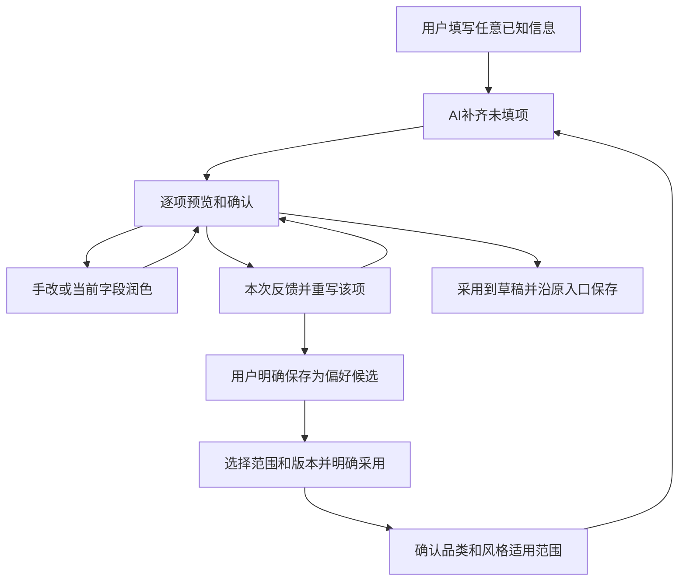

## Context

商品配置和三列镜头台已接入本机，improve-product-keyframe-preproduction 保持12/14，图片确认未完成。本次新增共享AI表单辅助，不更改那一需求的历史状态。现有文字正文AI编辑已采用“建议→明确采用→保存Master”，但接口与正文结构绑定，不能直接服务普通表单。

当前已有 CreativeIntentEditor/creative.intent.v1、版本化Brief/Master、模型登记与用途路由、LLMRun，以及有项目/角色作用域的Capability Memory。登记路由上限目前7，provider ROUTE_KEYS列表亦需同步；不另建模型供应商配置。现有capture-preference需要多份已保存Master，不能伪造这些证据来记录一次表单修改。

## Goals / Non-Goals

**Goals:** 任意已填信息驱动补空白；每项可确认、手改、润色和反馈重写；固定浮窗跨已接入表单复用；两种功能分别配置模型；明确反馈形成可追踪的改进依据。

**Non-Goals:** 首版不自动微调模型、不自动改Skills或Persona、不做投放分析或自动模型竞赛；不自动生成媒体、选择关键帧、确认权利或发布；不把网站所有DOM输入无差别发给模型。本轮接入商品创建、商品任务书、视频制作台的内容字段，其他业务页面可按同一注册合同后续接入。

## Decisions

### 1. 补空白，不要求先填完整意图
用户可从商品说明、买家、场景、核心理由、参考资料等任意部分开始。已有非空值（含默认值）不覆盖；null、空字符串/空白、空列表可作为未填，0和false不是空。用户明确跳过/不适用的项不反复补齐。创作意图整个区块始终排除批量写入；已有意图参与约束，缺失意图不阻断。没有任何实质信息时提示提供商品说明或一个目标，不猜测商品。输入互相矛盾时列出需要用户决定的冲突，不擅自改已填内容。

商品创建使用现有objective/primary_audience，视频使用已有creative.intent.v1，不再新造一套意图字段。第一次生成不锁死质量标准，用户可修改后再补齐剩余空白。

### 2. 一套浮窗，两种动作
浮窗固定在视口边缘、可收起；小屏呈底部面板。显示当前页面/镜头/字段名。用户聚焦注册字段时记录稳定字段键和选区，点击浮窗后不因失焦丢失目标。当前字段有内容时润色，空字段可生成该项草案；有选区则只改选区，否则处理该字段。切页面、删镜头或原文变化会使旧建议失效，不能写到新位置。用户主动选择意图字段可润色，但只作用于当前项。

“补齐未填项”先展示待处理范围，再生成同一批建议，逐项显示现值、建议、依据/待补资料；提供采用并下一项、手动修改、润色、反馈重写、跳过、返回上一项。不会先静默填满表单，也不强迫逐栏必填才能使用后续功能。确认写入页面草稿，Brief/Master仍走原保存入口；显示未保存状态。

### 3. 全字段按含义适配
| 类型 | 行为 |
|---|---|
| 创作文字 | 场景、购买理由、顾虑回答、CTA、脚本、镜头目的/动作、图像/视频提示词、后期反馈等可生成/润色 |
| 商品事实与数字 | 只从用户资料和允许引用的证据抽取，附精确来源；缺依据标待补，不估造规格、价格、服务和实测结果 |
| 目标参数/已有选项 | 时长、景别、素材分类等按合法类型和真实选项提出建议；真实素材/音色/模型ID仅从已授权目录选择，需人工采用 |
| 内部经营 | 不进入批量广告生成上下文；已有数值保留，缺失数值提示补资料。金额不做文风润色；估算继续走原算式 |
| 素材与权限操作 | 文件上传、选图确认、权利声明、任务状态等不属于文字生成；沿用人工操作，不用AI建议代替 |

网页视频提示词继续要求精确已确认图片，未选图先建议分镜/图像描述并标出依赖，不能提前生成可执行视频包。

### 4. 受控字段注册与共用接口
前后端以surface+stable field key定义类型、长度、可编辑性、事实/意图区分和合法选项；表单控件通过已有onChange更新，不靠随意修改DOM。镜头使用shot_id，不能用可变行号当字段身份。

建议接口接受已填快照、空白目标键、当前版本/哈希、所选资料引用和方法版本；服务端独立核对目标白名单、项目访问、资料使用权限及输出类型。响应按字段返回建议/待资料/依赖/错误，部分不可生成不丢弃其余结果。整页快照不包含密钥、内部成本或无关字段。对未保存的创建弹窗使用当前用户的草稿会话；不能强制先创建项目并启动Run。

每次采用核对原值和请求上下文；生成中用户补填过的字段不能覆盖，依赖上下文改变则重新核对后再生成。网络超时先读取原请求状态，明确重试不重复启动隐形任务。所有LLM输出按不可信数据校验，不执行来源内指令。

### 5. 反馈闭环与可持续改进
| 操作 | 记录与作用 |
|---|---|
| 这次改一下 | 可选原因：事实不准、太空泛、购买理由不清、风格不合、太长/太短；加自由说明，针对该项重新生成 |
| 采用/手改/跳过 | 记录动作和最终采用内容，手改不自动表示不满意，采用不自动表示高质量 |
| 以后也这样 | 用户确认一条清楚的偏好规则，先存现有Capability候选；默认当前项目，无项目时显式选作用域，不自动扩到全角色 |
| 使用偏好 | 沿用明确选择精确版本、渲染和开关；“保存候选”和“本次/后续采用”分开，角色默认另行明确保存 |
| 比较改进 | 原建议、反馈、新建议和采用结果可回看，保留模型/提示词/方法版本；版本对照可在相同输入下人工判断 |

单个owner-scoped FormAssistanceSession记录surface、可空project/unit、输入上下文哈希、字段项、LLMRun引用、逐项状态、反馈/尝试关联和并发修订号。新增一张表是为了保留刷新后的确认进度和真实反馈归属，不建立第二套Workflow。原输入/输出尝试保留；采用是本地草稿动作，记录区分“采用意向”和“已由原保存接口落库”，不得伪称已保存。内部成本不进入该批次上下文或公开偏好。

质量提升依靠补证据、明确反馈、少量已确认的规则与好例子、版本对照；不会因为点击次数或模型自评分自动推广方法。偏好不能把未经证实的商品事实变成证据。

### 6. 商品方法、品类、风格和具体商品分开

“商品创作”是创作类型；“电子产品/家具→充气沙发”是商品品类；“硬核演示/生活情境/简洁商拍”是表现风格；具体款式、价格和资料属于当前商品。品类与风格是不同维度，同一品类可选多种风格，同一风格也可在明确适用的多个品类复用。

| 层次 | 保存什么 | 示例与边界 |
|---|---|---|
| 商品通用方法 | 购买理由、证据区分、外观一致性、先关键帧后动态、后期流程等阶段方法 | 通用方法按现有开关选用；事实与权限合同始终有效 |
| 品类方法 | 该类买家的典型问题、应检查的资料、适合的展示方法 | 电子产品关注接口/兼容/真实操作；充气沙发关注使用场景、实际尺寸、与该款有关的准备/收纳证据；检查项不等于商品已经具备功能 |
| 表现风格档案 | 语言、叙事、画面、镜头、节奏、声音及各阶段方法版本/开关 | 同为充气沙发可用“户外松弛”或“居家温暖”；风格不是品类，也不是创作者身份 |
| 当前商品项目 | 具体型号、素材、参数/价格/来源、已确认商品专属偏好 | 当前沙发的尺寸不能成为“全部沙发”的事实；首版当前商品对应当前项目，不新增SKU库存系统 |
| 本次内容 | 当前受众/目标/意图、选用风格、单次调整与反馈 | 本次快节奏试验不自动变为角色或品类默认 |

商品风格可以类比角色的创作风格配置：它组合每一阶段的Skills及参数，但不复制Persona身份、账号、人物经历或独立执行系统。现有Persona继续表示“谁在创作”；产品风格表示“这件商品此次怎样呈现”。Persona的固定事实/声线/限制和所选商品风格如有冲突，呈现差异由用户选择，不暗中覆盖。

**页面承接**：商品资料新增“商品品类（可细分）”及“表现风格”选择，可先留空，由AI提出分类/风格建议后确认。选中风格显示简介、适用品类、参考例子（如有）、按阶段列出的方法与开关；确认应用才写入当前配置。用户仍可逐阶段调整。风格选择与既有创作意图同属人类选择，不被后续补空白静默替换。

**最小存储**：品类标识/名称及选定风格的精确Capability版本引用沿现有product_context持久化；可复用风格与品类方法沿CapabilityArtifact的结构化内容表达适用标签和阶段组合，不另建角色库或电商品类后台。标签用于匹配和展示，不充当权限作用域。已有owner/project/persona归属和明确范围扩展规则继续生效。已保存的商品风格版本映射到原ProductionStages；只有启用且明确选定的阶段方法进入生成，关闭后不由“通用层”悄悄补回。每次请求冻结实际选中的方法/风格版本，旧执行不改。

普通“这次改一下”不要求用户重复选择分类或范围，默认只作用本次。只有选择保存复用时才展示并确认以下两个维度。

**反馈有两个明确维度**：
- 改什么：商品事实/资料，品类展示方法，语言/视觉/节奏风格，某一阶段的操作方法。
- 用在哪里：仅本次（默认）、当前商品项目、当前品类、所选风格；商品通用方法属于更广范围，需用户明确选择后才保存候选。

品类/风格是适用条件，项目/Persona/owner是所有权及共享范围；两者分别保存。助手可以建议反馈的归类，但保存前展示完整范围，例如“充气沙发 × 户外松弛 × 镜头规划”；用户可以更改。“这个尺寸错了”提示修正当前商品资料，不形成风格规则；“开头先交代使用场景”可经确认形成品类/风格方法候选。保存候选不等于自动启用，后续通过版本选择/配置确认应用；不把销售事实或单件商品证据扩散到品类。

浮窗的“本批反馈”只重写仍待确认且目标仍为空的建议；已填写、已采用和已确认内容继续保留。若用户要修改它们，使用明确选中的单项润色或重写。

### 7. 商品视频素材导演 Skill：图片与据图视频统一负责

用户强调图像准确性和图生视频提示词是素材质量核心。对外提供一个“商品视频素材导演 Skill”承接单镜头素材制作；内部组合明确选中的商品真值/视觉一致性/镜头设计/视频审查方法。它负责图片与该图片对应的短视频素材，不包办整条内容的配音、音乐和Resolve/AE剪辑。继续复用video-production-handoff的精确版本、人工网页生成和回传合同；本轮仅设计，现有Skill尚未新增此完整编排入口。

| 环节 | 该Skill的职责 | 用户可审阅产物 |
|---|---|---|
| 镜头意图 | 从购买理由、品类/风格和分镜明确该镜头要说明什么 | 镜头目的、证据边界、所需真实素材 |
| 起始图片 | 基于真实商品参考规划/制作关键帧；审查外观、颜色、比例、构图、细节及运动空间 | 候选图片、来源和准确性/视觉质量检查，供用户选定 |
| 据图动作设计 | 查看精确选定的实际图片，区分画面已有内容与希望发生的变化 | 可执行的单镜动作、景别、运镜、节奏，不要求模型一次完成复杂操作 |
| 图生视频提示词 | 将镜头目的转成保留细节、主体动作、镜头运动、光线、时序及约束；区分图片提示词与动态提示词 | 同一图片版本绑定的Grok或Gemini提示词、画幅、请求时长、声音意图、参考图下载 |
| 人工生成与回传质检 | 等用户网页生成并回传；实际检查商品一致性、变形/穿帮、动作、稳定性、声音和可用片段 | 具体问题/时间码、可用范围、接受或重做建议，后续明确采用 |

图片审查分“商品准确性”和“画面/运动适合度”，美观不能抵消货不对板。真实参考看不到的结构不能靠生成图认证；缺必要参考时标出缺口。没有外部视频结果前只能评价提示词的明确性和可执行性，不能宣称生成质量已验证。即使图片和提示词通过审查，返回视频也必须实际检查。

**上下文绑定**：单镜Skill输入包括准确商品资料与证据、选定品类/风格和启用方法版本、镜头目的、精确图片revision/hash，以及请求的目标平台与参数。正式据图提示词必须基于实际图像检查。仅文本模型或仅文件名/图片描述不构成看图；调用现有图像理解能力或支持图像输入的已配置模型，并记录实际看图方式。若当前路由不支持且无可用看图能力，明确提示配置/补齐图像观察，不能冒称完成。不得凭Grok/Gemini品牌假定网站支持某个参数，输出用户可核对的请求目标。

**产品承接**：三列制作台保持布局，左栏增加关键帧检查和用户选图状态；中栏提供“根据这张图生成视频提示词”，显示绑定图片、动作设计及提示词审查结果；右栏回传后展示视频问题、建议剪入片段及反馈。所有采用沿用原确认和Master保存，不自动批准图片/视频。更换图片使旧动态提示词和对应审查变为历史；新提示词必须按新图重写或复核，不只替换hash。

**失败反馈归因**：区分原图不准确/不适合运动、动作或运镜不可行、提示词含糊、网站生成没有遵从、片段剪入选择不当。不预先认定都是提示词问题；保留图→提示词→返回视频的版本关系。只在用户明确复用时，将实际验证后的修订提炼为某品类/风格/阶段的方法候选；未验证改法不能标成成功经验。

**实现复用**：该Skill通过现有平台CLI/MCP与人工交接执行。方法定义与精确版本可由平台所选能力包交给Codex等Harness，平台模型辅助读取同一选定方法，不暗中加载全部Skills。生成图片仍走已存在的图像能力，Grok/Gemini视频仍由用户手工生成。不开新浏览器自动生成链路，不新建第二套媒体任务。通用浮窗仍可润色该提示词，但润色会触发既有重新确认，不能绕过看图、图像绑定与质量审查。

### 8. 两项模型设置
使用form_autofill（表单自动补齐）与field_polish（当前字段润色）两项用途，分别可选已登记文本模型；未指定时明示继承全局默认。更新登记允许用途/数量、provider路由列表、设置投影及前端名称。保存配置不调用模型；实际请求回执显示真实厂商、模型与配置版本。明确选择失效时展示错误，不静默换模型冒充原选择。

## Risks / Trade-offs

- 已填文字可能只是想法而非事实 → 标注用户提供/来源证据，不自动认证。
- 点击浮窗或异步返回配错栏位 → 稳定字段键、上下文哈希、明确目标名称和采用前校验。
- 新偏好互相矛盾或跨角色污染 → 明确版本/范围/选择，用户本次填写优先；冲突提示而非暗中合并。
- 未保存草稿与服务器已保存内容混淆 → 恢复候选进度，核对基线；原保存成功后才标落库。

## 素材生成流程

## Migration Plan

用户确认后先在隔离库完成一张加法会话表及权限验收，复用既有模型与保存机制；不修改旧Brief/Master/Attempt。上线前备份、最小集成与本机回读；回退入口代码时保留新表记录。验证不新增持久测试代码，沿用既有检查和临时隔离探针。

## Open Questions

无阻塞设计问题。待用户确认本提案范围后实施；具体模型可在新增设置中选择，本轮不代改正式模型配置。

## 流程

