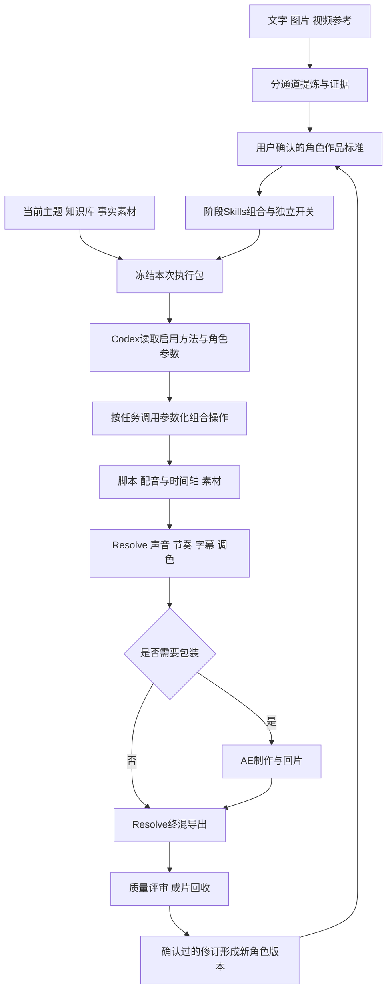

## Context

当前 checkout 为 main@49e4fdc（2026-10-16读取），包含大量相邻未提交修改。本轮仅形成方案，不改变运行服务、业务数据、既有 Skill 或全局安装。来源核查与候选比较见 research.md。

已有 persona-creative-configuration 定义版本化的四模态 profile 和 whole-profile replacement；studio-creative-skill-pack 区分内置、方法库、外部 Agent Skills。Creative MCP 的 find_capabilities/use_capability 能读取精确方法版本并记录使用，但不安装、批准或执行外部脚本。本设计在这些职责之上补齐角色参考提炼与阶段组合。

## Goals / Non-Goals

**Goals:** 科技角色具备经用户确认的文风、画面语言、视频表达标准；可选择阶段方法并实际传到 Codex；用不同主题验证可迁移性；声音、节奏、调色和包装均有独立方法与质量回执。

**Non-Goals:** 本期不训练模型、不保证复刻原片、不新增全自动网页生成、不接入第二套 NLE、不改平台为 AE/Resolve 执行器；生活角色和数字人生成只保留需求记录。

## Decisions

### 1. 三层角色资产，复用现有模型

1. **作品标准**：角色定位、证据习惯、文本/视觉/视频风格、正反例与用户修订，保存为带来源的 Style Preset / Capability Memory revision。
2. **阶段方法组合**：共享 Skill 引用 + 角色参数/参考 + 阶段顺序/开关。无需每个角色复制一整套上游仓库。
3. **作品评审记录**：记录哪项方法在哪类作品有效、用户采纳/否定了什么；一次反馈不自动升级成永久规则。

Persona 默认随现有 IdentitySnapshot 冻结；Account/Series 继续 whole-profile replacement。项目的阶段覆盖仅影响该项目，不能反写角色或其他项目。不存在与现有 recipe 并行的新 DAG 引擎。

### 2. 参考提炼是有证据的创作配置，不是模型训练

| 通道 | 提取内容 | 保留证据 | 不直接继承 |
|---|---|---|---|
| 文字 | 视角、结构、句式、术语解释、论证、开头结尾 | 原文段落和样本范围 | 参考作者身份、经历、旧事实 |
| 图片 | 构图、字体层级、色彩、材质、信息密度 | 原图与区域说明 | 商标、人物身份、无权复用的素材 |
| 视频 | 叙事、口播/录屏/B-roll比例、镜头语法、字幕、声音策略 | 时间码、帧、逐词稿，观察与推断分开 | 原片具体结论、作者声纹、固定镜头时间线 |

Hypit 的 reference-video 方法与 media/transcribe 命令作为可选本地分析候选。分析文件可转换到现有方法资产；不需要引入其 SVML/SVS/SVRUN 渲染体系。程序能抽帧/定位/转录，语义解释仍由模型与人判断；图片风格和文字风格不能假设由 Hypit 一次完成。可见但未试听的声音只记录未知，不猜 BGM 类型。

样本不足时产出可用但明确的暂定规则，不设置固定数量门槛；补充样本/用户修改后形成新 revision。先让用户确认可读的风格卡，再用于新主题生成，不直接替换现有角色默认。

### 3. 十阶段呈现，阶段内允许多个方法

| 阶段 | 正常输入与输出 | 候选方法/执行 |
|---|---|---|
| 1 选题与证据 | 主题、Obsidian与外部资料 → 观点/事实包 | hv-analysis 按需深研，ljg-read/explain 辅助 |
| 2 文案与脚本 | 事实包+角色标准 → 正文/口播脚本/视觉意图 | 去除作者身份后的 khazix-writer、Humanizer；公众号才启用 WeWrite 渠道方法 |
| 3 配音与声音准备 | 批准脚本/原录音 → 修正的旁白、词级时间轴 | 现有 MiniMax 角色音色；lanshu 对齐/讲解方法；真人素材才启用删词 |
| 4 分镜与素材 | 真实音频+视觉意图 → 镜头表/静帧/录屏/素材 | shotcraft 少量镜头、按需 Paper-Cut；图片确认后网页视频提示词 |
| 5 声音粗剪 | 原片/旁白/候选音乐 → 可听的声音主线 | Resolve；修口误、留语气、可选场景BGM/音效 |
| 6 画面粗剪与节奏 | 声音主线+镜头表 → 粗剪时间线 | Resolve；逐词/句意锚点，内容可读性优先 |
| 7 字幕与校色 | 锁定粗剪 → 字幕/匹配曝光白平衡的画面 | Resolve；字幕跟随同一剪辑映射，不重新估时 |
| 8 后期包装 | 指定镜头+角色视觉参数 → AE合成/渲染片段 | 现有 AE MCP；不需要包装则跳过 |
| 9 终混与导出 | AE回片+主时间线 → 成片/原生工程 | Resolve；复核混音、帧率/色彩/Alpha回片设置 |
| 10 质量评审与回收 | 成片/工程/证据 → 评审和平台素材 | 技术检查+创意质量，明确AI与人工检查范围 |

阶段是产品可见的工作步骤，复用现有 Recipe Stage/执行交接，不要求十次模型调用或十个新数据库实体。按作品跳过无须步骤；研究、精修等方法不强制每次都用。文案可先有视觉意图，最终镜头时长以修正后的音频为准。

原文档中的固定镜头秒数、统一响度值及“零版权风险”不能直接变成平台规则；时长/声压以当前作品目标与实际素材为准。音频先行适用于本次口播讲解路线，不扩展为所有广告作品必须采用的统一规则。

### 4. 开关必须改变实际任务输入

每项引用复用原有 inventory kind、稳定 ID、revision/version/hash，增加阶段范围、顺序、enabled、参数与来源说明。阶段总开关关闭时保留选择但不向本次执行注入其创意指令；角色身份与知识边界继续存在。无启用方法时由模型根据已确认角色和任务生成，不根据模型名字自动开关。

有效预览显示来自 Persona/Account/Series/项目的最终选择。冻结包仅携带启用项及其必要引用，同时记录禁用项 ID；Agent 回报实际加载/适配版本。界面开关不等于全局卸载 Skill，不修改用户 Codex 全局配置；受管任务须显式遵守本次清单，无法隔离默认自动触发时不能宣称开关验收通过。

方法文件不是执行权限。现有 MCP 继续负责读取和回报；平台领域 UI/API 负责配置、准备、接受和保存，Codex 操作平台仅 CLI/REST/MCP。

### 5. 方法移植不是工具名替换

将镜头配方拆成视觉目的、素材/图层、运动轨迹、锚点、持续/退出方式、声音提示和参考帧，再映射到 AE 参数/关键帧。先做三类小样：录屏局部强调、分层关系图、标题/数字揭示。逐项比较参考效果与实际渲染，再扩大库。

MCP 负责调用专业软件；必要时 Agent 通过 MCP 提交 ExtendScript/Python，用户不写代码。不能承诺“完全没有代码”或任意 Remotion spring/CSS/three.js 一比一转换。Premiere 方法只迁移剪辑意图和检查办法，不建立 1027 个工具名映射表。aftr 的预设与渲染复核循环可参考，现有 AE MCP 保持不变。

保留原始音视频及剪辑决定，以 source in/out 与词/句锚点产生编辑映射；变更配音或删句后字幕、图层、音效共同更新。AE包装发生在粗剪锁定后，输出经 Resolve 回收核对，不能用全片扁平化导出冒充可编辑主工程。

2026-10-16补充选型：优先参考yumehiko的声明式场景装配与局部修改、odaiouattara的Resolve脚本组合、ChaiWithJai的语义剪辑/声音/校色/交付方法。形成“创作判断→参数化组合操作→现有MCP执行”的适配分工；方法与角色参数保留，Remotion/HyperFrames调用及项目结构按需重写。已有AE工具目录提供保存和重放接口，优先复用，当前不新建完整场景编译器。

每个组合只封装本期实际使用的连续动作，约定精确输入、可调参数、输出和回读验证；画面效果仍通过实际小样比较。上游鼠标教程、静音间隙报告和固定音频参数不得直接标成可执行自动化。Resolve声音插件等未查明的脚本能力单独记录，不以有MCP推断全部操作已支持。详细取舍见research.md补充节。

### 6. 音乐属于场景资产

扩展既有音乐素材元数据：场景、情绪、能量、器乐/人声、节奏（未知可空）、可循环、时长、来源/许可。标签可改并保留修订记录；历史执行仍指向原素材版本和当时选用依据。Agent 按当前场景和旁白选择，输出曲目/片段/混音说明，允许不选。

首批整理少量“解释铺底、演示推进、轻悬念、收束”候选，不按角色各复制一份音乐库。先使用用户可用素材或逐曲可验证的来源。shotcraft 源文档承认部分曲目无法反查及部分 SFX 来源待考，不能整包导入后宣称可公开使用。采用已有音乐引用和轨道能力补交接，不建设音乐生成平台或新的搜索服务。

### 7. 先小样选法，再完整作品

固定主题、事实材料、角色配置和模型，比较无附加 Skill、单项、组合的正文与代表性镜头。评判内容准确、可理解、风格一致、字幕可读、声音舒适、画面对句意的帮助以及制作时间/返工。不同模型输出是另一项变量，不混进同次 Skill 对照。

随后以未参与风格提炼的新主题完成科技作品，核验正常页面设置 → CLI/MCP执行包 → Resolve/AE → 成片回收。检查实际 MP4、音轨、首尾与切点、原生工程可重开。能读ASR/测响度不等于实际试听；用户审美确认与技术通过分列，未通过不写为角色标准已定稿。

## Risks / Trade-offs

- 第三方默认身份/强风格与用户角色冲突 → 优先用户角色；移除参考作者人设，保留来源与修改记录，避免多个写作Skill同时互相改稿。
- 开源项目许可证不同 → 候选登记和实际复用分开；talkcraft/dbskill 暂不进入商业工作流；营造暂无许可不复制；Hypit按其组织内部使用条件试验，不默认对外SaaS授权。
- 外部运行时隐含安装/更新/云端发送 → 阅读文件与执行分开；适配版本固定，不继承自动安装、自动升级、推广或发布动作。
- 参考片含录屏与真人，而样片只有AI视频 → 以真实演示/解释画面为主；数字人未就绪时明确缺口，不用无关B-roll假装同等效果。
- 并非所有AE/Resolve操作均通过当前MCP暴露 → apply时做窄范围能力验证，失败明确报告并调整对应镜头；不暗换渲染引擎。

## Migration Plan

优先复用现有版本化JSON和素材元数据，仅确需字段时做加法迁移；先在隔离副本跑通，再按批准范围接入本地正式配置。旧profile缺少阶段Skill字段时保持原行为。新配置发布为新revision，回退使用上一版本；历史包、角色、素材原件与已归档change保留。不新增push或公开发布授权。

## Open Questions

本提案等待用户确认范围。商业限制候选暂不作为依赖；不要求用户现在采购授权。科技文字/图片样本可先沿用现有已接受作品和知识库明确标记的风格材料，作为暂定标准；用户给的参考视频仅贡献视频表达，不自动推定全部文风与视觉规范。

