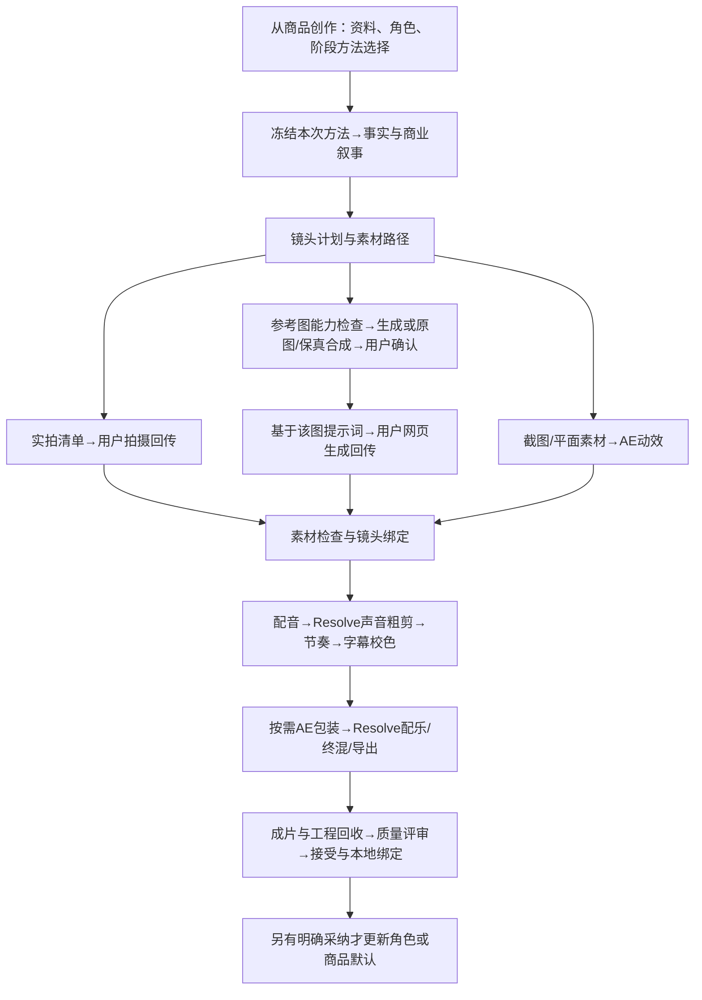

## Context

方案修订v2已获用户明确确认并实施；2026-10-16真实单图样片及正式回收已通过。

main@4a1f212已有科技角色十阶段/十二方法、图生视频人工回传和AE/Resolve原生交接；正常商品入口属于相邻未提交工作树，因此本次纯候选只提取其必要前置，并原样保留已应用迁移ID链，排除日批运行/调度与栏目改动。相邻工作区修改保留。此次新增商品方法与适配，复用既有角色、任务书、Recipe、CapabilityMemory、production_methods和edit_manifest。

## Goals / Non-Goals

**Goals:** 六组来源映射为六项专用方法与现有后期方法的商品适配；可视选择/启停；正常商品入口到原生工程和成片回收可验收。

**Non-Goals:** 本期不安装上游完整运行时，不增加发布/批量经营/数字人引擎，不迁移全部镜头库，不重做平台编排。保留现有人工网页视频分工。

## Decisions

### 1. 商品任务叠加在角色风格上

商品不是第三个Persona。选择现有角色，继承其身份/风格；在“从商品创作”的首次启动之前选择商品方法，保存为本次项目/Run的候选组合；后续执行阶段覆盖继续复用同一组版本。当前商品启动代码会直接启动首阶段且传空stage_override，故只在后期交接选择方法不够。实施必须把选择在Run首次冻结前写入现有项目/Run配置，并在阶段解析和后续CreativeExecution中传递；身份快照保留Persona风格与来源，增加任务覆盖来源的明确记录，不能临时改全局Persona。首轮预览、真实执行、重试恢复和后期包的选中方法hash必须一致；生成后修改选择形成新Run/任务，不修改已派发输入。无需为了商品覆盖科技通用默认或生活默认。关闭可选方法后不注入该方法，资料、权限与输出技术合同仍在。已有账户/栏目显式覆盖继续有效。

### 2. 六项独立方法，多方法按需组合

| 方法 | 现有阶段 | 输入→输出 |
|---|---|---|
| 商品事实底稿 | research | 商品任务书/来源→SKU、规格、已知卖点、价格及有效期、证据/未知 |
| 带货叙事 | script | 事实+角色+受众/目标→开场、演示、解释、CTA与逐镜文案 |
| 商品视觉与一致性 | storyboard中的AI规划/外部素材制作 | 原图/品牌/尺寸→身份锚点、主视觉描述、跨图检查；不直接注入确定性图文合成节点 |
| 素材与镜头路由 | storyboard | 每镜表达目的→实拍清单、图生视频计划或AE动效任务 |
| 产品演示动效 | packaging（Codex外部执行） | 实物图默认用焦点/材质细节/标注；仅软件商品且有真实状态截图时采用光标/界面演示 |
| 促销价格动效 | packaging | 已核实价格/币种/条件/时间→AE价格划线、折扣与CTA合成；无促销则跳过 |

配音、声音粗剪、画面节奏、字幕校色、终混及评审复用现有方法；不要新增同义Skill。这里的“六项Skills”是六项可独立选择的版本化方法，实际复用一个video-production-handoff执行入口与按需加载的详细方法卡；不能仅新增六段泛泛提示词就称适配完成。每卡写适用/不适用场景、原生动作与参数、输入输出、失败退路、检查点、来源和实际验证状态。

**确定性节点与创意方法分开：** 当前stage.graphic.compose映射storyboard，stage.professional.prepare映射finish；它们要求受验证的workflow-stage-recipe/config_patch，普通prompt_skill不能当作工具配置。商品视觉方法只给AI视觉规划和外部素材制作加载；AE/Resolve方法只给外部执行加载。同一阶段下具体节点不适用的方法必须明确跳过并记录，确定性底层合同继续工作；不可把配置标记为关闭、静默吞错或塞空recipe绕过。现有十阶段枚举保持；在现有适用性解析中补齐必要区分，并覆盖图文规划→合成和视频导演准备的实际预览检查。

**方法参数与素材事实分开：** capability args只支持string/number/integer/boolean，单方法参数最多4000字节。这里放语气、节奏、展示模式等小参数；不塞嵌套offer、图片字节、来源全文或JSX/Python代码。商品事实/促销结构放版本化任务书，镜头与素材绑定放Director/MaterialRevision。可执行AE脚本保存在现有AE工具库或本地适配资源，平台存方法说明与版本引用。促销、图生视频、AE均可跳过。单张平面图的缩放/分层视差只能称2D/2.5D，不承诺真实环绕或未知背面。

### 3. 每镜选择素材路径

实拍：Codex给拍摄清单（景别/动作/光线/角度/时长/演示证据），用户拍摄回传。图生视频：检查图片通道参考图能力后生成，或使用原图/保真合成→用户确认精确图版→按图写动作提示词→人工网页生成回传。截图/平面动效：现有AE MCP生成合成。一个片可混用；缺实物资料不伪造功能证据，复杂装配可转实拍或静图讲解。

**参考图能力前置：** 本轮源码核对model_capability_routing._multimedia_controls中openai.compatible和minimax.cli声明reference_images=false；这是平台当前路由能力，不能据此推断模型所有API都不支持编辑。首版不新增图片网关/适配器：选现有已验证的参考图编辑执行通道时，必须实际传入授权图像并留输入hash回执；通道不存在或拒绝时，明确走原图/实拍/AE保留主体像素的构图合成。文生图可补背景但不替换商品身份。参考图编辑即使成功仍逐图检查，提示词不能保证一致性。保留最初真实商品图作为身份基准，已生成主视觉仅是次级风格参考；不沿着连续生成图累积身份漂移。

**来源选择与参数改写：** 实物商品视觉优先motiful的main-image一致性规则及HiAPI的hero-visual；服装multi-angle仅服装任务适用。shotcraft、chandreshpv、iart的界面动效只作按需镜头库，不把所有实物商品拍成软件宣传片。场景开场、节奏与色彩沿用角色和目标；上游Amazon白底/占比、英文词数、统一紫光等不是通用要求。未核验的转化率数字不进入自己的Skill。统一1024px/1MB、自动重试三次等网关经验不继承，按当前执行合同处理并保留原图。

**价格动效：** 现有ProductOffer只有text/checked_at/valid_until。使用促销时在同一ProductContext做最小可选结构扩展，记录SKU、来源、币种、原价/售价、条件、截止日期及时区，兼容旧自由文本。不建价格表服务，不增加批量CSV渲染。金额以核实资料为准，差额/比例用十进制按币种精度计算，“优惠20%”与“8折”分开；冲突/缺价只停促销分支，其余创作继续。仅在来源提供并核实截止日期时展示含时区的静态截止时间；未提供时省略时效与紧迫性表达，不影响已核实价格展示。不使用Date.now驱动成片倒计时，也不把固定视频包装成直播实时倒计时；交付时复核优惠是否仍有效。

### 4. 原生后期适配

| 上游表达 | 本机实现与验证 |
|---|---|
| React Scene/Sequence、CSS布局 | AE Comp/Precomp、可编辑文字/形状/素材层；分辨率/安全区/字体按本次合同 |
| interpolate/spring、transform-origin | AE属性关键帧、缓动、锚点/父子层；重新验证首帧/峰值/收尾，无直接数学等价保证 |
| 截图光标/zoom、价格数字变化 | AE独立图层与可回读属性；截图状态不冒充已实测交互；数字与币种来自冻结事实 |
| 片段时序、照片运动/转场 | Resolve显式轨道与帧区间，运动用实际支持属性或AE补镜，不能仅替换工具名 |
| 音量函数/按拍切换 | Resolve实际增益/淡化/可用包络；读回并检查输出，不把固定增益称自动闪避 |

先验证实物商品焦点标注、价格/CTA两种AE组合（软件光标演示按任务适用性额外验证，未验证不宣称完成）及照片/实拍+音频的Resolve组合。用已有MCP工具库搜索/保存组合，避免建第二套执行服务。AE编辑、保存/重开与渲染分别处理，沿用撤销组修复经验。AE中间片回Resolve主时间线终混导出；工程实际重开并检查依赖。按实际素材统一色彩解释、分辨率、帧率、像素比例与alpha，回Resolve检查文字/商品边缘、透明底和商品颜色；不套统一LUT改变SKU颜色。口播优先保证完整可懂，配乐节拍只约束有余量的画面切点。MCP文档查询仅证明接口有描述，原生小样仍须真实执行验证。

### 5. 冻结与回收沿用现有合同

商品资料保存于现有版本化任务书，引用来源/MaterialRevision；包装阶段参数保存于现有方法args或Director合同，不另造孤立事实数据库。现有快照必须携带生成所需的商品证据与价格时间；如有缺失，只做最小传递增量。沿用准备→领取→use_capability→执行→回传→评审→接受→本地主稿绑定。最终成片、字幕、编辑清单、DRP、必要AEP和中间片必须符合冻结输出合同。

## Risks / Trade-offs

- 生成素材外观/结构漂移 → 原图锚点、首帧及运动中检查，必要时回实拍；只报实际结果。
- 模型表现与方法无必然对应 → 同题比较可选方法开启/关闭或不同组合，保存评审与选择依据。
- 上游固定色彩/节奏/营销规则不适合角色 → 变为任务参数，仅加载所选方法，不原样继承作者身份/网关/全局禁用规则。
- 原生脚本接口不覆盖部分效果 → 实测后记录可用、替代或待人工，不以派发成功视为已实现。

## Migration Plan

方案确认后隔离实施，先保存Git差异/正式库和素材基线；方法采用新增版本，正式导入/角色应用通过平台CLI/REST或MCP，历史不覆盖。完成既有检查、原生小样、实际商品片与质量评审，再同步主规范归档并选择性本地提交；无push。回退仅撤本需求增量/当前默认引用，保留已产出历史。

## Open Questions

首件商品为用户提供的懒人沙发原图；16秒单图二维本地测试已完成并接受。价格、规格和公开肖像/商品权限未知，样片不含这些断言。角色默认没有改动，不将本次测试视为默认风格采纳。

方法卡v2将详细原文/hash和bounded text同版冻结；原已制作v1样片与新v2正式导入分别记录，既有工程/视频字节保持，不声称重新生成。受限final仅本地绑定免模型许可，祖先与公开Candidate门禁维持。
