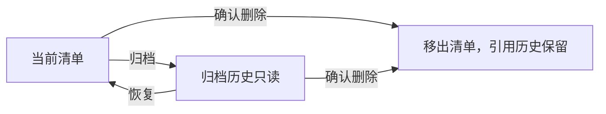

# 角色内容创作清单管理

## PRD / 需求背景

用户希望确认角色工作台能串联使用，并给内容创作清单增加类似任务管理的归档与删除。流程只读体检见 [review.md](review.md)。

## 当前阶段与已完成

2026-10-18：8/8完成，归档/恢复/删除已在本机正式工作台启用。231项既有检查、Web构建与预算、隔离API/页面操作及代码复核通过；原40内容单元与历史保全。原科技样片渠道配置阻塞与新任务全链生成不属于本次验收。

## 目录结构

- proposal.md：范围与能力
- design.md：操作语义、兼容与迁移
- specs/persona-creation-list-lifecycle/spec.md：验收合同
- tasks.md / task_plan.md：持续实施清单与计划
- progress.md / findings.md / review.md：进度、发现与检查证据

## 关键设计决策

归档可恢复；删除经确认逻辑移出当前和归档清单，保留项目、共享素材与被引用历史。操作作用于单元；旧身份替换历史不自动恢复。旧 DELETE 合同保持兼容。

## 代码位置与版本

HEAD 8539806eb3a1bebf5bf71ee08df3a286cdf9e00a 加未提交工作区。主要相关位置：apps/web/src/product/ProductionQueuePage.tsx、ProductionWorkspace.tsx；apps/api/app/routers/content_projects.py、product_skus.py 及 ContentUnit 模型。本轮未提交的实现范围与前后SHA见 implementation_manifest.json；基线来自已备份工作区，相邻改动保留。新增迁移unitlife000001，正式runtime仅同步REQUIRED_SCHEMA_HEAD；API/Worker按原launchd重载。

## 待完成 / TODO

本需求实现与验收完成，无待办；不包含回收站、媒体物理清理和新任务真实全链生成。归档路径：openspec/changes/archive/2026-10-18-add-persona-creation-list-lifecycle/。

## 依赖与启动方式

沿用项目现有 API 8000、Web 5173 与数据库启动方式，参见根 README；不新增依赖。规范检查：`OPENSPEC_TELEMETRY=0 openspec validate persona-creation-list-lifecycle --type spec --strict`。

## 使用与备份

角色内容工作台→内容创作→作品右侧“更多”：归档或删除。勾选“包含归档历史”后，新归档作品可通过更多→恢复。删除需确认，只移出清单，项目/共享素材/引用历史保留。运行中或unknown任务先通过既有执行流程处理。

备份位置：`backups/persona-list-lifecycle-20261018-194534/`，详细验收见review.md。没有归档/删除用户正式作品，没有push或公开发布。

