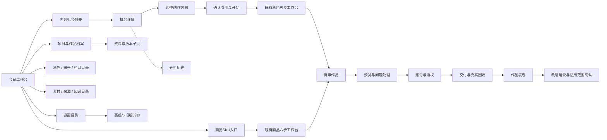
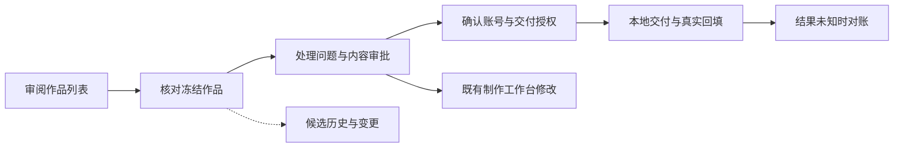
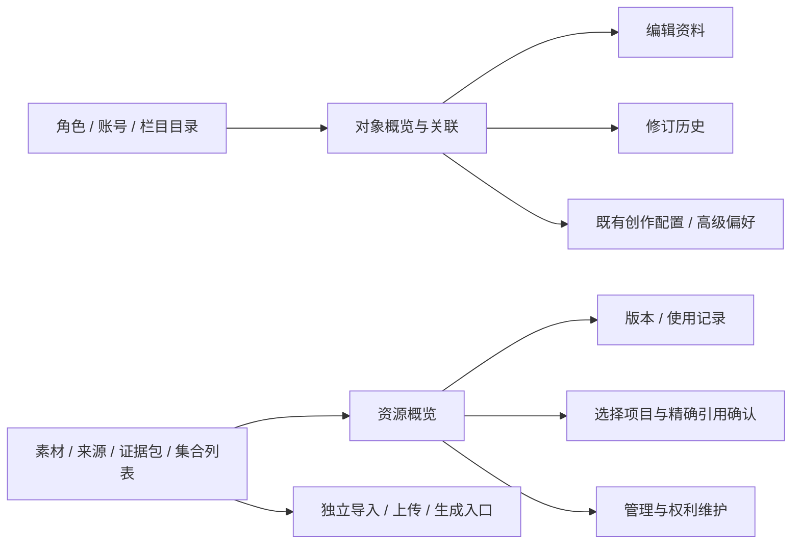

## Context

现有App.tsx有10个主导航项和多组兼容路径。已存在分页、页签和角色/商品分步页，不能泛称全站没有流程。问题是日常与管理、概要与高级操作层级混杂。依据NorthStar V2第6/17节及align-creative-orchestration-product设计第16/17节：项目仍是业务容器，原型只调整用户任务组织。

## Goals / Non-Goals

**Goals:** 全路由覆盖盘点；可操作原型确认主导航、内容机会主链及其余模块的列表/详情/编辑关系；手机和桌面可用。

**Non-Goals:** 不接业务API，不改数据库/评分/模型/调度/权限/发布逻辑。不重做已优化商品六步与角色五步内部；不把不同业务强行放进相同向导；不替代全部专业编辑器。

## Decisions

### 页面组织
主导航按日常工作（今日、机会、角色创作、商品视频、审阅交付）、长期资料（项目档案、角色与账号、素材知识、效果复盘）、系统设置分组。项目只展示归档/管理入口语义，仍保留进行中项目，不能把项目概念移除。当前制作中作品从工作台继续，项目用于跨形态管理、来源和版本追溯。

### 页面职责
- 列表：选择对象、筛选、分页；新建/导入进入独立页。
- 详情：当前结论、状态、主操作；历史/高级信息折叠或独立子页。
- 连续任务：分步URL，展示已确认/待处理/受阻，返回不丢草稿；浏览步骤不代表完成。
- 独立资源：局部页签而不是伪造线性完成进度；实体表单按职责分开。
- 每页一个主要操作；危险/高级操作有明确入口，不重复显示在每一块。

### 内容机会（首个深度原型）
列表选择角色和可用机会；详情分为“为什么值得做”“建议怎么做”“参考来源与缺口”；不直接显示JSON、hash、内部ID。来源仍需逐条查看原文，事实缺口不隐藏。详情→调整创作方向→确认使用资料→模拟进入既有角色工作台；创建预览明确角色/形式/标题/选中依据，提交只模拟。已有项目走继续创作；状态不满足不能冒称已生成。分析记录单独查看版本和变更理由；默认展示最新结果，历史只读。自动评估状态源于真实来源与运行状态，不能固定写自动不可用，也不能把手工修正说成模型重评。开页不会重新生成；当前后端无通用重评链时不能暗示已实现重试。

### 其他模块
见module-audit.md。审阅交付分“核对作品→处理问题→确认账号与授权→交付回填”，内容通过与公开发布不同。效果复盘分已发布作品、单作品表现、改进建议、确认适用范围；零数据不补造，长期方法需明确采用。角色/账号/栏目是不同实体入口但原继承关系保留；商品不强制绑定角色。设置已有模型分区保持，只做分组目录与返回定位。

### 原型约束
静态演示数据，常驻“交互原型·模拟数据·不写正式系统”。任何保存/创建/批准/导出仅更新本原型状态并提示模拟；不可伪装后台成功。提供空/失败/待分析/已有项目等机会状态。页面可分享hash和浏览器前进后退，允许检查列表分页、返回筛选、草稿跨页保存。原型内关闭/刷新丢失策略必须有说明。保留已优化工作台用边界占位说明，不复制假生产功能。

## Risks / Trade-offs

- [全站原型被误当正式接入] → 常驻模拟标识和所有写动作明确文案；业务代码零改动。
- [过度分页导致频繁跳转] → 列表与详情分开，仅复杂任务拆步骤，小型说明就近折叠。
- [隐藏重要风险] → 当前阻断原因和资料缺口仍在主内容；只折叠技术细节。
- [改坏已有稳定流程] → 盘点标注保持/整理/兼容；正式阶段逐模块提验收，不一口气迁移。

## Migration Plan

本轮无迁移。原型确认后先做机会与主页，再分模块实施；每批保留旧深链、业务实体/历史和权限，逐批数据回读与页面验收；现有未结案自然批、商品素材验收仍独立保留。

## Open Questions

等待用户通过原型确认导航分组、机会确认步骤与其他模块页面边界。未对新通用自动重评能力作承诺。

## 页面关系图

箭头表示用户去向，不代表自动执行或自动通过；审核、授权、发布回填和长期方法采用仍分别确认。

## 正式实施前的已知核对项

商品审阅账号请求当前会用null persona（见findings），需复用商品域账号目录；机会自动结果来源字段也须纳入前端类型而非依赖固定文案。列表真实分页与筛选、返回定位应使用原API与URL，不照搬原型模拟数据。当前自然批任务不因本轮页面审查而重跑。

## 2026-10-19已确认正式实施：首批主页与机会

用户已确认原型并授权本地正式接入，无需再次批准相同范围。原型部分保留作为演进背景，本节覆盖首批正式行为。

### 首批页面和原API映射
- `/home`：默认待我处理→继续创作→推荐机会三块；每块有限摘要和查看全部入口。项目活动、身份提醒以独立view子页呈现，保留所有实际问题和返回路径，不用隐藏统计代替异常提醒。
- `/opportunities`：角色/关键词/有效建议等列表筛选与分页进入URL，返回保留；当前科技有效建议跨日语义、生活日期和原状态筛选保持；自动采集状态缩成摘要，完整DiscoveryPanel放独立运行页，刷新只GET。
- `/opportunities/:id`：默认推荐详情；direction、sources、history、advanced等用URL视图分开。历史只读，技术JSON放高级详情；人工追加与来源维护继续可达，不放默认页。
- 来源正文通过既有GET /sources/:id按需读取；缺正文、读取失败、来源非文档、手动观察分开；不把annotation中的评估技术结构当正文，也不让外部javascript链接进入DOM。
- 当前评估来源读analysis_source/provider字段。system不等于模型：daily-discovery可称自动选题评估，system-*correction称系统修订，manual称人工评估，缺字段称来源未记录；无结果/请求失败按真实状态展示，不编造通用自动重评能力。
- 方向页保留项目标题、创作目标和当前角色/形态建议；新方向属于本次项目草稿，不覆盖原机会评估。不存在可保存的字段不得做成假配置。
- 明确确认“确认选题并创建项目”后，new/watching先PATCH qualified再按现有expected_assessment_revision和持久幂等key POST convert-to-project；qualified直接转换；dismissed/archived需明确恢复/只读，converted查既有关系禁止重复。PATCH或转换失败保留草稿并说明阶段，禁止后台自动重试。
- 源选择默认不选；无可绑定文档时可明确创建无来源项目，遵循既有合同。选中Source仅建立项目来源，不升级为事实/许可。
- 转换只创建项目和初始任务书，按现有合同不偷偷创建单元/IdentitySnapshot。成功进入项目总览并明确提示下一步使用既有角色创作流程；推荐形态保持suggested。

### 保存、身份与冲突
草稿使用当前用户/机会/评估版本范围的sessionStorage，URL切页与刷新可恢复；禁止跨用户或跨评估静默应用。新评估到来保留旧草稿并提示版本变化，采用前由服务409阻止；不要自动清掉输入。查询key始终包含currentUser，禁用请求缓存替代API权威状态。

### 样式与集成
首批页面按原型使用清楚的留白、标题、少量卡片和单一主操作；不全局替换既有样式，不改商品/角色工作台。保留HomePage导出的ProjectNextStageLink、ProjectOriginLink及其优先级规则，避免项目页断链。App仅在必要时补路由/导航分组，不引入重编辑依赖。

### 验收与边界
正式GET页面只读核对，所有写流程通过隔离用户/API或全部拦截的浏览器fixtures验证；不改正式沙发/拖鞋/机会。验证列表返回、来源阅读、草稿、系统修订来源、空/失败/partial、只读权限、重复转换/409与已有项目。构建及既有机会/Home检查通过后做独立代码与规范复核。原自然日批和素材成片质量仍独立进行，不因界面验收声称通过。

其他模块已获按同思路逐步调整的授权，仍在本任务清单记录后续批次；首批完成不归档整个全站change。

## 第二批：作品队列与项目入口（用户继续既有授权）

本批只覆盖tasks 5.1。复用现有API及制作工作台，未改角色五步/商品六步内部，不启动生成或修改正式资料。当前清单已含生命周期与延迟加载执行记录，必须保留。

### 作品清单

`/production?workspace=persona` 默认展示作品列表（清楚的状态、所属项目、继续创作），保留查找/形态/归档过滤与20条分页；q、modality、archived、page及view进入URL。`view=records`为独立任务记录页面，默认不加载原生/外部记录；刷新作品不得绕过enabled去加载任务。项目内嵌队列继续支持projectId，使用独立query键防止和项目tab冲突；不能覆盖workspace参数。

执行记录仍明确原生最多50条、每可见单元20条的覆盖范围，失败/unknown可见且不重发。默认作品排序保留unknown/blocked/stale优先，状态中文可读；生命周期归档/恢复/删除保持原服务、权限和历史保护。本页明确区分“继续创作”与“项目资料”，新建走项目入口。角色工作区只能显示角色域单元；项目级执行页可包含其商品单元，不要求Persona。作品列表退出到项目/制作再返回时筛选与分页仍在浏览器历史中。

### 项目档案列表与新建

`/projects`是同一主题下作品和依据的归属，不是另一个制作台；项目列表→项目总览→资料/作品/历史子页。提供名称/目标搜索、状态过滤及20条客户端分页，参数留在URL，声明范围为已读取项目。商品/角色入口指向各自工作台，不在此自动创建SKU或绑定角色。

新建项目使用`/projects?view=new`独立页面，当前用户范围的标签页草稿（标题与目标）切页/刷新保留；明确保存后才POST一次。创建中锁定，错误保留输入、失败不自动重试；viewer或权限未知不能提交。保留现有演示入口但移至低权重“演示与兼容”链接，不能伪装正式数据。

### 项目详情

保留overview/brief/evidence/assets/matrix/variants/execution/versions/activity全部旧tab深链。顶部一级导航整理成“总览 / 作品 / 项目资料 / 历史记录”，组内局部链接承接旧tab（内容矩阵仍表示作品与多形态管理，执行记录进入execution）。页面使用单独tab地址与浏览器返回，切换保留原搜索参数；不把路由分组当生产进度或强制前置门禁。

默认总览给出当前下一步（复用ProjectNextStageLink/Overview），已有单作品能一眼进入已有制作页；项目资料/共享素材/版本仍可达。编辑/归档降至“项目管理”二级入口；项目归档仍确认且只读。空项目明确“尚无作品，先确认任务书/来源，再到作品页创建”，不隐藏必要资料步骤。机会转换后的from=opportunity提示说明已创建项目/任务书、尚未生成内容，指向任务书/来源和既有作品入口。

项目资料内容组件本批不重写；新增权限读取使项目级可见写入口只对admin/editor显示，传readOnly给既有可读组件；子组件若无readOnly合同不得扩展本批去重构，而改用只读投影/阻止相应入口并保留原因，所有写仍服务端校验。部分读取失败不得显示成功空列表。细节读请求切换项目时需要取消/忽略过期响应，不让上一项目内容覆盖新页。

### 验收

真实数据GET前后回读；桌面1440/手机390看列表/新建/项目各分组/队列与记录；fixture覆盖分页返回、归档/恢复/删除、reader、无数据/读取失败、空项目、混合域、创建错误/双点防重复、项目切换；既有project/lifecycle检查与Webbuild/预算。只用临时检查脚本，不新增持久测试；规范/代码独立复核后勾选5.1。

## 第三批：审阅与交付（tasks 5.2，用户已明确授权实施）

本批复用ProjectReviewCenter和既有FE-F4 API，仅调整任务页面及必要只读投影字段，不更改审批、权限、账号校验、冻结、交付与对账合同；旧Topic审核、角色五步/商品六步内部保持。

### 页面、入口与步骤

- `/review`默认为待审作品列表，按项目/作品名称搜索、状态筛选和20条客户端分页，q/status/page入URL；Unknown优先且不能把失败当零。
- `/review?project=:id&unit=:id`保留现有深链，默认核对作品；不自动选择其它作品或修正无效ID。详情列表分开，返回列表保留筛选/页码。具体作品新增`step=issues|authorization|delivery`，默认preview；`step=history`独立候选/变更记录页。旧`candidate`参数继续精确选择原候选，v5每渠道系列当前性保持。
- 核对作品展示冻结预览、状态、当前阻断与明确下一步；没有候选时指向原制作页，旧Draft冻结放次级兼容入口。通用技术JSON/hash放折叠详情，阻断和待核对不能隐藏。生产内容修改仍回原工作台，不在审核页改冻结正文。
- 问题与审批页展示当前检查、warning处置及批准/要求修改。批准绑定精确候选ID/hash，warning不变pass，退改不改冻结内容。检查摘要可读，原始检查报告继续可查；变更比较与候选历史独立可达。
- 账号与授权页独立显示冻结目标、稳定账号、人工账号引用、动作和授权版本，只有当前已批准候选才可提交。冻结账号不可换；v5按冻结渠道过滤，失效不静默换号。商品使用自有账号目录，无需角色；历史商品仍有persona字段时按production_domain选择商品路径。不新增账号隔离规则或重写旧归属，权限/账号资格仍由服务验证。
- 交付回填页提供已有本地ZIP及回执操作，按目标独立填写回执/对账说明；Unknown要求对账，不显示可重发动作。已有official-readback保留精确Attempt/remote ID回读，浏览不执行。ZIP是本地交接、草稿回读不等于公开发布、人工回填不等于平台自动验证。

### 可靠性与权限

角色/商品以现有Unit.production_domain为权威，review projection添加production_domain只读字段（旧缺失时仅兼容persona_id为空商品，不更改历史）。用户权限未读取或失败时只读；freeze/授权/ZIP/回执按现有editor权限，批准/退改允许editor/reviewer，项目或单元归档均只读。加载失败分开显示候选/账号/记录错误，账号失败不使预览消失；禁用无法核实的相关动作。

步骤切换保留当前作品/候选绑定及草稿；输入以用户+project+unit+candidate限定暂存当前标签页，不跨候选继承审批说明/账号/回执。切换对象时清空旧展示并忽略过期响应，失败保留输入并允许显式重读；写操作防重复、不自动重试。正式数据仅GET验收，写链全API拦截fixture；不调用模型/远端发布。

箭头为可导航页面，不代表自动通过；API继续拒绝未批准授权、历史候选写入、归档操作、失效账号或未知结果重发。

## 第四批：角色/账号/栏目与素材知识（tasks 5.3，用户明确授权）

本批复用IdentityWorkspace、SystemAssetsKnowledgePage及现有子组件/API，正式接入已确认原型的长期资料层级，不改生产工作台、模型设置、继承/权限/版本/权利/引用的业务合同。不新增数据库、模型调用、自动初始化或全局自动保存。

### 身份目录与对象页面

`/identities`默认角色目录，directory=persona/account/series/brand分开列出已有角色、全部自有账号（包含无角色独立账号）、栏目、品牌；列表按名称搜索、状态筛选和20条客户端分页，q/status/page保留URL。角色卡片→概览→编辑/历史/创作配置等独立view地址；不默认打开树或编辑表单。品牌/角色/账号/栏目父子与persona_editorial/account_legacy归属在概览/关联页可追溯，不能平铺成互不相干的实体。

对象采用kind/id选择，view=summary/edit/history/creative/accounts/workflow/memory/publisher（实现可使用等价明确命名）；基础资料只读概览提供“编辑资料”主操作。编辑按原身份/表达/边界字段分组，inherit/override/clear和expected_revision原样保持；历史只读查看原修订，JSON和校验和不在默认概览。账号公开身份与实际平台登录、发布授权分别说明，publisher配置继续显式入口，不在账号列表自动调用。

`/identities?persona=:id`原制作页链接继续正确打开该角色，`/accounts`仍可到账号目录。无效kind/id或不可读对象明确报错，不自动切换到其他对象。StarterGallery与原生创作配置保持原组件，只在明确进入初始化/创作配置页加载；不因浏览目录初始化角色或保存默认。内容记忆复用MemoryPanel，增加可选readOnly参数，仅限制身份页只读维护，不重做效果复盘。创建按所选归属明确提交，独立账号登记复用现有owned channel account接口，管理员权限保持，不强迫选择角色。

权限未知/读取失败默认只读，归档及上级归档保护原继承链。各实际写入口按原服务角色执行，保存/创建防重复且失败保留输入；409保留草稿并显式核对新版本，不后台重试。身份切换或用户切换不应用过期响应，已有创作配置/参考风格的dirty保护与原组件保持。普通资料编辑离开有未保存提示，编辑页草稿仅属于当前对象；不引入跨用户/跨对象偏好继承。

### 素材与知识目录/详情

`/assets`保留tab=all/material/source/fact_pack/knowledge_collection分类；名称搜索/状态/种类/权利/分页进入URL（保持后端limit/offset真实分页），列表不同时挂载详情或生成/导入操作。选择资源进入已有resource/id深链，返回保留列表筛选/页码；无效链接、读取失败不能显示上一个资源或成功空态。默认详情为概览，精确版本/使用记录/项目引用/管理为独立panel地址。图片/视频/来源正文可按原组件明确预览，hash/原始来源结构作为技术信息展开，不隐藏权利未知/拒绝/撤销。

资源引用进入“使用到项目”单独页，优先按现有自有项目名称选择并核对，不要求用户猜ID；原ProjectReuse的精确素材Revision、冻结FactPack/checksum、边界expected_revision和显式确认原合同保留。集合只组织引用，不能当事实边界或素材许可。

导入文档/网页、上传素材、新建证据包/集合、生成预览与人工接受、公共素材搜索各自明确view入口，只有进入才加载相应工具；原`task`深链仍显示原任务，不重发/自动接受。底层SourceImport/MaterialUpload/Provider/PackBuilder行为保持。集合概览/成员/编辑管理分开，成员快照与集合revision同源校验、409冻结写入与重新读回、归档只读继续保持。默认详情不堆叠权利编辑、撤销、归档或证据包编辑器；进入管理再明确修改。

### 可靠性、范围与验收

仅改前端入口/本页展示及必要类型label，不改后端。真实正式数据仅GET对照；所有写链使用全API拦截fixture，后台测试复用既有身份/栏目/素材知识合同，不新增持久测试。1440/390布局与键盘、前后退/深链、草稿/409/权限失败、独立商品账号、素材精确引用和集合边界必须核对。已优化角色五步、商品六步与原生创作配置/参考风格组件做文件hash保留检查。

目录分区是不同资源职责，不伪装成线性制作进度；页面导航不保存、归档、授权或生成。

## 第五批：效果复盘与设置（用户已授权）

效果复盘按“已发布作品 → 单作品表现与缺失 → 同口径分析 → 改进建议与明确采用范围”组织。列表、详情、补记录、候选审核和记忆管理分别可定位；默认页面不铺开写入表单。已有 history/analysis/candidates/memory 与 published/candidate 深链兼容。指标缺失不补零，自动分析未提供就如实说明；接受候选、提升内容记忆、创建能力方法仍是独立明确决定，冻结版本与原接口不变。查看者及身份读取失败均只读。

设置默认显示六类用途目录，进入某类再显示该类工具；原始配置投影置于可展开详情。分类与分页使用URL并支持返回；模型内部三个子区、已打开组件与草稿保护原样保留，不改模型路由、登记、生成能力及商品默认配置合同。模型配置深链与旧页面入口保留。保留原离开草稿确认。

流程：`效果复盘列表 → 作品详情 → 表现/缺失 → 分析或候选详情 → 显式审核/选范围采用`；`设置目录 → 分类 → 原配置工具 → 版本化保存`。无新后端、数据迁移、依赖、持久测试或模型调用，正式数据只读验收，写链仅隔离拦截。

## 主链回归修复边界（用户已授权）
现有“明确下一步/返回保留筛选”规范适用于跨模块衔接。创作末步必须提供当前project/unit的审阅入口；审阅交付提供复盘入口且不暗示公开发布。队列/项目/主页/机会进入下游时保留可验证的本地返回路径，回退直接使用原路径，禁止外部跳转/嵌套增长。工作台制作步骤、草稿保护、模型配置与审批/授权/发布合同不重写。角色目标页链接写任务书，商品页写商品资料。

### 真实创作验收阻断修复（用户授权发现问题直接修）
真实LLM回执137出现creative_brief_inference_cannot_cite：证据简报的已存在校验规则禁止推论条目携带fact_pack_item_id，但输出提示合同未说明跨字段限制。最小修复仅补齐生成提示：inference不得带fact_pack_item_id，author_opinion保留观点归属不能冒充已核验事实；不放宽验证、不新增自动重试、不改变模型配置。保留失败attempt85与response hash，显式重跑当前阶段验收。

真实角色文字审核发现身份上下文11279字符，正文仅2694字符；无关graphic/audio/video配置使8000字符身份输入上限截断。核实其为可处置warning而非阻断；正常专用accept-result支持精确warning_dispositions。当前采用用户委托AI完整复核正文与原身份规则，保留模型partial/human_review_required，不宣称人类审核。文字输入投影属于后续可选优化，本轮不修改text_master_checks.py、不放宽限额。

真实标题阶段阻断：stage_resolver最终canonical 147519字节超过128KiB；upstream同时放入__current_master__和refine.payload，后续prompt_sections/effective_prompt再次序列化。creation_recipes.py已有精确同Master去重，但仅用于stage.master.propose。最小修复将现有去重条件扩展至stage.creative.method：正文完整保留在__current_master__一次，refine保留payload_ref、IDs/hash/lineage；不增大限制、不裁剪正文或证据。

## 角色检查截断修复（用户授权）
文字身份检查排除graphic_creative_profile、audio_creative_profile、video_creative_profile三个媒体制作配置，保留其余通用及文字字段（含未知扩展字段），不改原身份快照、正文或输入上限。身份检查实现版本提升以使旧结果失效，旧记录保留；超限仍报告partial。用同一Master重跑并检查候选/交付刷新合同，不公开发布。

## Lifestyle acceptance: identity semantic scope repair
Observed real attempt100: identity reviewer asserted sourced 2026 dates were future/fictional because it receives identity rules, not fact evidence. Add identity-only review scope: evaluate expression/role boundaries, do not adjudicate external truth solely from absent identity context; independent text_fact remains authoritative and unchanged. Version identity check3 invalidates old results. Preserve all deterministic checks and content evidence requirements. Normal editorial revision binds citations and removes unnecessary publication dates from prose, with full source provenance preserved in FactPack.

### 追加实际媒体验收修复边界（已授权发现问题直接修）
图文确定性组成器与可开关的创作方法分别承担执行和指导职责；关闭指导不得移除组成器必需的固定工具及包哈希。保留输出与引用校验、角色模型和工作台结构。
