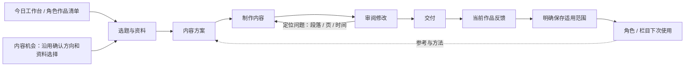

## Context

本方案基于 Easel 固定版本 `8d08b216105bd7c7057c84c97cd637cec44db609` 的研究，详见 findings.md。用户已确认以角色内容工作台为主，并要求先审阅方案。提案基线为 `main@8539806` 加现有未提交变更；工作区代码与已保存历史均不得按 HEAD 覆盖。

已有基础：角色五步入口；版本化 Persona/Account/Series 创作配置；Studio Skill、Style Preset、Quality Profile；Workflow/StepAttempt；参考风格 Capability Memory；Obsidian 选定知识上下文；Text/Graphic/Video Master，音频 MaterialRevision；原生渲染、ProviderGenerationTask 与 CreativeExecution。代码定点核对显示参考风格目前仍要求手填资源 ID/hash，且观察形态为 text/image/video；角色阶段状态有部分泛化文案。这里需要改善使用和执行质量，不需要另造工作流或第四种 Master。

本轮源码与规格核对不是运行验收。研究中八张既有卡片被上游布局算法提示空带较大，仅作为诊断线索，不推翻此前技术验收，也不把该算法当美学裁判。

## Goals / Non-Goals

**Goals:**

1. 角色参考作品、共用方法、角色风格、授权知识、分形态策划和反馈在现有产品中形成可用链。
2. 用户能看懂当前结果、待确认事项和下一步，按需要展开方法/配置；没有新一轮全页面平铺。
3. Easel 的有效方法被抽象为本地版本化方法，实际加载与产物有证据，不只登记名称。
4. 科技与生活各自通过可比较的成品质量验证，保留原模型和音色，默认风格须明确采纳。

**Non-Goals:**

- 不调整商品工作台、SKU 方法或商品实拍任务；不合并角色与商品业务域。
- 不重做今日工作台、内容机会、项目、审阅、复盘、身份目录和模型配置；仅增加本方案明确的角色子任务与定位入口。
- 不安装 Easel 全套工具、不复用上游网关、不替换现有图像/TTS/ASR/Resolve/AE 工具，不追求 114 项全接入。
- 不新增调度、自动搜源、自动整库 Obsidian 导入、数字人/口型同步、自动公开发布或广告效果归因。
- 不为完整性强制每个选题制作全部形式、不自动改角色长期默认、不把所有历史作品重生成。

## Decisions

### 1. 页面流程：保留现有五步，以当前产物推进

角色工作台仍使用 `/projects/:projectId/units/:unitId/production`，已有 `workstep=goal|plan|make|review|delivery`、旧 stage/execution 深链接及来源返回保留。工作流步骤是底层执行阶段，五步是用户任务视图，两者不重复存状态。

| 页面 / 入口 | 默认看到 | 主要操作 | 保存与离开条件 |
|---|---|---|---|
| 角色目录 → 当前角色 → 创作配置 | 当前认可的风格摘要、各形式参考作品、现用方法方案 | 查看参考 / 试用方案；高级参数折叠 | 试用仅本次；保存默认另行展示差异，不改模型/音色 |
| 今日工作台、内容机会、`/production?workspace=persona` | 保留现有列表、筛选及继续入口 | 继续已有作品 / 按原流程开始创作 | 不重复创建项目，不自动选资料、接受结果 |
| **选题与资料** `goal` | 受众、要回答的问题、目标形式/平台、当前选定来源及缺口 | AI 提出补充草稿 → 确认本次方向 | 已填字段保留；事实与资料授权仍独立确认；资料不足可保存草稿 |
| **内容方案** `plan` | 一份当前方案：观点、依据、提纲或分页/口播/镜头计划；必要未知项 | 起草方案 → 修改 / 接受 | 只运行适用阶段；AI 草稿不等于已接受上游；展开可看方法开关和实际输入 |
| **制作内容** `make` | 当前形式的主产物预览、下一项制作任务、真实运行状态 | 生成 / 修改指定部分；明确保存采用 | 文字正文、实际 PNG、可播放音频、真实视频或明确标注的导演计划分别呈现 |
| **审阅修改** `review` | 预览与短问题清单，按位置跳转 | 定点修改 → 重新检查 → 接受 | “技术检查 / 内容质量 / 角色认可”分开；没有检查显示未检查 |
| **交付** `delivery` | 已接受版本、目标账号/形式与本地包 | 沿用渠道适配和既有审核交付 | 不因内容接受而授权发布；本地交付仍明确本地 |
| 当前结果的“反馈” | 对应段落/页/时间及简短意见 | 仅改本作品；可另选保存偏好 | 本地作品反馈走 StepAttempt/ProjectEvent，不虚构发布记录进入效果复盘 |
| 已发布作品 → 效果复盘 | 沿用当前入口与真实数据 | 明确采纳可复用经验 | 无数据仍为空；播放量或一次修改不自动形成角色默认 |

页面内部：标题区为角色/作品/形式和返回；中部以预览为主，旁边仅当前动作与问题；输入依据、方法、模型实际回执和历史使用折叠详情。手机改为单列，先产物再动作，不水平挤压；分页或音视频定位需可键盘操作。导航不触发模型、渲染、保存或发布。

**步骤状态必须来自已保存数据**：区分草稿、待确认、运行中、待回传、待审阅、已接受、需重查、失败、结果未知；缺读数不得显示完成。上游更改只使相关下游失效，已保存旧版本仍可读。用户返回来源列表时保留角色、筛选、分页、作品和步骤；刷新后保存版本仍可继续，未保存草稿按既有离开保护处理。

选择五步内改进，是因为入口已被用户认可。另建六步向导或全能配置画布会重复流程与返回关系，不采用。

### 2. 六项补充的具体落点

| 用户确认的补充 | 现有载体 | 本次补齐 | 不自动发生的事 |
|---|---|---|---|
| 认可作品与反例 | 角色参考风格 CapabilityArtifactRevision + Source/MaterialRevision | 搜索/选择/预览真实素材，标明喜欢/避免及定位；补音频参考与听觉检查方式 | 不要求手填 ID/hash；不复制参考作者经历；缺样本不伪造认可 |
| 共用方法与角色风格分开 | Studio Skill + Persona creative profile/Style Preset | 新方法版本、适用阶段和角色参数，清楚显示继承与本次覆盖 | 不每角色复制一套 Skill；不静默启用新默认 |
| 同一选题分形态策划 | Brief/Fact Boundary + accepted StepAttempt + 原各形式实体 | 同一观点/依据，各自提纲、分页、口播或镜头方案 | 不由文章机械切图；不引入 Audio Master；不强制多形式生产 |
| 知识库参与 | 已有 knowledge context 和版本化选定摘录 | 在当前阶段显示“专业参考/风格样本/已核实事实”的实际用途与缺口 | 不读取未选笔记，不把旧观点当最新事实 |
| 反馈定位与积累 | StepAttempt/ProjectEvent + Capability Memory/Identity revision | 段落/页/时间定位、仅本次修订和明确范围的默认候选 | 不把每条意见自动全局应用；不自动创建发布指标 |
| 页面围绕任务 | 现有五步及角色配置页 | 当前结果、下一步、局部修订入口；高级信息按需展开 | 不重排全站，不改已有商品流程 |

参考选择保留原有精确 revision/hash、模型使用与本地/公开权限检查，界面代填精确标识而不弱化合同。现有 `persona.reference-style.v1` 只读与历史 hash 保留；涉及新增音频/正反例字段时使用兼容读取与明确的新修订/schema 版本，旧记录不重算 hash。

### 3. Skills 分工与本地适配

“参考上游”是方法来源，右侧是本地执行责任。不是原样安装上游 Skill。优先增强现有对应资源的新版本；确无对应职责才新增最小资源。

| 阶段 | Easel 参考方法 | 本地方法 / 执行 | 输入与产物 | 应保留的边界 |
|---|---|---|---|---|
| 资料与角度 | Profile 分层、按阶段使用上下文 | `studio.research.evidence-brief`、`studio.research.angle-lab` | 选定来源/知识/目标 → 证据简报、角度与缺口 | 不改变内容机会评分或抓取调度 |
| 文字策划 | 策划与表达分离 | `studio.text.outline`、`studio.text.title-hook` | 已接受观点依据 → 提纲、与正文一致的标题开头 | 不强制悬念、煽动或夸张钩子 |
| 文字创作与精修 | `style-transfer`、`text-polisher` | `studio.text.longform`、`studio.text.humanize`；正文检查沿用原工具 | 大纲/事实/风格 → 正文、针对清晰度/证据/表达的修订 | 保留不确定性、原文事实与选区外文字；无真人经历不得补写 |
| 图文叙事 | `skill-carousel-planner` | `studio.graphic.card-plan` | 内容依据 → 每页目的、短文案、视觉结构、衔接与素材需求 | 页数按内容；一页一重点不等于固定字数/模板 |
| 视觉设计 | `card-design`、按需风格参考 | `studio.graphic.visual-director`、`studio.graphic.image-brief`；角色 Style Preset | 角色样本/分页计划 → 字体配色层级、图形/图片槽位与生成简报 | 科技可用关系图/对比/录屏，生活按已确认偏好；不照抄上游禁色/强制字体 |
| 排版与成品检查 | 渲染后布局诊断 | `studio.graphic.layout-compose`、`studio.graphic.qc` 与现有 renderer | 已接受语义计划 → Graphic Master → 真 PNG → 按页问题 | 确定性工具仅消耗声明参数；自由文本不能暗中控制像素；留白算法只辅助 |
| 口播与声音 | 文字适听改写、音轨分工 | `studio.audio.spoken-adapt`、`studio.audio.voice-director`、现有 TTS/ASR/QC | 已接受稿 → 适听口播/停顿方向 → 原音色真实音频/转写/检查 | 保留模型、voice_id、rate 和原参数；无法以原参数达到目标时报告，不自行换音色 |
| 视频脚本与镜头 | `short-drama` 的参考索引、连续性、时长与逐镜检查 | `studio.video.script`、`studio.video.shot-director`、`studio.video.director-package` | 观点、脚本、素材 → 镜头目的/动作/参考/声音、连续性与缺口、执行包 | 不复制剧情题材或强制每镜 AI；不把计划标成 MP4 |
| 专业制作 | `audio-mix` 分轨、逐镜定位与返修思路 | 既有 CreativeExecution，Codex 经 CLI/MCP 执行；Resolve 主剪 / AE 按需包装 | 已接受素材/旁白 → 时间线、可选 BGM/音效、工程与成片回执 | 平台编排不冒充能直接操作 AE；Grok/Gemini 视频仍人工网页生成回传 |
| 审阅与反馈 | 具体维度检查、经验沉淀 | 既有 checks/Quality Profile、stage feedback、Capability Memory | 精确产物 → 问题位置/处理决定 → 本次修订或明确默认候选 | 自评和自动指标不替代用户风格认可；反馈不直接改事实或模型 |

统一合同沿用 `SKILL.md / STUDIO-CONTRACT.json / STUDIO-META.md`：每项写适用形式、输入/输出、可调字段、检查、来源版本与实际验证状态。参考资料按需加载，不把上游 114 项全文塞进请求。与本方案不相关的上游复制、发布与网关指令不进入执行包。

**开关与版本**：阶段总开关和方法独立开关、顺序、参数在本次预览可见；关闭创作方法后其正文不得经其他快照进入实际请求，基础事实/权限/必要产物合同继续生效。采用新方法产生新资源/Workflow 修订，旧 `@1`、已保存角色、历史 Attempt 和商品方法绑定保留。仅本次试用不会自动保存默认；默认采纳比较最新 revision，仅提交意图范围，409 保留草稿不盲重试。

### 4. 科技与生活的差异来自已确认风格

| 维度 | 科技角色试验重点 | 生活角色试验重点 |
|---|---|---|
| 给读者的价值 | 讲明机制、证据、适用条件和代价 | 让具体生活问题更容易理解和处理，观察具体、表达自然 |
| 文字 | 观点与证据清楚，概念解释准确，少炒作 | 不说教、不空泛，不虚构“我亲身体验” |
| 图文 | 用关系图、流程、对比、必要数字解释内容；延续已确认视觉 | 使用已有认可的生活风格；场景与细节服务内容，避免只加暖色滤镜 |
| 音频 | 专名、逻辑转折与停顿清楚 | 听起来像自然讲述；不靠填充语气词假装口语 |
| 视频 | 演示/图解/证据画面对应旁白，镜头切换有解释目的 | 场景/观察/细节有连贯关系，画面和讲述互相补充 |
| 需保持 | 原角色音色、模型与已接受事实 | 原角色音色、模型与真实经历边界 |

上述是评价维度，默认仍取角色当前已保存配置。缺少用户认可样本时可使用已授权样本形成明确标注的试验稿；用户未确认前不声称已建立新默认风格。

### 5. 数据、API 与上下游衔接

- 业务真值不变：Project/Brief/Fact Boundary 保存目标与事实；知识 context 保存授权摘录；Workflow/StepAttempt 保存中间产物、输入及反馈；Master/MaterialRevision 保存作品；Candidate/Delivery 保存审批交付；CapabilityArtifactRevision 与 IdentityRevision 保存明确采纳的可复用方法/风格。
- 共享内容依据指复用选定观点和来源的精确版本，不复制第二套事实表或强迫所有形式共享一个 Master。音频继续从已接受文字/视频源派生。
- 分页/分镜计划至少说明目的、对应内容/证据、画面与素材、衔接及需要的制作动作；声音方向说明口播、必要停顿、配乐是否需要以及依据。采用严格 schema 的旧合同不塞未知字段：兼容扩展或新增 schema/version，旧读取/验证行为保留。
- 复用现有 catalog、effective preview、stage execute/decide/feedback、reference-style、identity revisions、材料搜索/预览 API；缺少投影时只在现有响应中增加可选摘要，不增加平行“方法执行”API。配置不包含密钥。
- 反馈定位结构包含目标 kind、准确 revision/hash、段落/页/元素/时间区间、意见与预期；记录到已有事件/反馈载体。不存在的页/越界时间拒绝；目标已变更则保留意见并提示重新定位，不错误应用到新稿。
- 只改选定部分；既有工具无法局部重渲染时明确显示最小需重跑的阶段/产物及影响，按该范围执行，不声称未改页的 hash 必然不变。其它独立分支不重跑；所有受影响下游按原依赖合同需重查。
- 长期改进复用已有“保存有效做法”：展示候选规则、来源对照和目标角色/栏目/形式。仅角色/栏目现有作用域加形式选择，不创建新作用域模型；默认仅本作品。没有已确认规则差异时内容反馈仅作证据，不臆造参数补丁。
- 模型绑定、路由顺序、供应商配置、音色/rate、权限和商品配置在方法差异之外。更新读最新同版本配置并保留其它字段，单独对照校验；没有配置变更不写入。

### 6. 实施文件边界与最小顺序

| 文件区域 | 工作责任 |
|---|---|
| `apps/web/src/product/ProductionWorkspace.tsx`、`CreationRecipePanel.tsx` | 仅角色分支的五步产物投影、阶段操作与返回定位；商品分支保护 |
| `PersonaCreativeConfig.tsx`、`CapabilityMemoryPanel.tsx`、`IdentityWorkspace.tsx` | 参考选择、分形态摘要、试用与明确保存；不重做身份目录 |
| 既有 `ContentMasterPanel.tsx`、`ProviderMediaPanel.tsx` 与相关编辑子组件 | 复用产物预览/定位；只有现有接口不能承接明确目标时做必要小改 |
| `services/studio_creative_catalog.py`、`app/studio_skills/`、`starter_personas.py` | 新方法/风格/质量版本和可选择试验方案；不覆盖旧资源和已初始化默认 |
| `creative_artifacts.py`、`creative_method_stage.py`、`creative_configuration.py`、`stage_resolver.py` | 严格输入输出、按阶段实际上下文、关闭方法零正文、准确回执 |
| `stage_feedback.py`、`capability_memory.py`、现有对应 router | 定位反馈、参考与默认候选最小兼容扩展 |
| `services/content_harness/renderers.py` 及现有图文检查、`audio_quality.py` | 仅处理验收证明的排版/检查缺口，不重写渲染器或改变音色参数 |

实施顺序：先冻结当前行为与参考 → 接资料/方案与方法预览 → 文字/图文成品与定点返修 → 音频/视频方法及真实小样 → 默认采纳与保留回归。每步复用可用实现，不以任务存在为理由重复造功能。

### 7. 科技、生活的对照验收

#### 7.1 对照方法与输入冻结

每个角色独立比较 A（当前方法）和 B（候选方法）；两个角色之间不互相排名。每个角色先用一个资料已核实的题目作为对照，再用一个未参与风格提炼的新主题检查迁移。先写下问题清单/成功标准，再生产，不能事后挑有利指标。

冻结：来源与知识摘录版本、受众目标、渠道/形式、允许素材、基础角色、实际模型/路由/音色/rate/其它生成参数、执行器/renderer版本；A/B 只有声明的方法/风格/质量版本或必要排版实现差异。记录所有实际变项；工具修复导致 A/B 环境不同需标注“组合变化对照”，不得把提升全部归因于 Skill。

可复用已有 A 成品仅限输入和配置可证明一致，否则最多补一次同配置基线；一轮候选一次生成，有具体缺陷可定点返修一次。随机输出不构成统计显著性或转化率结论。持续不合格则定位原因并记未通过，不盲目扩批；额度不足/未知回执沿用原恢复规则，不换模型。

#### 7.2 产物矩阵

| 形式 | 科技与生活各自第一轮 | 新主题迁移 | 完成证据 |
|---|---|---|---|
| 文字 | A/B 同依据的文章与精修记录 | 各一篇 B；核对不是只学会参考文章题材 | 实际正文、引用/事实检查、角色表达评审、已接受版本 |
| 图文 | A/B 同内容的完整组图，页数按方案，不沿用强制四页 | 各一组 B；图形/场景选择可说明原因 | 逐张实际 PNG、手机阅读、排版/内容检查、位置反馈与返修 |
| 音频 | A/B 从同一已接受内容源分别做口播，以原模型/音色输出 | 各一段 B；可采用新主题文章的一个完整片段控制用量 | 真实音频、精确配置、全长转写/对齐和声学检查；实际试听与未试听分别记录 |
| 视频 | A/B 脚本/镜头计划对照；B 各一个完整内容小样，优先已有授权素材 | 各一份新主题导演计划；新主题完整视频不在首轮必需范围 | 计划/素材索引、连续性、旁白/声音安排；B 的真实 MP4、工程/执行回执、本地回收与评审 |

视频必须明确两层：计划/交接可用与实际成片通过。缺少素材或人工网页回传时，已完成的工程与其它形式验收继续，视频成片任务保持待完成，不能用分镜表或幻灯片占位冒充通过。没有对照视频原片时只比较计划，不能声称成片质量相对 A 提升。只完成第一批不归档整个 change。

当前科技 Project35/生活 Project36 的已交付文章、图文与音频可作为基线候选；是否符合严格同输入条件在实施时核验。其正文、历史回执和配置不被改写；新样本建明确命名的独立试验作品并由原对象引用。此前未直接试听/字幕草稿边界保留，不能用旧验收代替本次质量结论。

#### 7.3 三类结果与过关条件

| 结论 | 怎样判断 | 如何留痕 |
|---|---|---|
| 技术可用 | 页面主链/返回、真实生成与保存回读、方法开关实际生效、正确版本本地交付、硬性质量检查全部通过 | 实际请求/回执与资源 hash、API回读、桌面/手机验收、本地包完整性 |
| 内容质量 | 事实准确、解释清楚、结构适合形式、产物实际可读/可听/可看；每项标记通过/需改/未检查并引用位置 | 委托 AI 审阅与具体证据；图逐张看、视频按实际检查覆盖记录；ASR不冒充试听 |
| 角色认可 | 作品符合用户选定的参考和差异；用户明确采纳该角色/形式的新默认 | 对照产物链接、用户结论、采纳范围与新版本；未认可保持试验 |

B 不得引入新硬错误或已通过关键维度的退步；至少解决预先记录的一项实际问题才称为改进，没有差异就如实记录。留白/密度数值是诊断，不作为风格通用门槛；不以 LLM 自评分或播放量代替质量结论。

#### 7.4 操作与保留回归

- 实际五步链、从主页/机会/角色/作品入口进入与返回；桌面及窄屏，无新横向溢出、键盘和预览可用。
- 方法关闭/阶段关闭/单项启用、默认继承和本次覆盖检查完整真实请求；方法正文不重复、不串角色、不串商品。
- 参考选择与未授权/未选知识排除；音频参考未知状态；反例不被模型当正面风格样本。
- 指定页/段/时间返修，上游修改后下游提示失效；旧版本检查不用于新产物；409 保留本地草稿。
- 两角色独立保存方法差异，角色/栏目范围与形式准确；其他方法、模型、音色与商品配置回读不变。
- 只读/归档页不写；空/失败/unknown不伪造完成；无发布动作；本地反馈不制造公开记录。
- 执行相关既有检查和 Web 构建；本需求不新增持久测试代码，使用已有检查和必要临时隔离探针，保存回执而非临时脚本。

## Risks / Trade-offs

- 上游方法含强风格偏好 → 只抽象适用方法，先同条件成品对照，再采纳，禁止因“开源已验证”直接设默认。
- 方法增强与共享工具修改会影响商品 → 新版本显式绑定、角色分支隔离、商品固定样本保留回归；共享修复必须证明必要与兼容。
- 参数或版本更新破坏历史 → 旧资源保留、缺省兼容、按 revision/hash读取，禁止原地改历史定义。
- 模型的随机性影响比较 → 冻结真实回执、记录编辑和全部变项，只作本次质量判断；不作效果因果或业务收益声明。
- 图文过度追求占满/音频只有机器检查 → 逐产物实际评审，保留未检查项；在用户确认前不升级角色默认。
- 视频/试听受外部素材影响 → 工程与成片分项报告，先完成独立部分，不扩大到自动网页操作或购买服务。

## Migration Plan

1. 用户确认本提案后再执行 apply。先记录正式模型/角色/商品配置与作品历史的安全快照及待保留文件，明确修改清单；不把当前 dirty worktree当作已验证提交。
2. 以现有 JSON/事件/引用兼容扩展为主，不预设新表。若实际需要迁移，先说明不可复用原因和备份/回读方案，再限定于确认范围；不借机重构全库。
3. 新方法只供试验选择，保存为新资源/Workflow版本；原角色和商品默认保持。隔离对照完成后逐角色/形式由用户明确采纳。
4. 回退是重新选择旧方法/默认版本，保留新尝试、反馈和引用；不删除历史、不回滚相邻变更或模型设置。
5. 全部必需验收完成、未解决事项明确关闭后才同步 canonical specs 并归档。用户认可仍缺或成片未完成时保持 active，不把文档准备完成当实施完成。提交/推送遵循届时明确授权，本提案阶段均不执行。

## Open Questions

无阻塞提案的未决问题。本轮需要用户确认整份实施范围与验收矩阵。具体新主题、基线可复用性和素材不足项在实施时依据已授权资料确定；用户风格采纳在看到成品后单独记录，不要求现在预先认可未生成作品。
