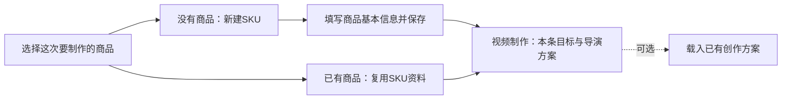
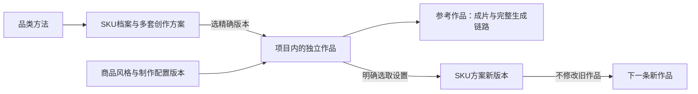
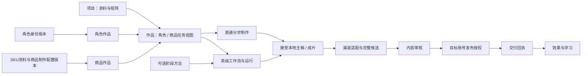
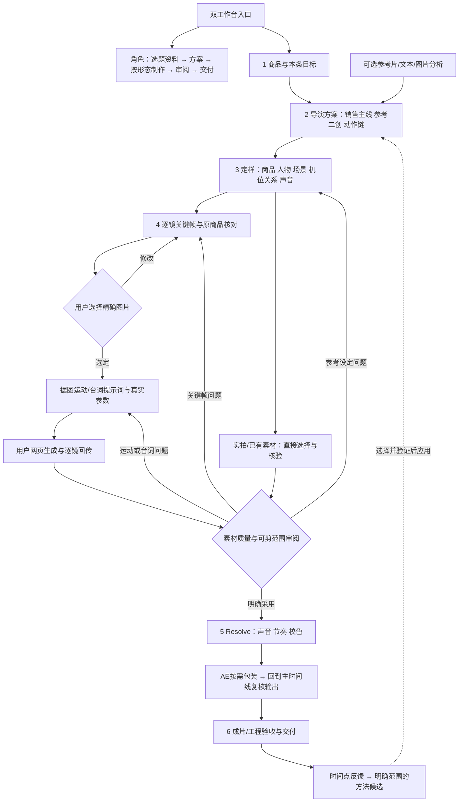
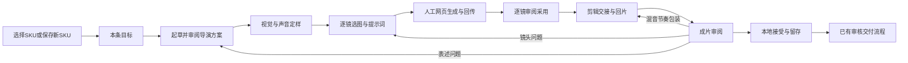
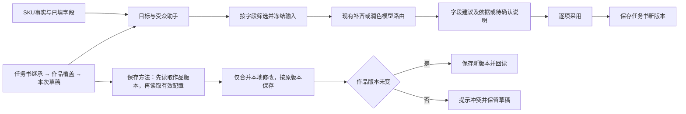
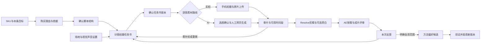

> 2026-10-18 状态更新：第10节已获用户明确确认，实施与证据以README/progress/review最新节为准；原提案标题保留用于已有链接。

## Context
本文件现为2026-10-17商品业务域独立修订，新增实现待确认。下述早期布局问题是设计背景，当前六步页面已接入；当前仍有角色耦合，不能视为独立性完成。实时审计：SKU1的Unit15绑定Persona2、IdentitySnapshot15和persona_default工作流18；SKU方案目前0条。

2026-10-17，本机工作树基于 main@8539806，已有相邻未提交修改。当前源码 ProductionWorkspace 同时渲染 CreationRecipePanel、素材抽屉、ContentMasterPanel，并列出渠道、执行、方法与自动化面板；VideoStudioShell 的六项步骤是同页锚点。ProductionQueuePage 同页排列内容列表、原生任务与外部执行。这是本轮确认的信息架构问题，不能仅再加锚点或折叠全部旧卡片解决。

用户已确认并实施六步布局，本次业务域解耦实施清单待确认；用户已要求以方法抽象方式综合全部相关项目，不能解释为安装或复制第三方实现授权。历史正式数据最近回执为 Project8/Unit14、Brief9、Master45、图59–63、人工任务3–7；该早期回执不代表本轮状态；本轮只读数据库核验见review.md。原 16/20 工程记录保留，用户已否定静态展示的创作方向，新连续动作样片尚未制作。

## Goals / Non-Goals
目标：用户进来知道从哪里开始、当前看什么、要做哪一个动作、下一步去哪；商品有独立旅程，角色内容按形态引导；阶段方法真实进入现有执行；不因换页面丢草稿或错用旧产物。
非目标：不拆服务／数据库，不重做全部管理页，不建立第二套状态机、商品库存、订单、投放、专用数字人训练／身份克隆或自动学习系统。本轮不进行代码实现、素材生成或历史任务改写。

## Decisions
### SKU长期资产与生产项目（2026-10-17用户确认补充）
品类表达共性，SKU精确识别可售规格。SKU内部稳定ID与用户可读编码分开；新建编码由系统在保存时自动分配为SKU-000001（至少六位流水号，超出后自然扩位），在当前工作空间唯一且永不复用；不编码品类、颜色、价格，改名不改号。型号/颜色/尺寸等可售规格不同分别建SKU，商家/供应商编码存独立选填字段供检索；已有历史编码保留可查询，不批量强制改号，不依靠商品名称匹配。允许逐步补资料，未知规格不由AI猜填；缺SKU的旧作品保持“待关联”，不根据名称/颜色自动分配。

SKU档案保存版本化商品事实、规格、原始参考/证据与多个创作方案。方案包括适用拍摄类型/风格、各阶段方法开关与版本、模型选择/参数引用、声音与参考配置；模型凭证仍在设置中，不复制进档案。Persona独立保存定位、受众、观点、风格、音色及身份/方法版本，商品作品不引用Persona作为创作身份，人物参考和音色作为独立资产按需选取。

商品库跨项目提供资料与配置；Project依旧是生产任务的根，Unit关联稳定SKU ID及精确资料/方案版本。品类方法可复用，SKU方案可细调，本作品可覆盖创意设置；不能通过创意覆盖改变商品事实或权限。新建时选择方案版本并保存快照，默认方案以后变化不改历史作品。SKU可有多方案及一个明确默认，调整默认必须显式操作。

“设为参考作品”固定已保存的作品版本，保留脚本、分镜、选图、提示词、源片、声音、工程、成片和评审引用；缺项显式标注。“保存为SKU创作方案”另行选择复用哪些设置，创建新版本，不把单次价格/文案/商品测量或原接受状态变为通用默认。按方案新建独立作品不复制已接受状态，不触发模型调用；工程/素材按现有资产存储保留，临时路径不能冒充长期可用。

入口：商品工作台→选择商品（可按SKU/名称搜索）；没有商品则新建SKU并填写基本资料→保存后直接进入视频制作。已有商品直接复用资料。SKU详情四区为次级管理入口，创作方案可在制作中载入，不要求先浏览档案或选择方案才能创建视频。作品页可回SKU及项目，不要求重复填资料。角色入口保留相同的长期配置/版本原则；本轮不扩展订单、库存、采购或营销投放。

### 0. 对比后选择的流程（本版取代前版六步次序）
| 方案 | 优点 | 对当前需求的不足 | 决定 |
|---|---|---|---|
| 原平台线性长表单/视频后配音 | 已有能力和数据合同完整 | 选择与表单同时铺开；人物/声音介入晚；关键帧缺共同参考 | 保留底层，调整操作顺序和界面 |
| 以Renoise式路线/表现方法为中心 | 商品类型、互动和声音描述具体 | 对特定生成服务和输入角色依赖；不能直接承接现有手工回传 | 抽象创作决策和表现方法 |
| 以ViMax式叙事/机位依赖自动流水线为中心 | 跨镜头参考、首尾动作和阶段产物清楚 | 自动选图/直接拼接不能替代人工批准、商品事实和专业后期 | 抽象参考关系、候选检查和局部重做 |
| 自有六步：目标→导演方案→定样→素材→剪辑→验收 | 前期决定清楚、生成有共同依据、逐镜可控、软件职责明确 | 需要重新组织页面并补前置声音/参考关系 | 采用；不增加第三方运行时 |

“最合理”指最符合本用户的手工网页生成、人物/旁白可选、同商品多作品和专业后期约束，不是宣称行业最佳。相关方法以历史固定快照及本轮Renoise/ViMax源码观察为依据，完整来源到本地阶段映射见页面方案§10。

原创方法政策：学习抽象原则并自行编写本平台决策过程、提示词和参数，不复制外部源文件/模板/配方实现。每项保留来源观察、提炼原则、适用条件、自产方法版本、产物验证记录。已有历史代码/方法来源不被改标为全新原创；保留原署名，不在本轮做无关清理。

### 1. 入口与归属
沿用 /production 查询路由：/production?workspace=persona 和 /production?workspace=product 作为两个导航入口；/production 兼容为简洁工作台选择页，执行任务移至按需“任务记录”。/projects 保持“项目”入口和业务根容器地位，两个工作台是独立业务旅程，复用既有项目/单元等存储与执行能力；制作页持续显示项目→作品面包屑，可返回项目总览、矩阵、共享资料和关联单元。/identities 使用“角色与账号”标签，素材、设置仍共用。正常新建/继续不要求先访问矩阵，但不得将项目降格为历史档案。

归属使用单元级production_domain，不能仅依据项目的product_context或视频形态。可靠的ProductSkuWork/商品launch关联用于兼容回填；证据冲突或不足的旧记录保留历史入口并标明待确认，不按标题或Persona名称推断。混合项目逐单元分流，不复制项目。

商品新建和继续不出现“讲述角色”、角色必选项或角色默认工作流要求。商品页头显示SKU、商品/作品名、资料版本、制作方案版本及保存状态；声音入口进入商品制作设置。角色页仍显示身份版本与原角色配置。

### 1.1 原架构的可达性与职责
以 NorthStar V2 §75/§78 与 Frontend Product Contract V1 §1/§2 为约束，以下入口在简化页面后仍可达；不借本次改版重建全部管理模块。

| 原架构职责 | 本版承接位置 | 不可混淆的边界 |
|---|---|---|
| ContentProject / Unit | 项目面包屑、项目总览/矩阵、共享资料 | 双工作台不另建业务根，也不复制混合项目 |
| Persona 身份版本（仅角色域） | 角色页头“角色身份”，链接既有角色管理 | 定位、受众、观点、风格、音色、事实边界是身份资产；Skills 是可替换的方法 |
| Workflow / Run | “高级工作流”入口，复用既有流程与执行视图 | 普通步骤是任务引导，不替代节点、运行状态、输入输出、局部重跑和版本 |
| Master → Candidate → Review → Delivery → Learning | 成片接受后进入“审核与交付”，连接既有渠道/审核/账号/回执/学习页面 | 本地接受、内容审核、发布授权、真实发布分别记录 |

高级工作流保留既有流程配置、节点增删/编辑/排序、数据来源、项目覆盖入口；角色域保留身份×形态默认版本，商品域使用商品默认版本。实施时列明现有页面映射和实际缺项；未实现的历史蓝图能力单列，不宣称已上线，也不自动扩大为重做流程引擎。进入高级视图或返回普通步骤应保留草稿；单节点重跑仍要求明确执行和保存的精确输入。

交付审核绑定完整 Candidate 的文本、素材及元数据版本/哈希，目标账号授权独立校验；公开权限不足仍可按既有规则保留本地成片，但不得显示为可公开发布。效果/学习只展示真实回执或数据，未发布不捏造指标，反馈扩大作用范围仍需明确采用。

### 2. 单步骤工作区
页头仅任务名、角色或商品、保存状态和“更多”；左侧步骤及状态；中央只呈现当前步骤；右侧资料／方法／历史抽屉默认关闭；页底一个主操作与少量次操作。整体流程与线框、各步输入输出见 product-workspace-design.md。

阶段选择使用现有 production URL 加独立 workstep 参数，保留 stage/panel/execution 的旧链接解释。每一步是真实可聚焦的视图，不是滚动锚点。共享编辑草稿由现有上层编辑器持有，切换步骤只切呈现，不销毁未保存编辑；不把 hidden 全量长表单当最终布局。必要时拆现有组件的展示区域，保持业务存储和事件合同。

### 3. 状态与下一步
步骤状态从原 Brief/Master、Recipe candidate acceptance、素材选定、执行及成片回执派生为未开始／进行中／待确认／等回传／需修改／已完成／不适用；读取失败单列“暂时无法读取”。导航访问、上传成功或候选生成不能变成已完成。最新可用与曾经完成区分，上游版本变化只提示受影响引用需复核；历史接受记录不撤销、不自动重跑。

可浏览所有步骤、并行准备资料／声音；仅操作本身缺的必需输入阻止生成或执行。不设置全局完成比例门禁。未选配乐明确“不使用配乐”，不得让“无记录”自动变成已完成；AE 无需求可明确跳过。用户可以保存草稿，不被强制逐步确认空字段。

“采用建议”“保存版本”“进入下一步”复用既有语义。能由现有事务一次保存的使用“保存并继续”；跨接受／保存事务需真实回读成功再继续，失败停在当前处显示恢复动作，不假装原子成功。打开页面和切步骤不会调用模型。外部执行只读取已保存精确版本。

### 4. 角色旅程
统一五步：选题与资料、内容方案、制作内容、审阅修改、交付。第二步选择已有流程并审阅方案，默认收起模型和底层节点。制作内容按文字／图文／视频呈现；音频沿用已接受文字的派生流程，显示口语稿、声音方案、音频结果，不新增 audio Unit 类型。不能把科技／生活强行限定为口播或配图。

### 5. 商品旅程与方法
六步：商品与本条目标、导演方案、视觉与声音定样、逐镜素材、剪辑包装、成片与反馈。第二步规划购买理由、动作链和粗分镜；第三步确定共用视觉参考、讲话方式/台词预算及配乐方向；第四步制作和审阅逐镜关键帧、运动提示词与原片，保留镜头／图、提示词、回传三列，每次强调选中的镜头与当前动作，长提示词和历史按需展开。图片先确认再据图提示词；网页由用户人工生成；实拍／现有素材直接引用或上传并审阅。

新连续镜头应先规划人物、服装、商品、场地、光向、动作起止与剪辑连接，再生成可衔接关键帧。真实触摸／操作证据与 AI 情境分别标明。旧 S01–S05 批准仅针对原字节，旧人工包不重写；新风格不能沿用旧图批准冒充新图批准，是否重做哪些镜头由实际创意方案与用户选图决定。

Skills 映射见页面方案；一个阶段可组合多个方法，关闭只移除创意方法，不关闭素材权限／事实边界。平台保存选择与版本、组装执行包；Codex 消费包并使用 Skills 操作 Resolve/AE，平台不被宣称具有桌面剪辑能力。参考拆解先复用现有素材及方法候选记录，保存时间点、观察、推断、适用范围和参考出处，不新建分析引擎。

### 5.1 多类型作品、人物同步与参考二创
用户明确要求吸收全部商品拍摄类型和表现形式。作品类型（展示/品牌场景/人物UGC）、创作方式（原创/参考二创）、逐镜声音方式及可选对照版本分开配置，避免把可以组合的选项做成互斥类型。复用现有Project下多Unit/修订，一个商品可有多作品；商品事实在Brief，作品制作选择在该Unit的现有版本化创作意图/视频文档扩展中，禁止用项目级当前配置覆盖所有Unit。

具体字段承载须实施前核对现有schema扩展点；如增加兼容JSON字段，应同步前后端验证、请求投影、包冻结/哈希、回读和旧记录默认。旧作品缺字段按现有行为解释，不能自动开人物生成或静音原声。新建/从现有作品新建使用当前接口创建独立Unit并关联来源，选择继承哪些材料，接受状态不复制成新作品已验收。原始素材权限不变。

人物同步与旁白是并列路线。台词/语言/人物/动作时轴在素材生成前规划，生成包显式携带声音要求，回传检查后决定保留原声；后期声音页兼顾对白、现场声、旁白和配乐。用户手工网页生成保持不变；若网站不支持所需输入，执行前说明并保留选择，由用户决定替代，不静默改用旁白、不新装付费服务。至少一个真实人物同步样本才能验收这条路线；未获得样本保持待验。

演示、对比和时间变化可作为表现形式；素材分类区分情境示意、资料解释、真实实测。不能由AI生成过程推出新的性能事实或冒充使用经历。参考二创保留结构/动作等用户指定部分，替换与改写在计划内明确；不强制所有参考路线使用模型video-reference角色。对照实验复用既有派生版本，不建实验平台。

### 5.2 连续镜头的自产方法与素材状态
在已保存作品的原镜头文档中兼容表达：scene/镜头标识、人物/商品/场景参考精确版本、可借鉴的前镜头或关键帧、起止状态、相机运动与主体运动、接镜点、拟用声音和媒体来源。参考关系可以按场景分组，不能强制全片只有一个根机位；独立场景允许独立准备。商品原始参考与AI衍生参考角色分离，每次检查回到原商品依据，防止错误沿链传播。

参考依赖必须指向存在的、当前可用的精确版本，不能自引用或循环。变化后定位受影响下游并标需复核，不删除历史或重做所有镜头。保持原手工执行包字段兼容，额外参考按所选网站实际支持决定是否发送；不把“用于分析的参考”伪称“已作为模型输入”。

候选比较是可选质量动作，候选数量由当前任务选择，不能默认加倍调用模型。复核商品准确性、人物/空间一致、动作可行与接镜；允许全部不合格，AI推荐不替代用户选图。已批准文件字节不变仍有效；依赖变化时仅要求复核受影响使用方式。返工区分商品资料/视觉参考/关键帧/提示词/模型输出/剪辑范围原因，保留原始结果和比较依据。

### 5.3 声音前置与后期修整
旁白型：方案阶段写口语稿，定样阶段选择音色并准备时长依据；能用真实音频时以音频定时，未生成则显示暂估。人物型：先定人物、原语言台词、动作与说话时间，生成前不用强制已有独立TTS；输入音频驱动仅在实际支持时采用。无讲话型：先定动作节奏与环境/配乐方向，配乐可明确不使用。生成片后再检查原声/口型、剪入范围和字幕时轴；后期仍按先声音修整、再节奏、再校色，AE按需包装，回到主时间线检查后输出。

### 6. 视觉与可用性
复用已有样式组件，统一标题／说明／状态／操作层级。默认不露出 Master、Recipe、hash、JSON、调试日志；放入详情仍可查询。当前工作是画面中心，模型选择、方法和反馈放抽屉。桌面三列素材可用，窄屏按镜头内步骤纵向且单次突出当前操作。键盘导航、可见焦点、文字状态与错误定位必须可用。

## Workflow

## Risks / Trade-offs
- 当前前端草稿有多个所有者：实施先梳理保存边界，界面切片不丢编辑；保存中禁止重复提交，冲突保留本地输入。
- 双入口不能只按视频筛选：须使用现有商品归属证据，失败不默认为没有任务。
- 新页面不会自动提高视频质量：参考拆解、动作连续性和真实素材单独验收；无用户参考片／新片回传时保留待验。
- 人工网页等待不是平台错误；显示具体镜头回传入口，其他步骤仍可准备。
- 用户要求平台操作只用 CLI/MCP：实施验证用对应接口与页面只读检查，实际点击易用性由用户试用回执确认，不冒称已点击走通。

## Migration Plan
本次需要兼容迁移业务域、可空Persona关联和账号所有权；优先复用当前实体，保留原路由和查询参数映射，不能静默改身份、素材权限、模型或方法默认。补确有缺失的只读投影及作品级兼容配置字段；任何新字段沿用原版本/验证/冻结合同，不预设新表。先完成角色与商品一个步骤切换纵切验证，再扩展两旅程；保留相邻 dirty 工作树。最终独立评审、规范同步、归档、本地选择性提交沿用授权，push/发布不在范围。

## Open Questions
无阻碍方案形成的业务歧义。本修订版待用户确认；参考卖货视频尚待用户提供，视频生成仍由用户人工进行。收到新资料前可以实现通用页面，但不能虚构参考拆解或成片验收。

### SKU编号与图片绑定补充
流水号在服务端保存事务中分配，并由唯一约束兜底；不按商品条数或客户端预览号作为生产编号，不回收删除记录的编号，允许有空号。当前原型仅模拟单会话编号，不代表生产并发已验收。旧编码保留，不通过推断颜色/名称改写历史身份。
主图绑定SKU稳定ID和现有素材版本引用；搜索结果投影带对应缩略图、名称、编码和规格。换主图不改旧作品冻结的素材版本。无主图/失效时明确占位，不以其他SKU或AI情境图替代。演示合照以“原始参考合照，待补单款主图”标注。

### 选品后的单作品操作与返工

原型演示所有SKU的同一操作路径；新的作品默认没有导演候选和采用状态，起草为明确按钮。已有文字保留，未提供商品事实不从其他SKU复制。后期状态归属作品；依赖镜头、声音或方案改变后回片需重新审阅，旧素材保留为历史而不作当前通过。缺回片不提供接受完成状态。

## 商品业务域边界修正（待确认）
### 数据与执行
ContentUnit持久记录persona/product业务域。商品域允许persona_id及identity_snapshot_id为空，角色域仍严格验证身份；不能全局取消身份校验，也不能创建占位Persona。沿用ProductSkuWork、SKU资料版本、ProductSkuPlan及ProductionProfileRevision固定商品上下文，现有Workflow以商品默认范围承载版本与节点，Run继续共用。

配置解析从显式作品覆盖、选定SKU方案、明确启用的商品品类/风格方法与商品基础默认获得最终配置；品类/风格为可选，不增加必经建档。精确版本和来源一起冻结，不再回退IdentitySnapshot。商品事实独立于创意覆盖；凭证只引用现有设置。

请求准备、表单补齐/润色、Recipe、选图/图生视频提示词、TTS及交接包都读取同一商品上下文；共用校验与执行工具但禁止夹带角色定位、观点、受众、身份风格或角色默认音色。已有persona.*内部profile合同需做明确兼容适配，不以改显示名称代替上下文解耦。

### 页面、方法与声音
商品六步不变：选SKU/本条目标 → 商品导演 → 视觉声音定样 → 逐镜素材 → 剪辑包装 → 成片反馈。页面只呈现商品资料/方案与本条覆盖；不读取角色列表作为启动依赖。商品方法依次覆盖销售依据、导演与连续镜头、素材导演、声音、Resolve/AE和商品质量评审；可以复用通用方法实现，但适用范围、开关、版本、默认和反馈归属独立。

音色是商品方案或本作品的显式配置，人物/UGC是拍摄对象与参考素材，不是内容Persona。没有讲话不要求TTS，人物同步原声不被旁白覆盖；需要旁白而音色缺失时仅阻止配音。不得把历史角色音色自动写成SKU默认。

### 审核与交付
商品就绪检查核对SKU/制作配置版本、任务书、事实边界、精确素材与权限，不再要求角色身份。商品质量关注购买理由与证据、商品一致性、人与物互动、镜头连续性、声音及CTA；角色审核保持原标准。商品无账号可完成本地成片；选择交付时独立核对账号所有权/使用权、渠道匹配、完整Candidate版本与发布授权。现有账号经Persona推导所有权时，仅对可验证归属做兼容迁移，冲突不放行；不因移除同Persona检查而扩大账号权限。

### 历史兼容与验收
旧Unit15、Master46/47、Run19及identity快照保持历史事实。按商品模式继续时产生新的配置/执行版本并显示可沿用素材和待确认设置，旧接受与发布授权不自动覆盖新版。既有35项完成证据仅覆盖旧实现，第8节全部待验。

在隔离环境以零Persona起步，贯通SKU新建/继续、AI助手与导演请求准备、逐镜包、声音配置、后期交接、成片绑定检查、SKU方案保存及独立账号交付授权。检查实际请求和冻结包无角色依赖，修改角色默认不影响商品；同项目商品视频与角色视频正确分流；跨用户账号拒绝、旧作品回读、角色身份门禁及方法开关回归。使用既有检查与隔离执行，不新增测试代码。没有新商品素材的环节只证明工程机制，不宣称新样片质量完成。

## 第9节：目标与受众方法化辅助（用户已确认，待实施）

### 来源核对与取舍
2026-10-17读取dbskill的dbs-diagnosis、dbs-content和LICENSE。前者用于商业诊断，可参考概念澄清、需求和事实缺口检查；后者明确偏内容诊断而非代写，可参考核心表达、冗余和受众价值判断。因此以自编判断辅助现有字段生成，不把原诊断报告直接填进字段，不调用/dbs总调度器。
上游当前为CC BY-NC 4.0。按此前已确认的抽象方法路线，以用户七项销售标准和字段合同独立编写具体规则；记录研究来源与差异，不复制/翻译/打包上游指令、案例、知识原子、作者身份或固定话术。自有实现不宣称已安装/直接适配第三方Skill；不能靠改名将复制内容变为自有。未来如需直接复用上游资料需另行核实商用授权，本方案不包含直接复用。
来源：
- https://github.com/dontbesilent2025/dbskill/blob/main/skills/dbs-diagnosis/SKILL.md
- https://github.com/dontbesilent2025/dbskill/blob/main/skills/dbs-content/SKILL.md
- https://github.com/dontbesilent2025/dbskill/blob/main/LICENSE

### 方法与字段
| 自有方法 | 适用字段 | 输入和判断 | 输出要求 |
|---|---|---|---|
| 受众与购买需求 | primary_audience / buyer_situation / main_objection | 商品已知事实、用户已填需求/场景及证据；定位一种具体需求与最大顾虑 | 具体场景，缺依据的买家/用途假设在note注明待确认；不编造调查、人口统计或体验 |
| 购买理由与表达 | objective / core_message / cta | 已知需求与商品支持的好处，聚焦一条视频的一点理由 | 简洁明确、保留意图；购买入口/优惠/售后缺失时不造承诺，note注明缺项 |
两项都开时先梳理需求再组织表达，合并到一次现有模型请求，不引入多Agent或每字段串行远程调用。只渲染当前目标字段适用的方法，已填其他字段可作背景。现有items[].suggestion/note/source_refs合同保持，不新增诊断报告页；未确认假设不写成SKU事实或证据。

### 页面与开关
复用当前“目标与受众”单个AI助手，折叠“商品方法”区显示两张卡：名称、版本、适用字段及独立开关。补齐和润色使用同一选择，关闭一项其字段走普通辅助，全部关闭仍可普通辅助；事实、权限、版本与采用合同始终生效。只切换方法不得改变导演阶段总开关，阶段总关闭则方法不执行。
用户明确启用这组方法时两项默认开；旧作品未选这组方法保留原助手行为，浏览页面不自动保存/启用。切换不触发生成、不保存字段。开关在请求前可见，不用空默认回退重新开启。

### 配置与接线
复用现有production_stages.script.methods单方法开关、版本和冻结机制，将两项登记为自有商品方法，不增加新全局阶段或表。GuidedProductionGoal目前只传project_id且只读brief.production_stages，实施须传实际unit_id并核对商品域/所有权，准确读取作品制作配置。项目任务书字段共享、作品方法独立职责保持。
继承顺序沿用商品默认/选定SKU方案/当前作品，再叠加本次助手草稿；复用现有制作设置显式保存，字段仍“逐项采用→保存目标与受众”。仅更新两方法选择，不覆盖script其他方法或自动改SKU/角色默认。草稿导航保留，冲突沿用现有处理。
两种purpose沿用form_autofill与field_polish，不增加模型设置。请求冻结方法ID/版本/hash、开关、适用字段、SKU/作品配置和输入值，回执记录模型。关闭方法不得从selected_methods、project_snapshot或风格背景重复进入执行指令。切换或版本变化后需重新生成，旧建议可查但不得按新配置直接采用；旧接受/历史请求不改。

### 补空白与润色
现状objective/primary_audience前后端均protected，不能补空白。仅对商品product_brief这两个空字段允许建议和明确采用；其他surface、身份/事实/权限保护保持。非空值是上下文，补齐不重写；明确跳过不填。没有任何可用商品或用户上下文时提示缺依据，不编造商品/受众。
润色只改焦点字段/选区，保留既定意思和受众；发现冲突写note，不擅自替换用户目标。新建议先预览，再明确采用并保存；输入或方法变化触发重算/冲突保护，不能静默覆盖。

### 数据流

### 实施与验收
相关位置：GuidedProductionGoal/ProductionWorkspace/FormAssistancePanel/GuidedProductionProfile及现有ProductionStageControls、formAssistanceTypes；后端form_assistance、creative_configuration、product_context、studio_creative_catalog与必要的两项方法资源。优先复用现有选择/保存/冻结，不重构其他表单。
不新增持久测试代码。运行现有form assistance、production stages、product context/recipe与角色保护检查；临时隔离验证四种开关组合、实际prompt/版本、空目标/空受众、非空/跳过保全、焦点/选区、无依据、配置漂移、跨用户及旧记录。Web构建/桌面窄屏/strict与独立代码复核。对真实样本按具体需求、单核心理由、有依据、保留意图评审，HTTP200不代表内容质量通过；不覆盖正式沙发字段/旧接受记录。

2026-10-18第9节实现说明：商品执行沿用有效配置和已核对的冻结方法版本；任务书不得覆盖作品关闭选择。方法保存以有效配置保留继承项，先读作品revision再读effective，CAS使用原revision；仅合并净修改，组开关变更视作两项修改。跨对象原子事务不在本次实现范围。

## 第10节：实拍任务书与阶段方法留痕（2026-10-18 提案，待确认实施）

### 目标与范围
将用户已认可的“购买理由→脚本→分镜拍摄任务书→实拍回传→剪辑成片”变成可重复操作的产品流程。产品保存事实、版本、关联、确认与反馈；阶段Skills提供判断标准和执行方法。当前仅出方案，不将聊天结论称作已安装Skill或已上线功能。

保留商品独立业务域及六步导航，角色入口不变。每条作品在第一步选择素材路线“实拍 / AI生成 / 混合”；本次儿童拖鞋拟选择实拍，待实施及明确保存后生效，不改所有商品默认。实拍不要求生成或确认AI关键帧；AI镜头继续既有先选图再写提示词、人工网站生成路线。混合按镜头标记来源，共用同一脚本和镜头编号。

### 六步承接与页面
1. **商品与本条目标**：选SKU、目标买家/使用场景、一个核心购买理由、辅助理由、已知事实及证据、最大顾虑和目标行动。保留已有七角度字段，内部成本仍独立可选，不强迫补齐全部信息。候选卖点可以暂存“待核验”，不能冒充证实。
2. **导演方案**：局部页签“销售思路与脚本 / 分镜与拍摄任务书”，默认先看脚本。先审阅并确认版本化的内容结构、卖点顺序和画面表达，再生成拍摄任务书；草稿允许提前编辑，未确认脚本只能预览任务书，不能标记可拍。确认脚本不要求写好完整口播。任务书初稿可编辑、AI补空白/润色、确认后供拍摄。
3. **视觉与声音定样**：实拍选择场地、出镜范围、光线/背景与手机拍摄条件；沿用已知条件，用户可不填无关选项。声音模式继续保存；旁白可留空后期生成，选择现场对白时才保留相应对白要求。此步可在分镜准备时补充，确认任务书时引用其已保存版本；不要求AI图或配音成品。
4. **逐镜素材**：沿用三列“镜头任务 / 拍摄说明 / 上传与审阅”。实拍中列显示动作、机位、角度、重点、原片时长和收音说明；AI中列继续参考图及提示词。每行原片可多条，查看原片后标记可用/需补拍/不采用，记录时间段与原因；接受素材和放入剪辑是不同动作。手机按镜头卡片逐个操作，顶部仅显示当前需要拍/补拍的项目。
5. **剪辑包装**：按已采用素材形成可用片段清单与剪辑交接；先声音、再画面节奏、再调色，Resolve主剪，AE按需。旁白可此时生成或修订，实际音频时长与素材可用范围决定剪辑，不靠假定时长强行拉伸原片。
6. **成片与反馈**：具体到镜头/时间点反馈，返回策略、脚本、拍摄或剪辑责任步骤。真实广告反馈和本地画面评审分开；没有发布/销量数据不宣称转化已验证。沿用既有交付与SKU方案留存。

每步显示“输入依据、当前成果、下一步”及一个当前主动作。方法开关/版本、历史与调用详情在抽屉，避免全屏堆表。相同场地/机位任务可按拍摄顺序分组查看，成片顺序独立保存；重新排序不改变镜头ID。

### 拍摄任务书最小合同
任务书属于当前商品作品，并引用精确脚本/主稿版本，不是另建商品档案。字段分必需表达和可选制作说明：

| 内容 | 约束 |
| --- | --- |
| 稳定镜头ID、所属场景、成片顺序 | 一场景可含多镜头，不把6–8秒强制为每镜长度；6–8秒只是当前样片建议 |
| 镜头目的 / 要说服什么 | 对应购买理由或待解答顾虑，不能只有“拍好看一点” |
| 画面主体、动作、机位/角度、景别、拍摄重点 | 让非专业拍摄者能照做；说明必须看清什么，必要时写动作起止 |
| 原片建议时长、预计剪入时长、拍摄顺序 | 三者分开，拍摄前后留余量；只规划，不假装实际媒体时长 |
| 商品细节与证据要求、素材路线 | 区分外观情境、真实演示、资料/实测依据；“鞋底特写”本身不证明耐磨 |
| 旁白建议、字幕建议、收音说明 | 旁白/字幕可为空；可标记后期补配音，不阻断无现场对白的拍摄 |
| 审阅状态、版本与修改原因 | 草稿→待确认→已确认；有依赖变化显示待复核，保留历史版本 |

拍摄说明默认具体动作、手机摆放和观察重点，专业镜头参数仅在有实际意义时选填。不强制昂贵器材、电影感、夸张情节、固定镜头数或一次完整拍成长片。任务书支持手机阅读及下载可读清单，下载内容必须来自同一已保存版本，避免另有一套手填文档。

### 方法分工与可调优逻辑
不建立一个包办全部环节的大Skill；优先扩展现有自编商品方法，版本升级后明确选用。

| 步骤 | 方法承接 | 应检查的判断 | 输出与改进位置 |
| --- | --- | --- | --- |
| 购买理由 | 既有受众与购买需求、购买理由与表达 | 购买者/使用者区别、场景、核心收益、证据与顾虑；谁不适合 | 结构化销售思路及简短依据；反馈归属作品/SKU/品类 |
| 脚本 | 既有商品脚本方法 | 开头是否切题、每段新增什么信息、演示能否支持文案、下一步是否明确 | 可审阅脚本结构；无需完整旁白 |
| 拍摄任务书 | 一项自编“商品实拍任务书”方法，按既有storyboard阶段合同注册 | 从脚本反推镜头任务、机位、动作可拍性、证据可见性；拍摄顺序节省切换 | 逐镜任务与素材缺口，不调用相机/模型自动拍摄 |
| 原片审阅 | 扩展既有商品素材导演的实拍分支 | 实际清晰度、曝光、动作完整度、商品细节、可用时段及证据边界 | 带时间点选段与定向补拍，不自动拒绝所有普通手机画质 |
| 剪辑与评审 | 既有声音/节奏/字幕调色/包装/质量方法 | 片段服务卖点、声音可懂、素材与文案一致、包装是否喧宾夺主 | Resolve/AE交接及成片反馈，实际工程验收沿原合同 |

每项方法含：适用输入、检查问题、决策规则、结构化输出、验收要点、遇到不足怎么处理。继承现有独立开关、版本/hash、适用阶段/字段过滤；关闭只取消可选方法，不关闭事实/所有权/版本保护。人工可完成相同流程，平台不得强制某个Skill才能填表。
“思考留痕”指可审查的依据、结论、简短采用/排除理由和不确定项，不存或索取模型隐含推理链。

### 数据与最小实现
复用SKU资料/方案、BriefRevision、MasterRevision、ProductionProfileRevision、MaterialRevision、Execution及既有反馈/Capability Memory。实施先核对实际schema和路由，再在现有视频主稿的镜头上增加可选拍摄说明与确认引用；脚本确认和任务书确认保存其所引用的精确版本/hash。必要的数据扩展遵循现有版本/加法迁移，不另建执行引擎或通用流程平台。

原片通过既有素材上传入库，以作品+镜头ID+任务书版本关联；可用片段保存素材精确版本/hash与入出点，补拍是新素材/记录，不覆盖旧文件。上传成功不等于审阅或采用。上传/保存沿用所有权、幂等与CAS冲突保护，手机/CLI/MCP操作结果回读一致。

每次生成/润色/执行保存输入版本、方法ID/version/hash及开关、实际模型/执行器回执、结果、采用/拒绝/修改记录、操作者/时间；人工编辑标记人工来源。仅打开页面/开关不会触发生成。AI补齐以任意已填内容为依据且只补空白，润色只改明确焦点/选区，生成结果先审阅后保存。

已确认脚本或拍摄条件变化产生新版本；受影响任务及其当前剪辑采用状态显示待复核，旧文件/原确认不被抹去，不自动重拍或重渲染。若尚不能可靠识别局部依赖，就提示当前任务书整体复核，不能假称精确定位；人工可说明素材仍可复用。只改旁白不自动令拍摄任务失效，改变画面要求才需复核；实际配音改变后期时长另行检查。

### 反馈与方法沉淀
当前镜头反馈默认只修本作品；“以后同类也这样”才形成明确作用域的偏好候选（SKU/品类/表现风格/通用阶段）。商品事实只归SKU；一次穿着/材质发现不能自动成为品类规则。方法更新产生新版本，记录变更与验证样本，明确启用后作用于后续执行，旧作品冻结版本保持可读。不自动自训练或后台修改所有默认，不把某款拖鞋分镜硬编码成商品通用方法。

### 验收与兼容
确认后完成真实API保存/回读与页面呈现；无旁白的实拍脚本→任务书确认→隔离样本上传/选段/补拍→后期包做工程验证。实际儿童拖鞋原片未提供前，素材质量与成片验收仍待，人物同步继续延后，旧AI路线独立保留未完任务。验证关闭方法未进入请求、改版不改旧历史、局部返工、跨作品隔离、并发冲突、旧AI网页任务可读与原有引用完整。不新增持久测试代码；用现有检查、临时隔离探针和独立复核。

本节新增8个待批准实施任务；此前50/58为已批准范围，含本提案任务清单50/66。CLI status中的artifact done仅表示文档存在，不代表实施完成。全部已批准范围真实完成后才归档/选择性提交；原8项不得用实拍新路线直接勾销。

### 流程图

### 2026-10-18 已批准第10节的界面一致性修正
六步引导按实拍/AI/混合语义显示；拍摄确认、后期资料检查、发布条件必须分开表达。已确认拍摄任务可以拍摄并回传，后期包与发布继续原有门禁；不把后期缺口说成不能拍摄。旁白段落未写不等于脚本结构未确认。当前商品Brief的销售思路与已确认四镜保持一致，未知参数/性能仍未知；摄影说明进入保存任务书及其下载，不另保一套仅聊天说明。只修正原第10节展示与数据遗漏，不新增工作流或放宽后台合同。
