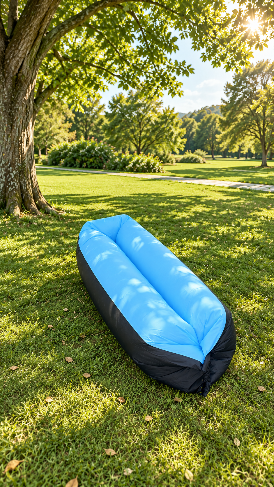
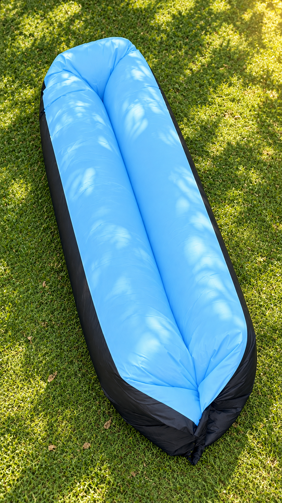
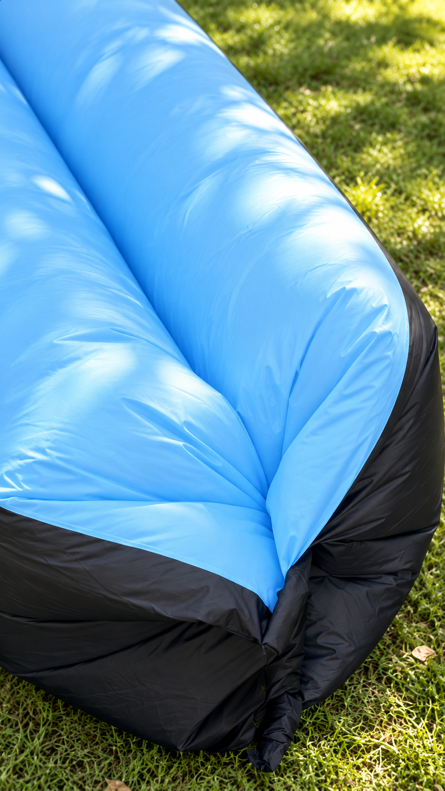
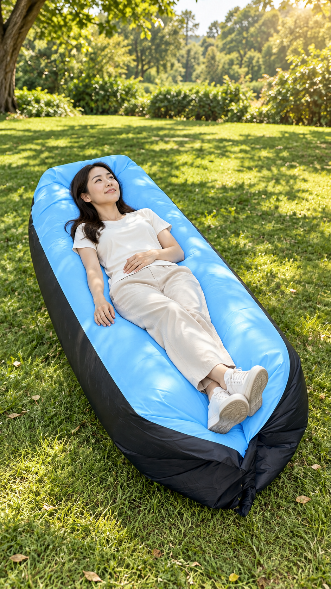
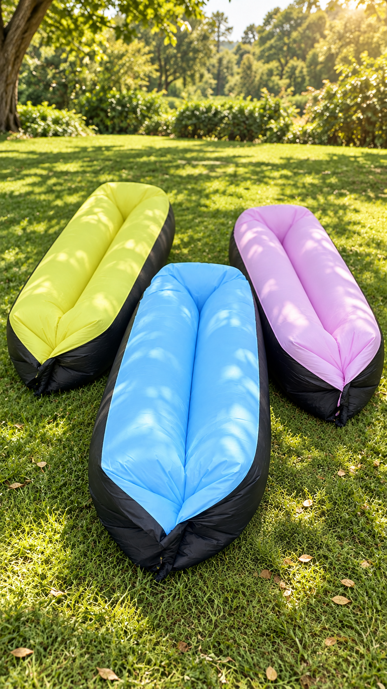

# 懒人沙发｜给周末留一个躺下的位置

**状态：用户已确认S01 v2及S02–S05 v1；精确图片/据图提示词已存Master45，人工网页任务3–7待生成回传。E01真实尺寸素材仍待补。逐镜提示词见manual-video-briefs.md。**

## 销售思路

本版面向“周末到公园待一下午、走累后想找一个躺靠位置的人”，以“在草地休息时，多一个躺靠的选择”为核心购买理由。这是根据原图使用情境提出的创意假设。用原图浅蓝色作为统一主角，末镜展示原图可见的黄/蓝/浅粉色。

当前能够表达的是外观、颜色与使用场景；受众与文案是创意假设，并非市场调研结论。尺寸、材质、充气/收纳方式、承重、防水、价格都没有资料，因此暂不使用“便携、秒充、躺着不累、耐磨”等承诺。后续若补到这些真实资料，可用功能镜头替换价值较弱的氛围镜头。

## 七项销售检查

| 项目 | 本次选择 / 已知 | 证据与缺口 |
|---|---|---|
| 买家与具体场景 | 周末公园停留、想在草地躺靠休息 | 创意假设；原图有草地与躺卧情境 |
| 一个核心购买理由 | 休息时多一个躺靠的位置 | 不延伸为“更舒服、不累、方便携带”等未经核实好处 |
| 如何证明 | 原始合照可见人躺卧；新图仅帮助理解构图与情境 | 尚缺真实连续使用片段；生成动作不能替代实测 |
| 最大顾虑与边界 | 优先回答“尺寸是否适合自己” | 策划假设；尺寸资料和测量实拍缺失，回答待确认；不猜适合身高或体重 |
| 为什么这家 | 未提供 | 不编造选品、服务、售后优势 |
| 一个购买入口 | “查看这款商品的实际规格与颜色”作为CTA草案 | 商品链接/款号/价格未提供，购买链路未完成 |
| 是否赚钱 | 未知 | 进货、包装、运费、平台、推广、制作分摊、退货售后均未给；不按0算利润 |

本版先做场景型静态分镜，暂不做没有证据的对比、效果演示或假测评。五类表达方式已进入方法卡；需要测试时再固定商品和卖点，只比较一个表达因素，不自动一次制作三条。

## 约30秒静态分镜

节奏暂按约30秒设想，最终由已接受素材与旁白时长决定。已有五张AI关键帧，另设一个必须用真实资料解决的尺寸答疑位E01；它是素材缺口，不伪造第六张测量图。以下为静态策划，图片确认后再写运动提示词、再按实际网站能力生成短片。

| 镜头 / 暂定时段 | 购买问题与信息增量 | 画面 | 旁白/画面文案草案 | 素材依据与限制 |
|---|---|---|---|---|
| S01 v2 / 0–4秒 | 我会在哪种时刻想用它？ | 大树、草地与浅蓝沙发的较远场景 | “公园逛累了，想找个地方躺一会儿？” | AI场景，原图场景依据；字幕为该句简写，后期添加 |
| S02 / 4–8秒 | 商品到底长什么样？ | 更高俯角，完整长条轮廓与中央凹槽 | “这一款懒人沙发，先带你看清楚。” | 上表面为依据；不标尺寸、不展示未知背面；字幕“整品外观” |
| S03 / 8–11秒 | 近看是什么外观？ | 蓝色外缘、凹槽与黑色底部近景 | 留白，不添加“耐磨、防水、亲肤”等文案 | AI外观构图，不是工艺证据；拟不加字幕 |
| S04 / 11–18秒 | 商品在这个场景怎么用？ | 成年人静态躺卧，人和产品完整可见 | “在树荫下，给自己留一点休息的时间。” | AI使用情境，不是实际体验或性能证明；真实使用演示待补 |
| E01 / 18–25秒 | 尺寸适不适合我？ | 待补同款真实尺寸图或卷尺测量实拍；此位不生成假测量 | 仅可先说“下单前，先核对实际尺寸。”；数值和适用结论待核实 | 缺素材/参数，尚未真正解答顾虑；字幕和数字等真实资料后添加 |
| S05 / 25–30秒 | 下一步看哪款？ | 黄、蓝、浅粉三色同场，蓝色居前 | “选好颜色，再看这款的具体规格。” | 三色原图依据；CTA后期添加，真实链接待配置 |

每镜图像生成提示词、原图引用、版本和必须保持的细节已保存于 [manifest.json](keyframes/manifest.json)。E01需真实资料，不写图像生成提示词。所有视频提示词保持未生成/未确认；待你选图再给每镜“参考图＋场景＋一个动作＋景别＋运动＋光线＋保留细节”的可复制包。每段可从约3–5秒试起，不把生成时长与剪入时长混同。

销售表达尚未完整：E01没有真实尺寸依据，商家优势与商品入口也缺资料。当前可审的是视觉与场景方向，不能标记成“已证明购买理由的完整广告”。

## 关键帧审阅

所有图均由 Codex imagegen 实际输入原图生成；S02–S05另用S01 v1作场景连续性参考，该图仍未获用户确认。独立检查指出S01 v1与S02过于相似，故新增较远场景S01 v2并保留v1历史。生成提示词与每图SHA256见 [manifest.json](keyframes/manifest.json)。尺寸均为941×1672，接近9:16；并非1080×1920最终交付素材。

### S01｜场景吸引

### S02｜整品看清

### S03｜可见细节

### S04｜使用情境

### S05｜颜色选择

## 素材缺口与下一步

- 外观确认：原合照分辨率有限，新图的蓝色凹槽、端部褶皱和饱满程度需要用户核对。不能因为生成质量高就当作真实商品精确还原。
- 功能展示：E01已保留尺寸答疑位，待真实尺寸资料或测量实拍后制作。目前无收纳、安装和性能资料，不安排相关效果镜头。
- 图片选择：按 S01–S05 给出保留或修改意见；只有被确认的精确候选才能进入视频提示词与网页生成。
- 剪辑与声音：候选图确定、视频回传后再安排；保留原角色音色，撤回的 MiniMax 参数截图不应用。配乐按场景可选，Resolve主剪，AE仅按画面需要包装。
